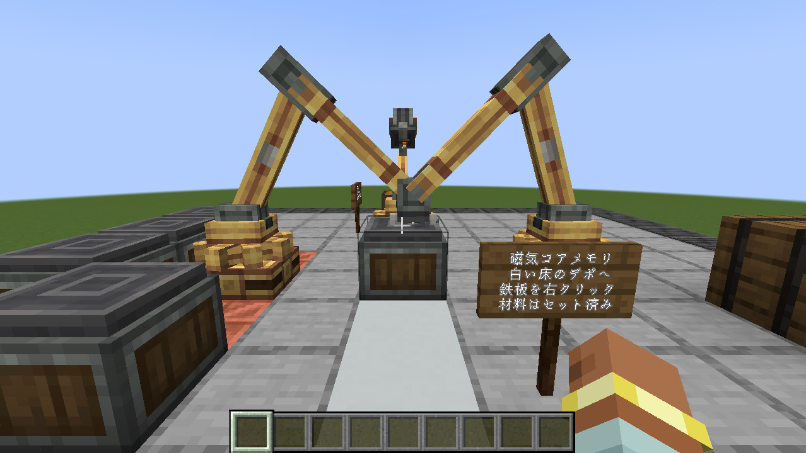

# 磁気コアメモリ・デポ組立

[テストワールドのZIP](magnetic-core-memory-line-world.zip) · [このワールドで使った修正版JAR](create-refinery-n-reactors-depot-playtest.jar)

Minecraft 1.21.1、NeoForge 21.1.219、Create 6.0.10、Create Diesel Generators 1.21.1-1.3.15、Create: Electro Energetics 1.21.1-1.1.4を使用。修正版JARを `mods` に入れる際は、既存の Create: Refinery 'n' Reactors のJARと入れ替えます。

## 動かす

1. ZIPを展開し、`Magnetic-Memory-Depot` フォルダーを Minecraft の `saves` に入れます。「磁気コアメモリ・デポ組立」を開きます。
2. 手に持ったCreateの鉄板で、白い床の先にある中央のデポの上面を右クリックします。鉄板が手元にない場合は予備材料の樽から取れます。部品の補給とアームの設定は済んでいます。
3. 素のアームがコアを並べ、次に2台で線を通します。トーチを付けた3台目がはんだ付けし、約15秒で完成品を黄色い床のチェストへ運びます。
4. もう1個作る場合は、予備材料の樽からコア64個、64個、16個をそれぞれ供給デポへ補給し、4台目の供給デポにエナメル線25本を置きます。中央の作業デポへもう1枚鉄板を置きます。

| 設備 | 座標 |
| --- | --- |
| 鉄板を置く作業デポ | `0 -54 0` |
| コア供給デポ3台 | `2 -54 -2`、`3 -54 -1`、`3 -54 0` |
| 線材供給デポ | `3 -54 1` |
| 材料を取る素のアーム / 補助アーム | `2 -54 0` / `-2 -54 0` |
| トーチ付きアーム / 完成品チェスト | `0 -54 2` / `0 -54 3` |
| 予備材料の樽 | `-4 -54 -1` |

各アームの下面に16 RPMのクリエイティブモーターが直結しています。材料側の素のアームは5つのデポを青（取得先）に設定しています。補助側は回転だけをつなぎます。トーチ付きアームは中央の作業デポを青、完成品チェストを橙（置き先）に設定しています。自作時の操作は[産業用アームのガイド](../industrial-arm.md#使い方)を参照してください。

[完成品が回収チェストに入った実機画面](magnetic-core-memory-depot-output.jpg)
