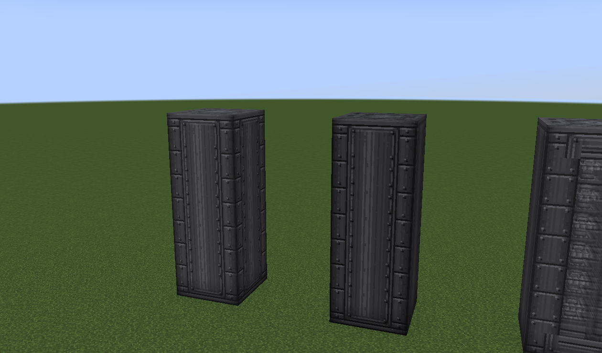
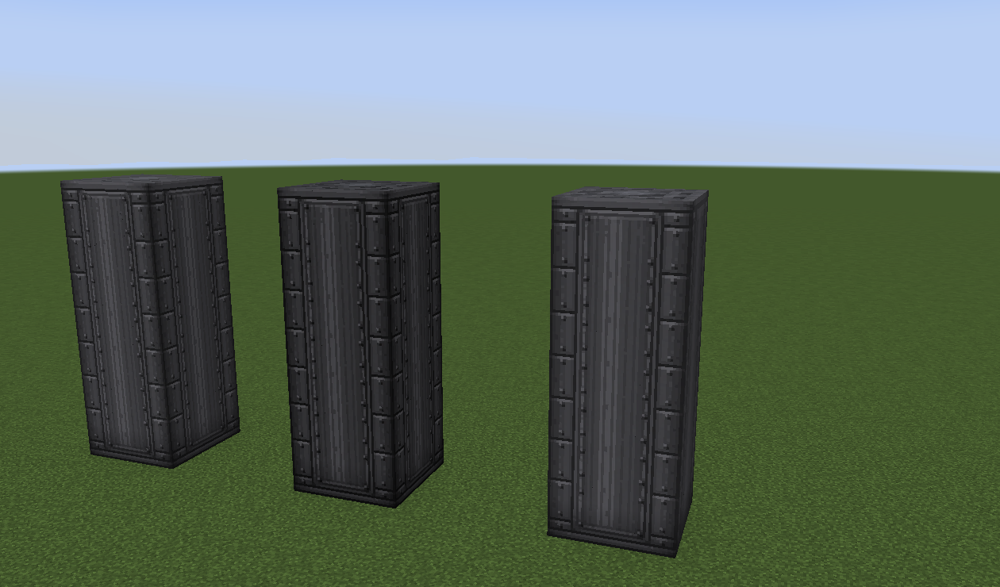
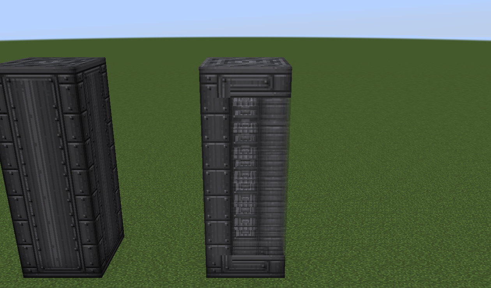

# タンク風の吸収塔

反応塔の鋼板・枠・留め具の模様を使い、吸収塔を少し明るい金属色にしました。外形はCreateのタンクと同じ平らな天底と胴板で、段付き屋根や外付け配管の張り出しを取り除いています。

左が吸収塔、中央が従来の反応塔です。両方とも3×3・高さ8マスの実ワールド上の設備です。

逆側から。右が吸収塔、中央が反応塔、左が吸収塔の内部確認用モデルです。

内部確認用に外殻の一部を除いた吸収塔。中央に6段の棚段があります。

2026-11-09、Minecraft 1.21.1 / Create 6.0.10 / NVIDIA RTX 4060で撮影しました。関連GameTest 15件と、反応塔との連結タイル114か所の比較に合格しています。

[実装・検証・制約](../../reports/absorption-tower-tank-style.md)
