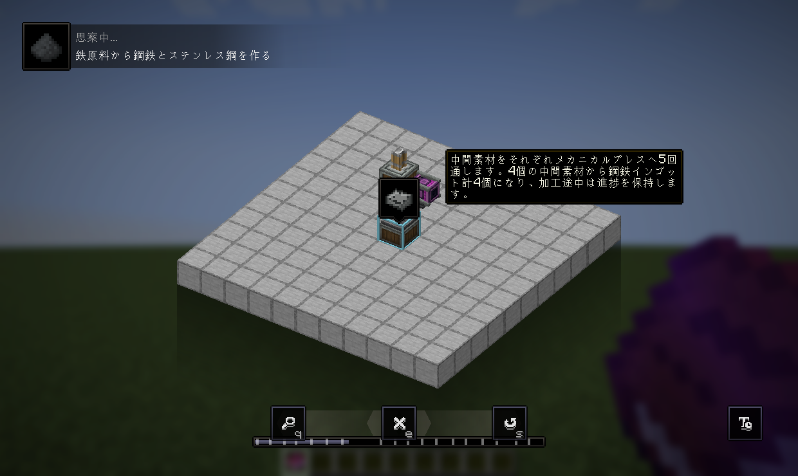

# 炭素粉と鋼鉄の工程

原料は炭素粉1個と鉄インゴット4個。超加熱のミキサーで中間素材4個を作り、それぞれ5回プレスして鋼鉄計4個にする。旧パドル鉄と未完成パドル鉄は登録・レシピ・アセットから削除する。既存の銑鉄鍛造・転炉は維持する。

関連28件の再実行にはJava 21を使う。一時ディレクトリに検証用ワールドを作り、通常のワールドは使わない。

```sh
bash gradlew --no-daemon -I docs/quality/compact-centrifuge/verification.gradle \
  -DtestDir=/tmp/createplant-carbon-steel-tests \
  -DtestClasses=CarbonSteelGameTests,CraftingRecipeGameTests,ForgingGameTests,ManufacturingPonderGameTests,PlantTutorialGameTests,SurvivalReachabilityGameTests \
  build runGameTestServer
```

GPUでPonderと素材アイコンを確認する場合：

```sh
mc-debug bash ./gradlew --no-daemon -I docs/quality/carbon-steel/client.gradle runClient
```

`CarbonSteelGameTests`は、石炭・木炭それぞれで石臼と破砕ホイールの一意な炭素粉レシピ、通常加熱では失敗する実Basinの収支、実プレスの5回加工と途中の保存復元を確認する。Createのバルクプレス設定を変更せず、4個のバッチ全体の収支を検査する。既存の鍛造が同じ赤熱中間素材を使っても、レシピIDごとに進捗が分かれることも既存の鍛造テストで確認する。



RTX 4060で日本語Ponderと2素材のモデルを描画した。検証結果JSONの成功後、ワールド保存・終了時に環境の`libEGL_nvidia.so.0`でexit 134が発生する。`runClient`全体の終了成功とは区別する。音声の聴取確認はしていない。

詳細は[完了レポート](../../reports/carbon-steel.md)を参照。
