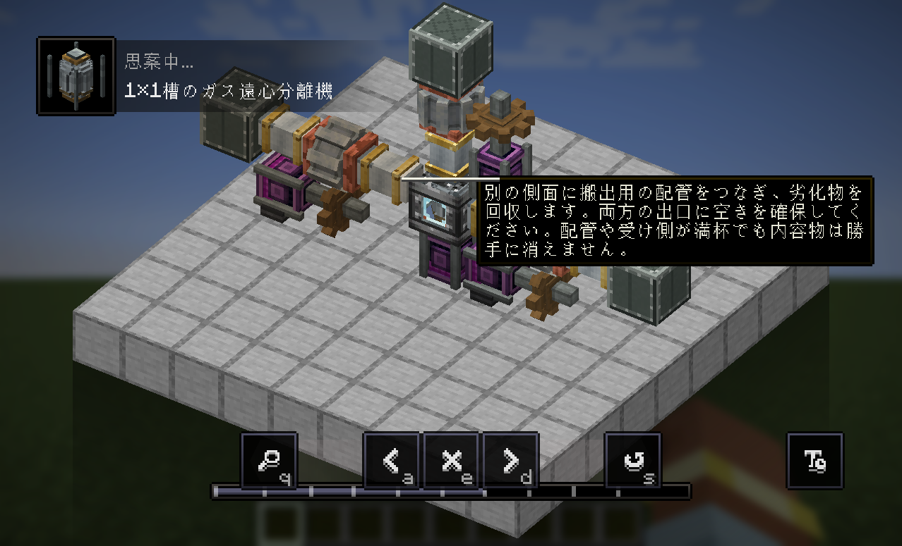
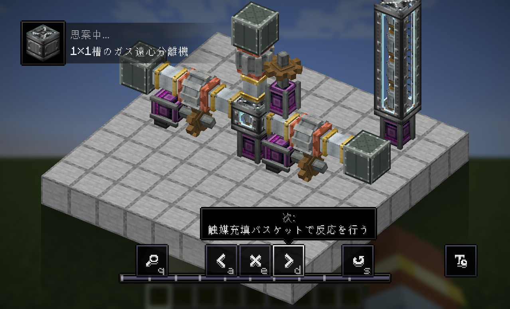

# 1×1遠心分離機の表示・動作確認

Minecraft 1.21.1 / NeoForge 21.1.219 / Create 6.0.10 / NVIDIA RTX 4060、2026-11-10。

`running.png` は実クライアントの専用Ponder。`1x1-and-four-layers.png` はcomputer-use-linux MCPで撮影した同シーンの最小構成と4段の拡張例。画像の編集・生成はしていない。回転状態はクライアント上の実際のBlockEntityで32 RPM／停止時0 RPM、幅1、窓あり、ハッチなしを照合した。





専用の9件のGameTestは次で再実行できる。保存先は一時領域で、通常のプレイ用ワールドを使わない。

```sh
bash gradlew --no-daemon -I docs/quality/compact-centrifuge/verification.gradle runGameTestServer
```

対象クラスを追加する場合は `-DtestClasses=CompactCentrifugeGameTests,ReactorGameTests` のように指定する。Java 21が必要。詳しい結果・制約は[完了レポート](../../reports/compact-centrifuge.md)を参照。
