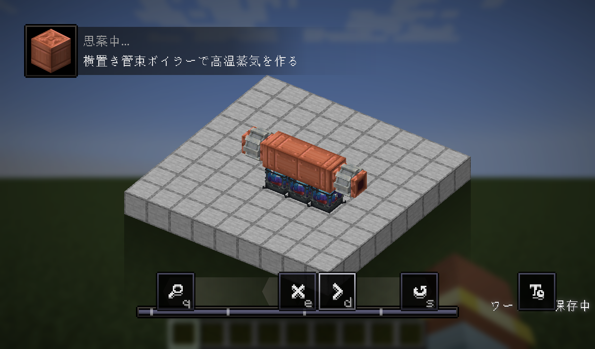
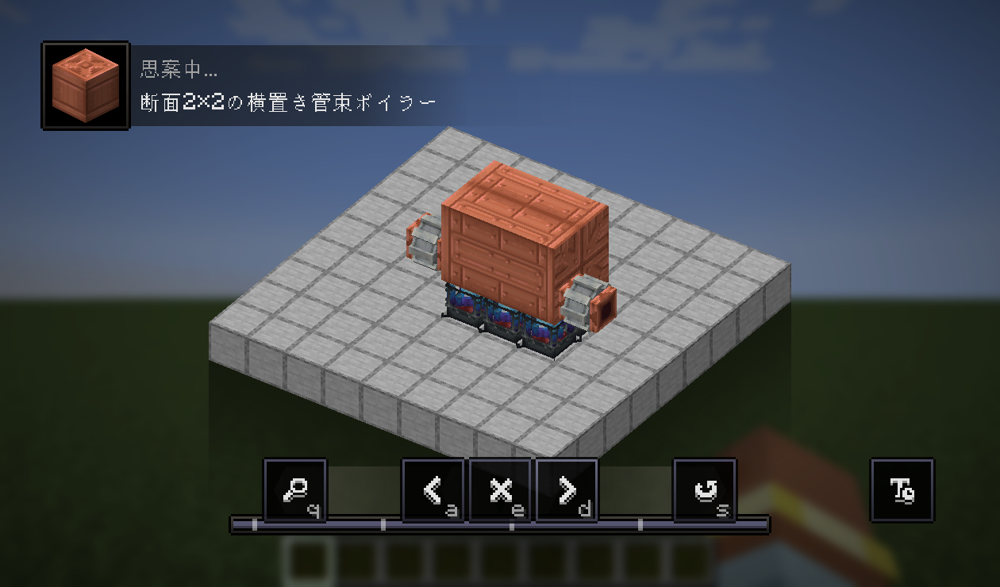
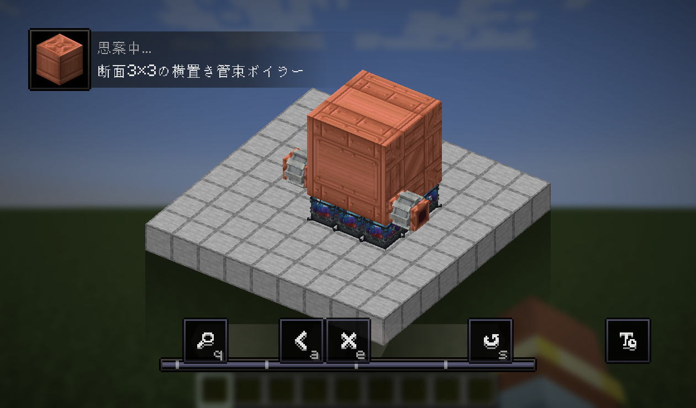
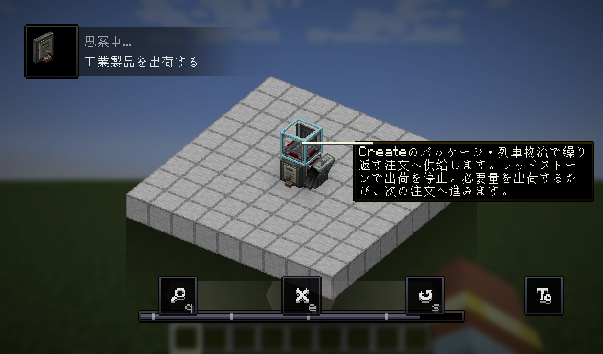
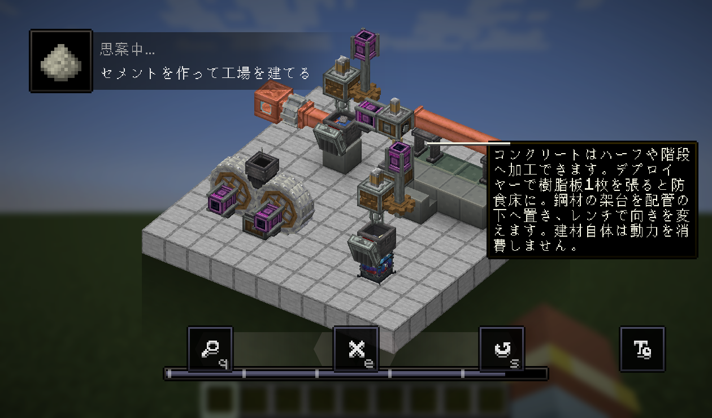
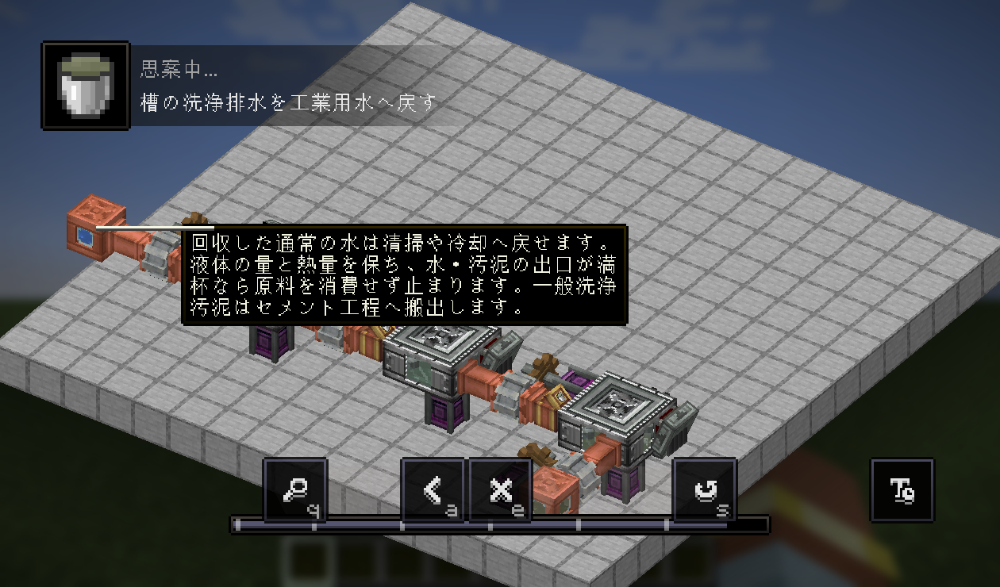
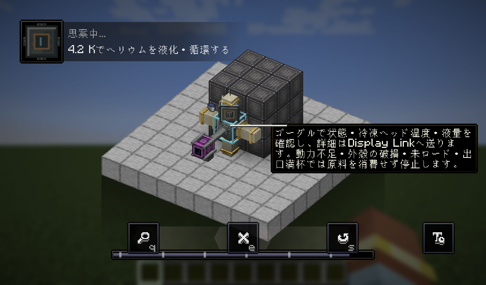

# 追加設備のゲーム内画像

実装後のMinecraft上のPonderで撮影したスクリーンショットです。画像をクリックすると拡大して確認できます。

## 横置き管束ボイラー

通常の横型タンクと共通の外装で、伝熱管を内蔵したボイラーです。断面1×1・2×2・3×3に対応します。

断面1×1：

断面2×2：

断面3×3：

## 受注・出荷票

Createのアイテム保管庫に取り付けて使います。

## セメント・工業建材

既存のCreate設備を使ったセメント・コンクリートの製造ラインです。

## 排水処理プラント

撹拌槽3段で、中和・凝集沈殿・ろ過を行います。

## 液体ヘリウム冷凍機

断熱箱・再生芯・冷凍駆動部を組み合わせた装置です。

[実装内容・動作試験の報告](../../reports/industrial-expansion.md)
