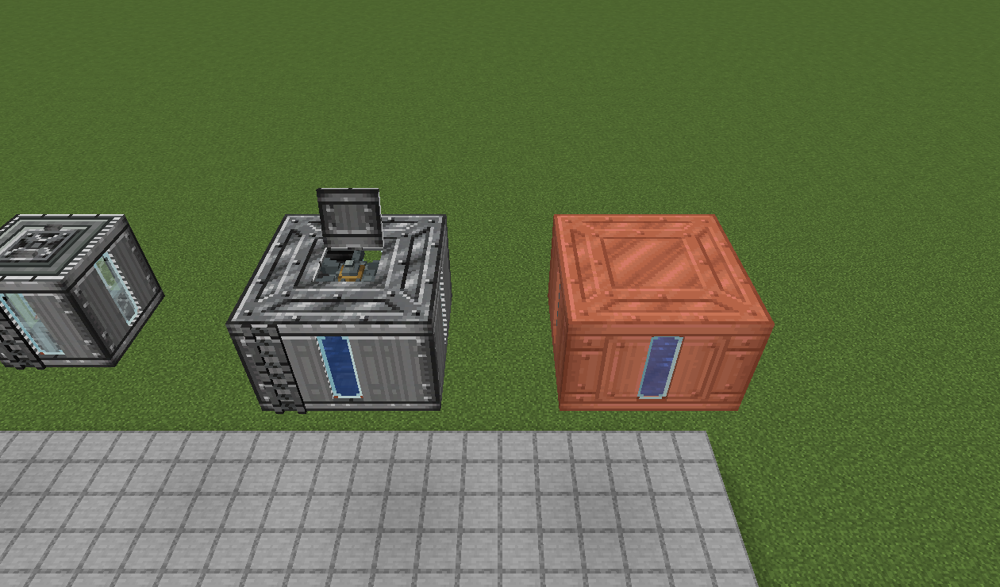
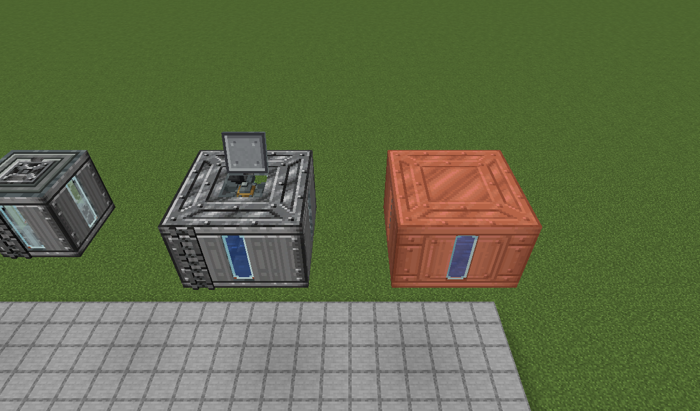

# ふた付き槽の内壁・ふた裏・切り口

内壁・床・ふたの裏側を、鋼板の陰影と留め具が見える材質へ変更しました。板の切り口と窓まわりの厚みには、粒状感のある鋼肌の素材を使っています。

変更前のふた裏：

変更後のふた裏とハッチの切り口：

Minecraft 1.21.1 / Create 6.0.10の実ワールドで撮影しています。中央左がふた付き槽、右の銅色が比較用のCreateタンクです。

2026-11-09の再実行で再撮影しました。ビルド・実クライアント確認は合格し、3×3の上下面18か所の接続タイルもCreate本家のタンクと一致しています。

[実装と確認の報告](../../reports/lidded-vessel-cut-surfaces.md)
