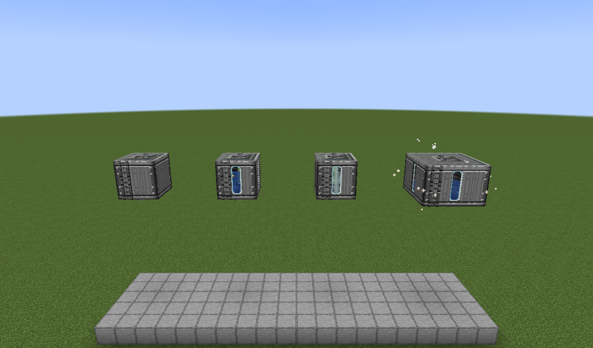
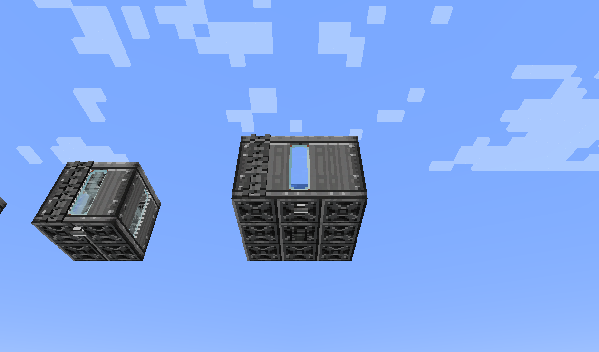

# 四角いふた付き槽とタンク式の点検窓

3×3の上下面は、[Createタンク式の鉄灰色の連結模様](../lidded-vessel-tank-caps/README.md)へ更新済みです。以下は底面入力を中央へ限定した時点の画像です。

Minecraft 1.21.1 / Create 6.0.10の実ワールドで、2026年11月9日13:45 UTCに撮影しました。3×3に実際の撹拌翼を装着し、各槽に実在庫のアイテム・流体を入れています。

左から、窓なしの2×2、窓付きの2×2、液体窒素で霜が付いた2×2、窓付きの3×3です。高さはすべて2段です。2×2はタンク専用で、内部部品と回転入力を持ちません。

- 撹拌翼や遠心ロータを入れても外形は四角いままです。
- はしごは、蝶番の反対側の面を外から見て左端に付きます。
- 側面レンチで切り替える窓は、Createのタンクと同じ幅・上下の縁・ガラス素材です。

底面の接写です。右の3×3は中央1ブロックだけが回転入力で、ほかの8面には軸がありません。左の2×2には回転入力がありません。

[今回の実装と動作試験](../../reports/lidded-vessel-central-input.md)
