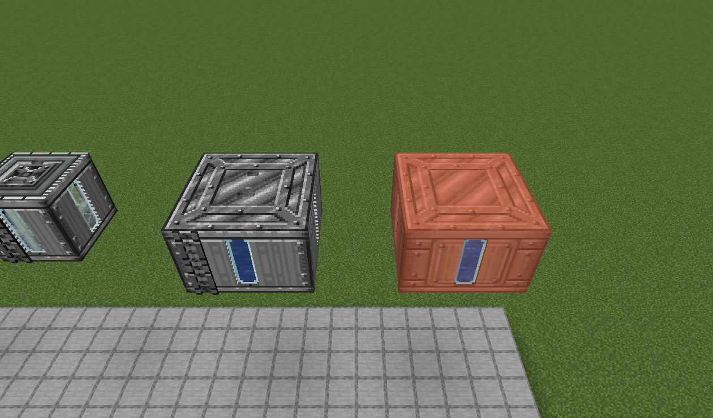
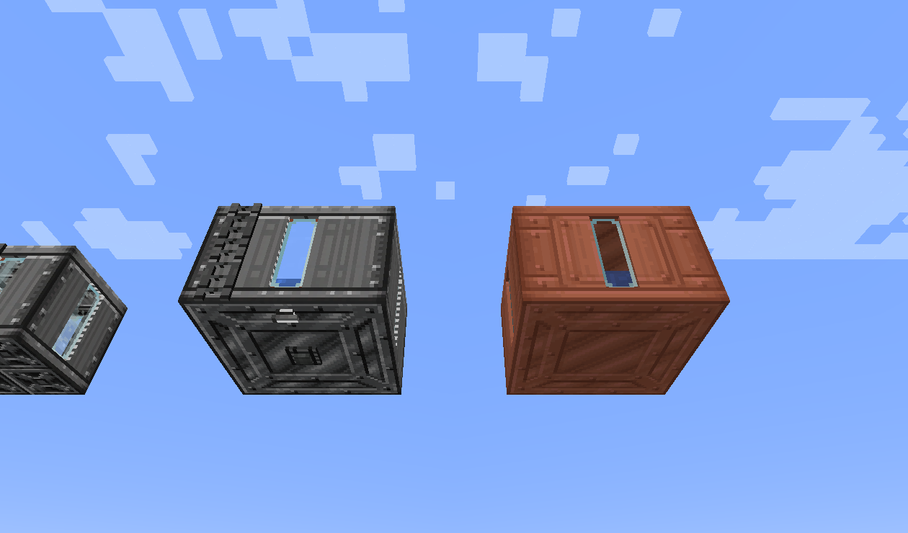
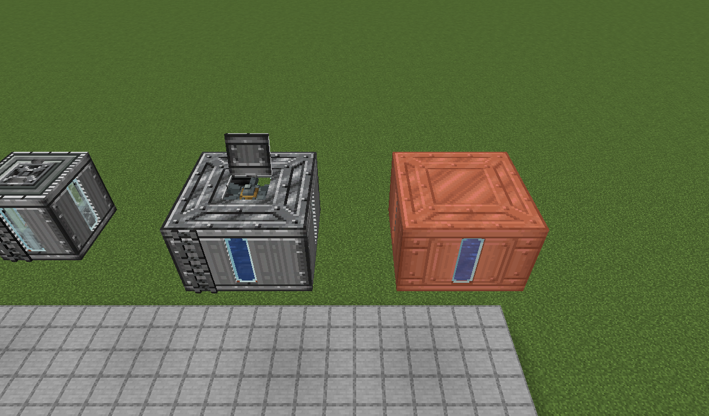

# ふた付き槽の3×3連結天板・底板

内壁・ふた裏・板の切り口は、[鋼板の材質へ更新しています](../lidded-vessel-cut-surfaces/README.md)。以下は連結天板・底板を変更した時点の比較です。

Minecraft 1.21.1 / Create 6.0.10の実ワールドで撮影しました。中央左がふた付き槽、右の銅色が比較用のCreateタンクです。どちらも3×3・高さ2段です。

Createタンクの面取り・リベット・斜めの金属模様を参考に、鉄灰色の素材で上下面をつないでいます。

上面。外周が槽全体で一周し、閉じた中央ハッチも模様につながります。

下面。9枚の枠を並べる形から、槽全体で一周する底板に変えました。回転入力は中央1か所です。

中央のハッチを開いた状態です。

[実装と確認の報告](../../reports/lidded-vessel-tank-caps.md)
