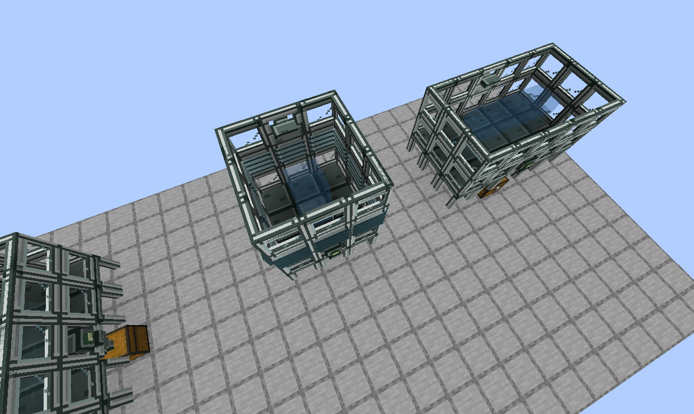
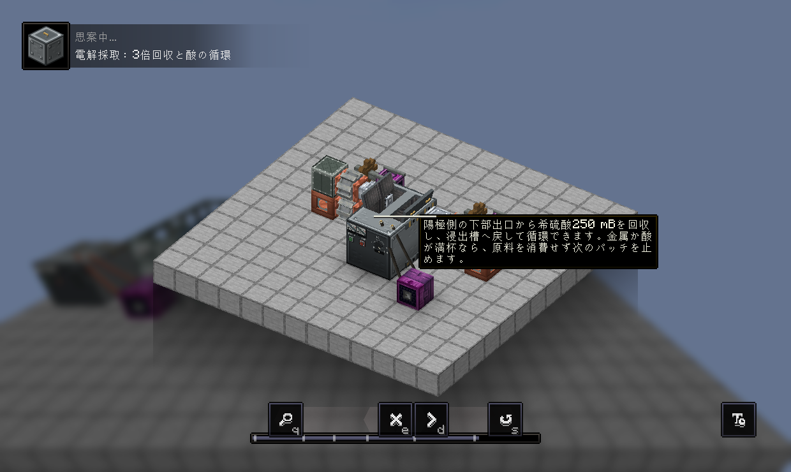

# 汎用金属の回収ライン確認

鉄・銅・亜鉛・錫の加熱浸出、専用沈降槽、電解採取、専用晶析槽を確認する。倍率は原石1個から3インゴット（電解）または2インゴット（晶析・加熱）。

## 再実行

Java 21で関連する68件を実行する。保存先は一時領域の検証用ワールド。

```sh
bash gradlew --no-daemon -I docs/quality/compact-centrifuge/verification.gradle \
  -DtestDir=/tmp/createplant-metal-recovery-tests \
  -DtestClasses=OreLeachingGameTests,ElectrolysisCellGameTests,CraftingRecipeGameTests,PlantTutorialGameTests,ManufacturingPonderGameTests,SurvivalReachabilityGameTests,VesselBasinGameTests,ReactorGameTests \
  runGameTestServer
```

GPU確認用のフラットワールドは以下で作る。通常のワールドでは開発用フラグは無効。ワールドが表示されたらPキーで新Ponder 4章とJEI 3カテゴリの確認へ進む。スクリーンショットはComputer Use MCPで撮影するため、ゲーム側の自動撮影を無効にしている。

```sh
mc-debug bash ./gradlew --no-daemon -I docs/quality/metal-recovery/client.gradle runClient
```

`createplant.recipeScreenCheck` は検証用のJEI画面を開くためのフラグで、工場全体を対象とする旧 `recipeTraceCheck` の監査を実行しない。

## 範囲と制約

- 槽の4方向、正規の入出力面、小分け充填、シミュレーションの不変性、満杯停止、加熱停止、構造欠損・空洞の閉塞、保存・再開・制御部アイテムへの格納を確認。
- 4金属を実際の加熱撹拌槽→沈降→電解に通し、3インゴット・酸250 mB・20 kJ（ニッケル14 kJ）の収支を確認。晶析→精錬で2インゴットも確認。
- 実際のCreate製ポンプ・シュート・チェストで、浸出液の搬入、廃泥と金属の搬出を確認。
- NVIDIA RTX 4060上で専用槽のモデル・液層・結晶、Ponderの日本語、JEIを確認。結晶のPartialModelはクライアント初期化時に登録する。Renderer生成まで遅らせると最初のモデル焼成に間に合わない。
- 多人数サーバーでの長期負荷試験・実チャンクアンロードを伴う長期試験は未実施。音声デバイスがないため聴取確認は未実施。
- GPUクライアント終了時のNVIDIAネイティブクラッシュは、画面確認・ワールド保存後に発生する環境上の制約として記録する。`runClient`全体の終了成功とは区別する。





詳細と対象外の既存検査の結果は[完了レポート](../../reports/metal-recovery.md)を参照。
