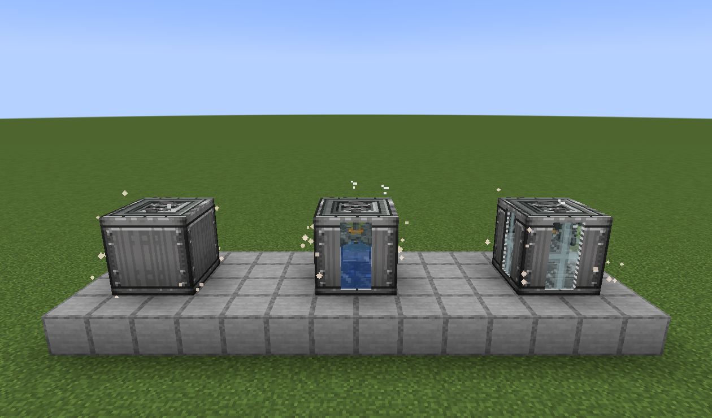
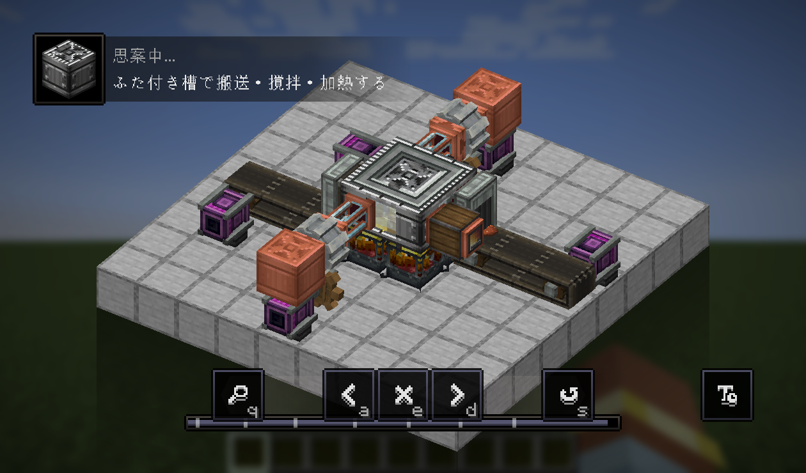
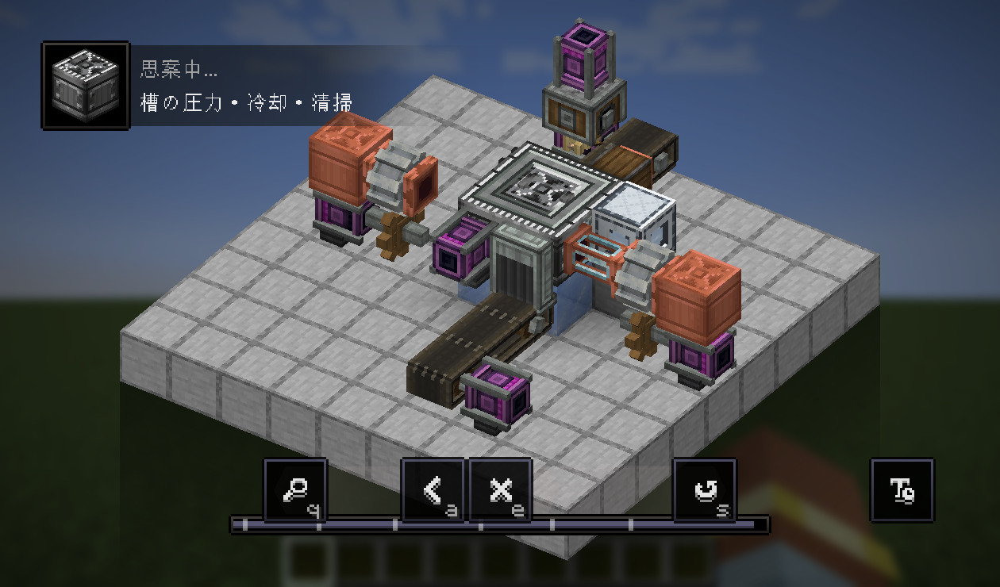

# ふた付き槽の搬送・反応・保守

Minecraft 1.21.1 / NeoForge 21.1.219 / Create 6.0.10の実クライアントで撮影したPonder表示です。描画はNVIDIA RTX 4060、画像は1260×740です。Ponderは操作を説明する状態を表示し、物量・加熱・安全停止は専用GameTestでも確認しています。

## 実ワールドでの比較

左から窓なしの水槽、窓を付けた水槽、77.36 Kの液体窒素を入れた槽です。各槽は2×2×2、32,000 mBと鉄8個・金4個を通常の能力経由で投入し、実際の部品装着と窓切替を行っています。

## 混合と加熱

側面の窓から実際の保存在庫を描画します。羽根と材料の周回は、同期された回転速度と処理状態に対応します。

## 冷却と保守

霜は内容物の温度から計算します。圧力計、底の氷、隣接する液体窒素の保冷タンク、ブラシを使うDeployerを配置したレッスンです。

操作と試験の記録は[実装レポート](../../reports/vessel-basin-operations.md)を参照してください。
