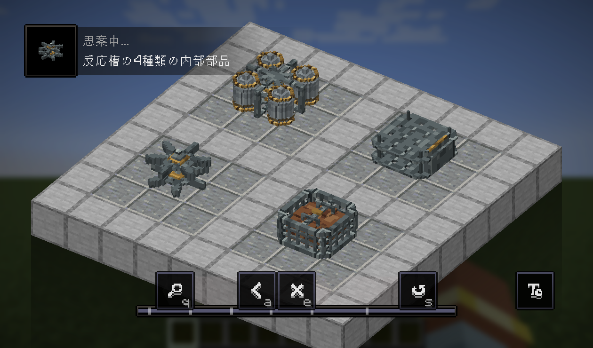
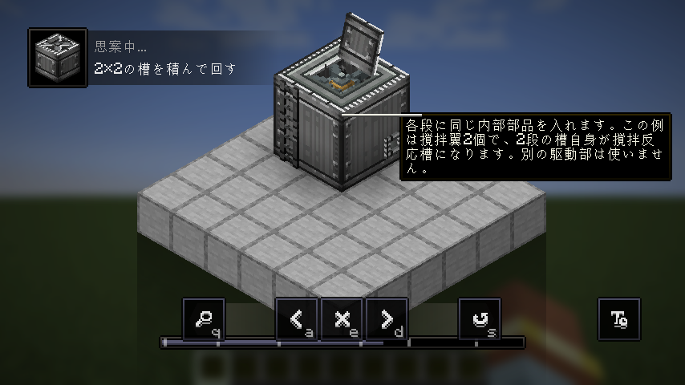

# 槽の4種類の内部部品

Minecraft実クライアントで撮影した、作り直した4部品です。色だけでなく立体形状を変更しています。

| 画像内の位置 | 部品 | 形状 |
| --- | --- | --- |
| 左下 | 撹拌翼 | 上下6枚ずつ、計12枚の羽根。2段の円板・ハブ・ボルトと連続軸。 |
| 右下 | 触媒充填バスケット | 開口のある金網、補強枠、粒状の充填物、吊り手。 |
| 右上 | 分離棚段 | 穴が実際に開いた2段のデッキ、左右の降液管、支持柱。 |
| 左上 | 遠心ロータ柱 | 4本の密閉した段付き鋼筒、軸受、静止した支持枠。 |

ゲーム内では各内部部品かふた付き槽のPonderから「反応槽の4種類の内部部品」で外形を確認できます。装着した撹拌翼と遠心ロータは、槽に入れた回転動力に対応して動きます。

## 槽へ装着した状態

2×2・2段の槽へ撹拌翼を取り付け、中央ハッチを開いた状態です。槽の天板が周囲を覆うため、羽根全体の形状は上の部品展示で確認できます。

[実装・検証記録](../../reports/vessel-internals-remodel.md)
