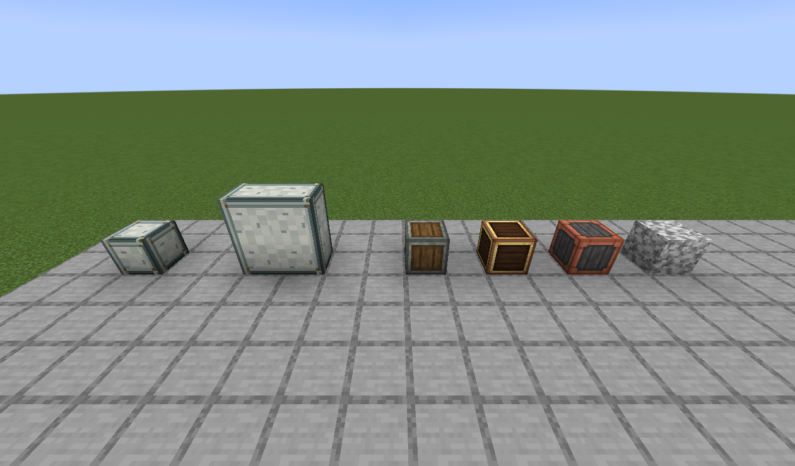
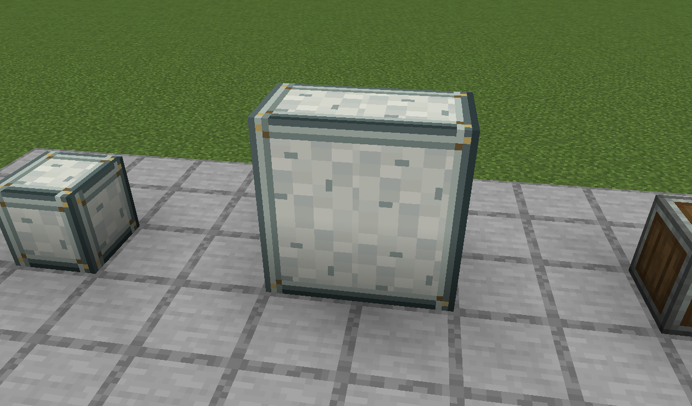
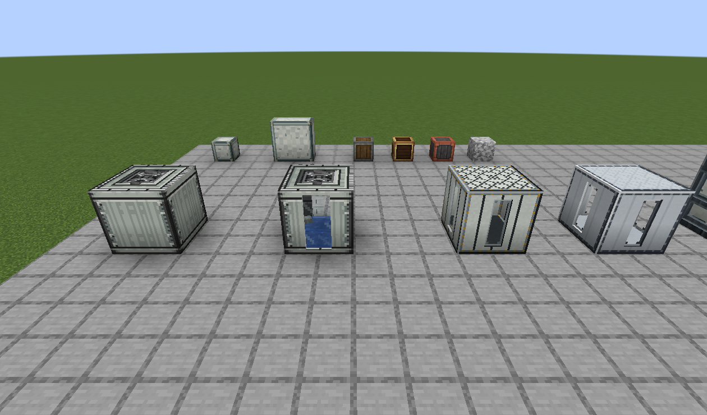
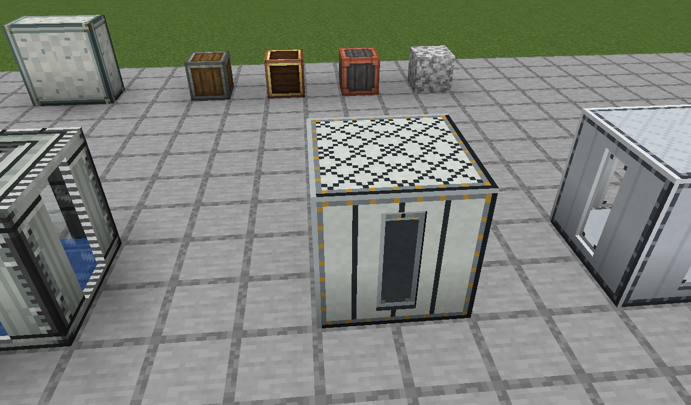
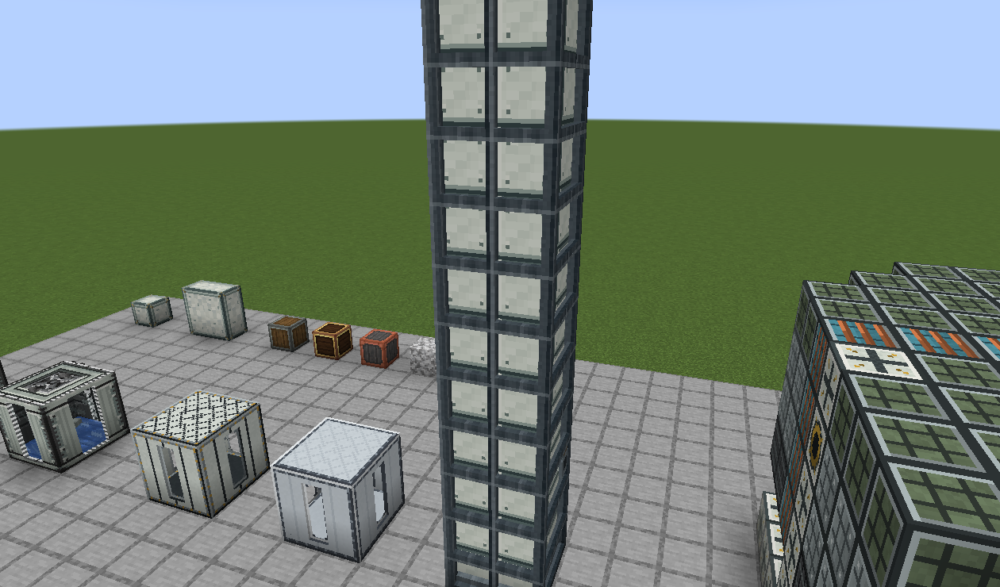
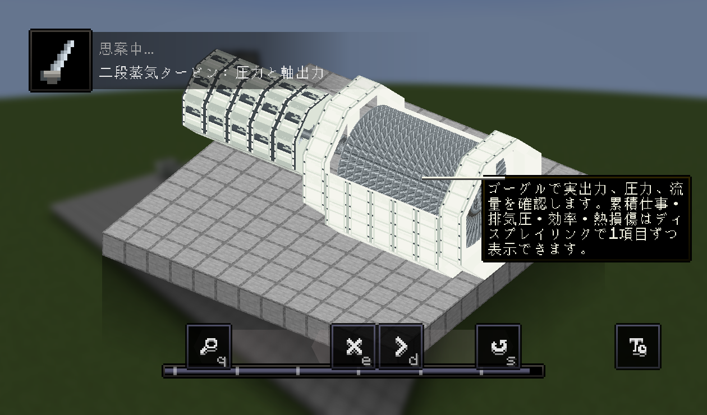
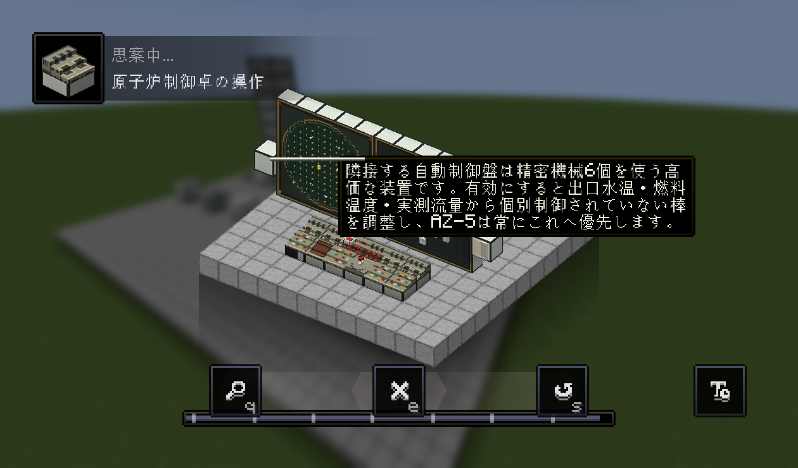
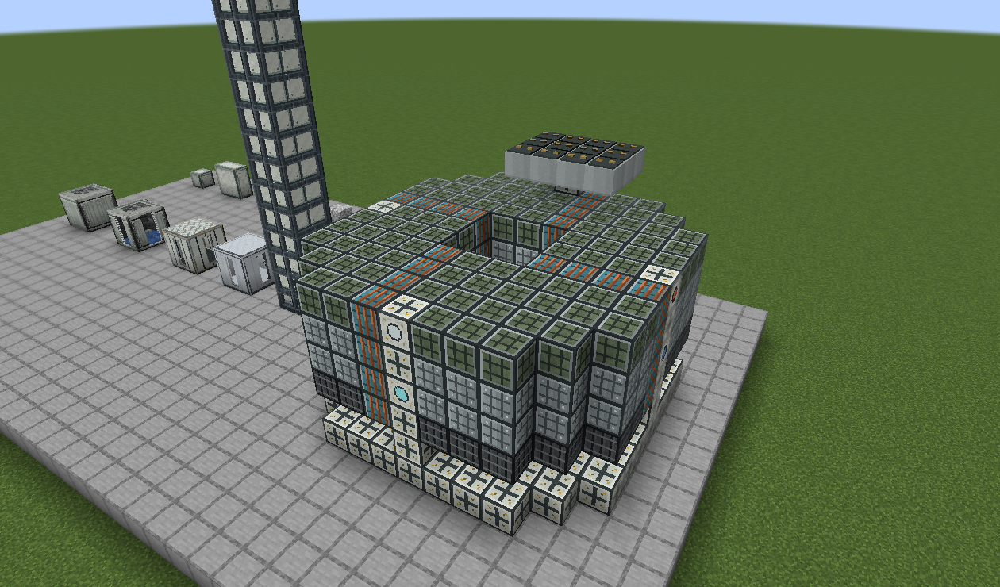
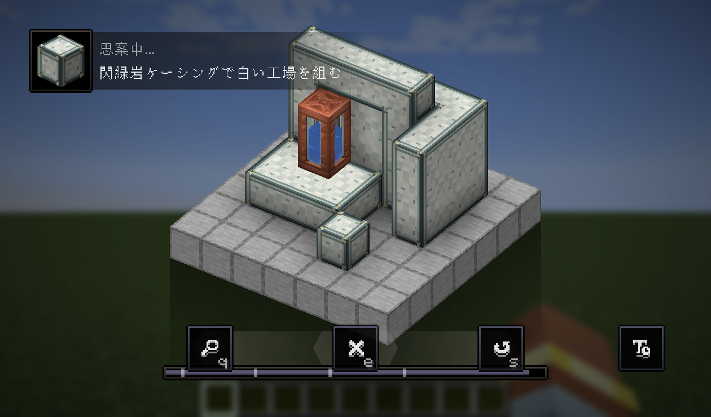

# 履歴：撤回した白い工場外装と閃緑岩ケーシング

> **全体白化は撤回済みです。** 2026-11-09の後続指定により、既存設備の外装は白化前の`c26c2198`へ復元し、新しい閃緑岩ケーシングを保持します。以下の画像・検証結果・実行例は撤回前の履歴で、現在の既存設備の外観や再生成手順ではありません。現行方針は[既存外装の復元](../block-surfaces.md)、新ケーシングの操作・再生成は[使い方](../../diorite-casing.md)を参照してください。

2026-11-09の当初の依頼では、外装の主面を白系へ変更しました。白い石・塗装板、暗い鋼の枠と継ぎ目、銅と真鍮の小部品を組み合わせていた時点の記録です。既存の形状・UV・透過部分・装置の機能は維持しました。

## 閃緑岩ケーシング

閃緑岩を置き、安山岩合金1個を持って右クリックすると作れます。Create標準の手適用・デプロイヤーレシピです。隣接面はつながり、壁・柱・梁・台座を作れます。一部設備の安山岩ケーシング枠にも使えます。詳細は[使い方](../../diorite-casing.md)。

左が単体、中央が2×2の連結壁です。Create本体の安山岩・真鍮・銅ケーシングと、バニラ閃緑岩を同じ照明で並べました。





## 既存設備

既存PNG74枚の外装を変更し、新しいケーシング本体・CTシート・共通白塗装の3画像を追加しました。白塗装材は194モデルの素材参照から共有し、同じ塗装画像を別名で複製していません。原料・地金、軸・羽根・摺動部、燃料、流体、警告灯や計器の表示色は保持しています。

下は実際に形成した2×2×2槽とタンクです。覗き窓の槽には水を入れ、内部部品も設置しています。無動力・停止状態で外装を確認した画像です。











核融合炉では外装とポート周囲を白系にし、コイル・真空容器・ブランケット等は素材の識別を保っています。炉の寸法と形状は変更していません。



## 当時の再生成と確認（履歴）

当時は`tools/generate_white_factory.py`と`tools/white_factory_materials.json`で外装を生成し、原本コミット`c26c219873700d8aa1d99ae5c85f864d7bd39e0e`を入力にしていました。この全体白化の生成器とマニフェストは現在撤去済みです。以下は当時の実行記録です。

```sh
python3 tools/generate_white_factory.py
python3 tools/generate_white_factory.py --check
```

当時の関連GameTestと実クライアント撮影には、Java 21環境で次の設定を使いました。`whiteTestDir`には空の開発用ディレクトリを指定していました。

```sh
bash gradlew --no-daemon --max-workers=2 -I tools/white_factory_checks.gradle \
  -Dcreateplant.whiteTestDir=/tmp/createplant-white-tests \
  -Dcreateplant.gameTestClasses=AuditGameTests,CraftingRecipeGameTests runGameTestServer

JAVA_TOOL_OPTIONS='-XX:ActiveProcessorCount=4 -Dcreateplant.clientQualityCheck=true -Dcreateplant.whiteThemeWorldCheck=true -Dcreateplant.whiteThemeOutputDir=/tmp/createplant-white-images -Dcreateplant.clientQualityTargets=diorite_casing@diorite_casing -Dcreateplant.clientQualityCaptureDelay=300 -Dcreateplant.clientQualitySeekFromEnd=310' \
  mc-debug bash gradlew --no-daemon --max-workers=2 -I tools/white_factory_checks.gradle runClient
```

当時の全体白化では常に固定原本から変換し、再実行による重ね塗りを防いでいました。CTシートはCreate 6.0.10の隣接判定に合わせ、256通りの隣接状態から47種類の有効タイルを描いています。Createの画像を転用せず、石目と枠を整数ピクセルで描いています。

[資産検証データ](asset-verification.json)には、変更画像・モデル、元の寸法・透過・形状・UVの保持確認を記録しています。[実ワールド撮影結果](world-render-result.json)は7視点の保存対象です。GPUはNVIDIA RTX 4060、Minecraft 1.21.1 / NeoForge 21.1.219 / Create 6.0.10を使用しました。稼働プラントの長時間性能試験は今回の確認範囲に含みません。

新機能に関係するAudit/CraftingのGameTestは11件すべて合格しました。実クライアントでは118シーンの登録・日本語表示を検証し、新ケーシング・原子炉制御卓・タービン・小型コンプレッサーのPonderを撮影しました。生成器の一致確認、Ponderの参照と言語検査、アイテムの識別性検査も合格しています。

このコンテナでは、撮影・検証の完了後、クライアント終了処理でNVIDIAの`libEGL_nvidia.so.0+0xb56ae`がSIGSEGVを起こしました。撮影と`CLIENT QUALITY PASSED`の確認とは分けて記録しています。`runClient`全体の正常終了を確認できたという意味ではありません。

新しいPonderでは製作から壁・支持構造・タンクとの組合せを説明します。


