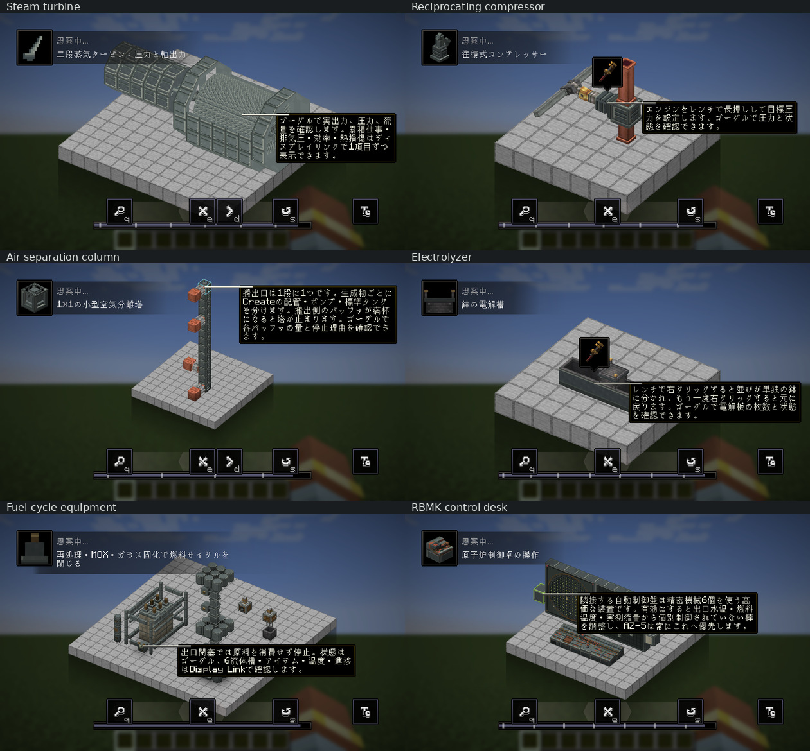

# 全ブロックの外観更新

2026-11-08。ユーザーの「核融合炉だけでなくほかのすべてのブロックを改善して」に対応し、DESIGN.mdの材質・密度・枠・配色ルールをMOD全体へ適用した。

## 実装

- 対象は登録済み196ブロック。化学設備、電解炉、原子炉と制御盤、タービン、全染色フライホイール、クレーン、冷却設備、タンク、配管、計器、再処理・ガラス固化、鉱石・建材を含む。
- 開始時451枚のブロックPNGを全件分類。382枚を描き直し、直前に更新済みの核融合炉40枚を維持した。同一合金の29パスは鋼材・鋳鉄・真鍮・銅の4共有素材へ統合。機能識別用8枚、共有素材4枚、連結用7枚を追加し、最終441枚。
- 16 px/m、外枠1 px、左上を明るくした面取り1 px、低コントラストの2 px以上の材質模様、有限パレットを使用。銅・真鍮の面を暗くし、明るい色は縁・小部品へ限定した。
- 既存の羽根枚数、全染色フライホイールの識別色、機器ごとのポート・計器・接点・使用済み表示を維持。復水器入出力、冷却塔の3ポート、空／封入済み廃棄物容器等の重複外観を解消した。
- 同じ素材のPNGを機器ごとに複製せず、モデルの参照を共有パスへ置換。1269モデルの形状・UVは変更していない。tank_casingの単一面は32 pxから16 pxへ合わせ、面当たりの密度を修正した。
- 7種類の共有平面はCreateの47形連結テクスチャに対応。描画済みモデルが正確な6面の完全立方体で、許可された素材だけを使う場合に適用する。付属物や部分面のモデルは対象外。BlockEntityはケーシング／シェル以外を除外する。
- レシピ、温度・流量等の数値、構造判定、BlockState定義、翻訳、保存形式、Ponder組立手順は変更していない。

## 主なファイル・再生成

- `tools/minecraft_style.py`: 共通の有限パレット、2 px単位の材質模様、枠・面取り。
- `tools/generate_block_surfaces.py`: 全設備のテクスチャ生成、共通素材参照への統合、連結atlas生成。
- `tools/generate_process_surfaces.py`、`generate_storage_surface_assets.py`、`generate_misc_block_surfaces.py`: 形状・レシピ等を再生成しない素材更新の入口。既存の各設備用painterも更新した。
- `client/PlantSurfaceModels.java`: 完全立方体の選別とCreate CTの適用。
- `client/AllBlocksClientCheck.java`: opt-inの実登録ブロック一覧と連結面のネイティブ表示。
- `tools/validate_block_surfaces.py`: PNG、参照、旧素材削除、形状・UV・ゲームデータの不変を検証。
- `tools/validate_visual_identity.py`: 共有材質の有限色・面取り・暗い金属面と、完成アイテムの識別性を検証。従来の1 pxノイズを要求する検査はDESIGN.mdに合わせて修正した。

Pillowを導入したPython環境で、リポジトリのルートから実行する。

```sh
python tools/generate_block_surfaces.py
python tools/validate_block_surfaces.py --revision 6c10f6fc --output /workspace/outputs/all-blocks-validation.json
python tools/validate_visual_identity.py
```

既存の設備生成スクリプトには、モデル・レシピ・翻訳まで書き出すものがある。外観だけを再生成する場合は上記の統合入口を使用する。Create由来のUV atlasに使うJARは解決済みGradleキャッシュから取得し、必要なら`CREATE_JAR`で明示できる。

## 確認結果

- 統合生成を再実行し、アイテムを含む対象テクスチャ・モデル1824ファイルのバイト一致を確認した。
- 全ブロックPNGは24色以内・16 px単位。ローカル参照切れなし。旧29素材のファイル・参照が残らないことを確認。
- 開始時との比較で1269モデルの形状・UVが一致。ゲームデータ・BlockState・翻訳・Ponderの変更なし。
- 完成アイテム285件の外観検査に合格。意図的な既存のコンプレッサー部品共有を除き、重複グループなし。
- 7連結atlasをCreateの47文脈・256入力maskで照合。単体・接続辺・外周・凹角・枠なし平面を確認し、各atlasは6～10色・完全不透明。
- 追加のネイティブ連結ページで、ステンレス・チタン・タンクケーシング・共有鋼材の欠け角／突出を表示した。中央の半透明部分は未形成タンクの既存組立ガイドで、実際に置かれたブロックではない。
- CI検査の既存11テスト、Ponder翻訳・案内の検査に合格。
- `build runPowerPlantRegressionGameTestServer`に合格。関連GameTest29件すべて成功。外観変更なので全プラントの長時間運転試験は実施していない。
- RTX 4060 / NVIDIA 595.99.02のハードウェア描画を確認。実登録196ブロックを9ページに配置し、全ページをネイティブ画面で確認した。流体はガラス容器に保持し、未形成の装置も既存の描画を使用した。
- 代表14対象のPonderを実クライアントで描画し、112シーンの日本語見出しを実行時に検証。対象は小型・往復式コンプレッサー、分留塔、高圧タービン羽根、RBMK、耐圧・樹脂配管、冷却ファン、水タンク、自然通風塔、燃料サイクル、クレーン、電解槽、原子炉制御盤。Ponder対象には複数の案内があり、キャプチャは各対象の最初の案内を使用している。

## 制約・次回の注意

- ネイティブ一覧は各ブロックの代表状態、Ponderは案内用ワールド。全装置の稼働・停止・全方向・全液面・全故障表示の総当たりや、実配管の連続運転を証明するものではない。
- 今回追加したCTの初回起動確認で、bake時に未解決のspriteをMapへ入れるNull参照が発生した。ResourceLocationで照合する実装へ修正し、再起動・描画に成功した。
- Ponder検査は`CLIENT QUALITY PASSED`と14枚の保存後、終了時に既知の`libEGL_nvidia.so.0`のSIGSEGVでexit 134となった。`runClient`の正常終了とは扱っていない。一覧用クライアントは終了時にチャンク保存が停止したため、キャプチャ後に該当プロセスを終了した。ゲーム中の素材読込・表示の失敗とは分けて記録する。
- 再生成後は共有素材の統合まで実行すること。個別の旧生成スクリプトだけを実行すると、一時的に旧素材パスが再作成される場合がある。

## 証跡とコミット

成果物は`/workspace/outputs/`の`all-blocks-*`。ネイティブ一覧、Ponder画像、材質監査、ビルド・GameTestログ、更新版JARを保存する。



画像集は`all-blocks-ponder-images.zip`（14対象のPNG原本）と`all-blocks-gallery-images.zip`（一覧9ページと連結面のJPEG、配置メタデータ）。一覧PNG原本もoutputsへ個別保存した。

- 外観実装: `993e5e3c`（全設備外装・共有素材・CT・検査・生成ガイド）。
- リモート更新の統合: `d3f671e50e49de598bb0651cbf2f645765fad5a2`。追加されていた核融合炉テストワールド5コミットを取り込んだ。今回の画像確認は統合前の外観実装で行い、統合後は`build`成功を確認した。新規テストワールドの運転は今回の確認対象に含めていない。
- 配布JAR: `create-heavy-indusstry-all-blocks-d3f671e5.jar`、4,606,134 bytes。
- SHA-256: `a4200702cafef1743bdc1f45a25da5bfc5c0ca3780f1849f7919805a87fbde20`。
- JAR中の素材・モデル1827ファイルをソースと照合して全件一致。欠落・旧素材29パスの残存なし。新しいCT、一覧チェック、リモートのテストワールドの各クラスも含まれている。
- 最終ビルドは成功。自動検査結果と画像の原本は前記outputs、実クライアントの見出し検査結果は`docs/quality/block-surfaces-client-result.json`に保存した。
