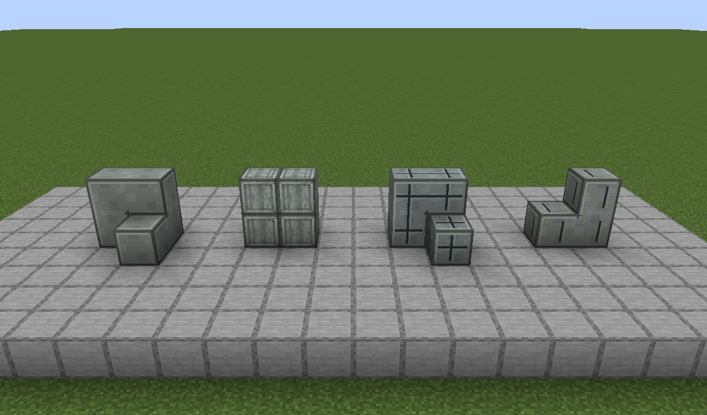
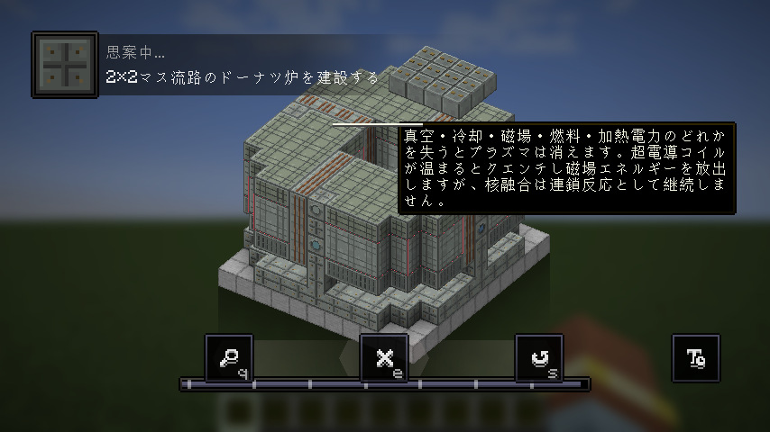

# 安山岩合金ブロックを参考にした外観更新

2026-11-08。「変更されたブロックのテクスチャをDESIGN.mdの条件で安山岩合金ブロックの色合いとか風味を参考にして作り直おして」「核融合炉もやって」に対応した。

対象は、現在も変更後の外観が残る設備の金属部と、明示指定された核融合炉。前回戻したラジエーター、RBMK炉と制御盤、蒸気タービン、角型蒸留塔、パイプ、タンクの外観は維持した。

## 実装

- 参照は依存するCreate 6.0.10の`create:andesite_alloy_block`。実際のモデルは`create:block/andesite_block`を使う。木の入る安山岩ケーシングとは区別し、解決済みJARの原画像13色を調べた。
- 灰緑の内面3色`(130,135,132)`・`(143,150,145)`・`(154,164,157)`、外枠`(96,99,95)`、左上の面取り`(168,179,171)`を参考にした。模様は原画像のコピーではなく、独自の2px単位・2～6pxの鋳肌の塊で描いた。
- 外枠1px・面取り1px・内面12×12、有限パレットを適用。銅・真鍮、染色部、表示灯、液体、ガラス、鉱物・粉体等の用途と識別色を残した。
- 既存178枚を実際のRGBA画素で更新。核融合炉35枚を含む。全既存PNGのアルファチャンネルは変更なし。新しい核融合用CT6枚を追加し、ブロックPNGは444枚から450枚になった。
- 核融合炉は元の補強線、巻線、ポート記号、制御盤の状態差を維持。6種類の立方体部材にCreate標準CTを使い、接続面の内枠を消した。11×11×8のドーナツ構造、2×2流路、プラズマ画像、動作は維持した。
- 前回復元した画像222枚（原子炉制御盤等、羽根アイコン2枚と核融合プラズマを含む）は画素・寸法とも開始時と一致。復元保護マニフェストは新指示に対応する核融合の構造・制御画像だけ解除した。

主な変更元は`tools/minecraft_style.py`の共通灰色パレット・鋳肌、`generate_fusion_assets.py`の核融合painter、`generate_misc_block_surfaces.py`のチタン面、`generate_block_surfaces.py`の共通CT生成。`FusionCasingModels`を再適用し、開発用一覧には実物のCreate安山岩合金ブロックを並べた。形状・UV・レシピ・保存データ・組立手順は変更していない。

```sh
python tools/generate_block_surfaces.py
python tools/validate_block_surfaces.py --revision d22feeb2 --output /workspace/outputs/andesite-surfaces-validation.json
python tools/validate_visual_identity.py
```

## 確認結果

- 再生成で画像・モデル1833ファイルのバイト一致。
- 1269モデルの形状・UV、ゲームデータ・BlockState・翻訳・Ponderが開始時と一致。
- 完成アイテム285件の識別性検査に合格。意図した部品共有以外の重複なし。
- 12 CT atlasは128×128・不透明・6～10色。独立監査で47文脈×12枚の564組、単体・接続辺・外周・凹角・面取りを確認した。
- 独立監査で保護対象222画像をGitの開始時原本と直接比較。17色フライホイールの染色部、鉱物、粉体、耐火材、表示灯の状態色、ガラスと水の透過性も維持した。
- RTX 4060の実クライアントで登録196ブロックの9ページと、連結面・実物Create合金の比較ページを確認。
- 代表8対象のPonderを実描画し、112シーンの日本語見出し検査に合格。核融合炉、小型・往復式コンプレッサー、反応槽、冷却塔、燃料サイクル、PID制御、電解炉を保存した。
- 別実行の`build`は成功。JAR内の画像・モデル等1836ファイルがソースと一致し、欠落・差異・旧不要画像の残存なし。

## 制約と注意

一覧は代表状態、Ponderは案内用ワールド。全方向・全液面・全稼働状態の総当たりや、プラントの長時間運転試験ではない。Ponderの赤い輪郭などは説明用の選択表示で、テクスチャの色ではない。

最初のPonder起動は、一覧クライアントの終了が残った状態で始めたため実行環境のスレッド上限に達した。残ったテストプロセスを終了し、単独で再実行して上記表示検査に合格した。表示と画像保存の後は、既知の`libEGL_nvidia.so.0`の終了時SIGSEGV（exit134）が出た。`runClient`の正常終了とは扱っていない。

## コミット・成果物

- 実装コミット：`07395775`（安山岩合金の灰緑色と鋳肌を設備と核融合炉へ反映する）。
- 配布JAR：`create-heavy-indusstry-andesite-style-07395775.jar`、4,683,198 bytes。
- SHA-256：`1a44d64f3a27bb426cfa32bdc1b08236e9026d55410c40fe3384684ccdb915e3`。
- 証跡は`/workspace/outputs/andesite-*`。`andesite-style-images.zip`は一覧と代表設備のJPEG、配置・表示検査JSONを含む。PNG原本は個別保存している。




