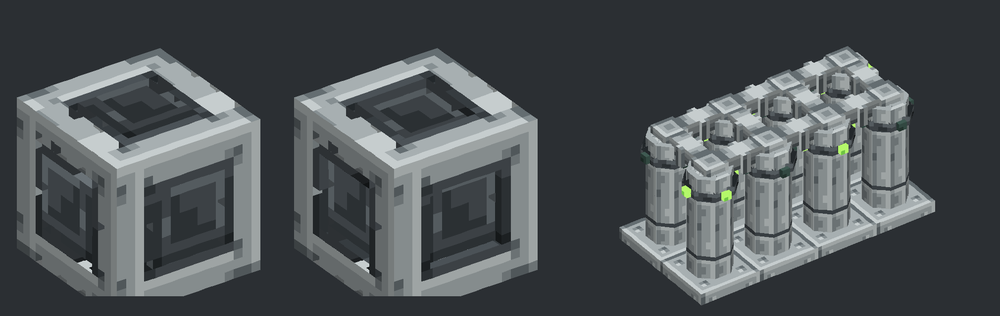
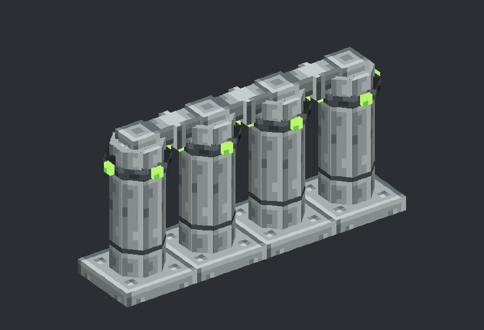
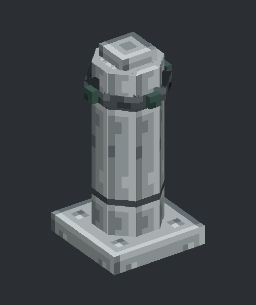

# ガス遠心分離機とキュービックプレスのテクスチャ・モデル差し替え

Minecraft 1.21.1 / NeoForge 21.1.219 / Create 6.0.10、2026-11-16。

[実装済みのガス遠心分離機カスケードとキュービックプレス](centrifuge-cascade-and-cubic-press.md)について、**テクスチャとモデルだけ**を描き直しました。Java・レシピ・Ponder・GameTest・翻訳は変更していません。

## 変更したもの

| 種類 | 場所 |
| --- | --- |
| 生成元 | `tools/generate_centrifuge_and_press.py`のテクスチャ・モデル部分 |
| 遠心分離機のテクスチャ6枚 | `textures/block/gas_centrifuge/`（`shell`・`plinth`・`bearing`・`band`・`cap`・`header`） |
| 遠心分離機のモデル6個 | `models/block/gas_centrifuge/`（`lower`・`upper`・`lamp`・`lamp_lit`・`header`・`item`） |
| プレスのテクスチャ3枚 | `textures/block/cubic_press/`（`frame`・`anvil`・`sample`） |
| プレスのモデル4個 | `models/block/cubic_press/`（`frame`・`anvil`・`sample`・`item`） |
| blockstate | `blockstates/gas_centrifuge.json`（モデルの組み合わせだけ変更。状態名は同じ） |

旧テクスチャ（両ブロックの`steel`・`dark`、遠心分離機の`lamp`）と旧モデル（`upper_true`・`upper_false`・`north`・`east`・`south`・`west`）は削除しました。描画コードが参照する`cubic_press/anvil`・`cubic_press/sample`と、`cubic_press/frame`、`<名前>/item`の名前は変えていません。

再生成は`cd tools && python3 generate_centrifuge_and_press.py`です。画像は手で編集していません。この生成元はレシピ・Ponder構造・翻訳も書き出しますが、その部分には手を入れておらず、実行後の差分はテクスチャ・モデル・blockstateだけでした。

## 形状

- **遠心分離機**：下半分は高さ3ピクセルの台座と直径10ピクセルの八角柱、底面中央に軸受。上半分は八角柱の続きで、上端の3ピクセル下に暗い鋼の締結帯、天面に6ピクセルのヘッダー接続口。
  - 八角柱は、交差する2枚の板と、それを45度回した2枚で作ります。締結帯だけは幅5ピクセルのため、半ピクセル座標を使います。
  - 表示灯は締結帯の東西南北に2×2ピクセル。点灯時（`lamp_lit`）は`neoforge_data`の`block_light`・`sky_light`で発光させます。
  - `header`は北向きの配管（太さ4ピクセル）と半分のフランジ。blockstateで東西南北へ回して使います。
- **キュービックプレス**：各辺に太さ3ピクセルの柱がある骨組み。各面は金床が通る1ピクセル幅の工具鋼のガイドだけで、開いています。
  - `anvil`は北面用の金床（8→6→4→2ピクセルの段付き、先端はz=6）。既存の描画コードが6面へ回し、中心へ最大1ピクセル押し込みます。
  - `sample`は中心の2×2×2ピクセル、発光。

テクスチャは1枚ずつ文字の並びで描いた16×16で、最大9色です（上限24色）。明るい鋼・暗い工具鋼とも、明るい面・基本・暗い面・継ぎ目の4段階にしています。

## 確認したこと

- 生成元を実行し直しても、同じファイルが出ること。
- すべてのモデルが存在するテクスチャだけを参照し、UVが0〜16に収まること。blockstateが存在するモデルだけを参照すること。
- 旧テクスチャ名・旧モデル名への参照が、ソース・ツール・リソースに残っていないこと。

簡易プレビュー（自作の描画スクリプトによる正投影。**実クライアントの画面ではありません**）：

## 実行結果

| 確認 | 結果 |
| --- | --- |
| `sh gradlew build` | 成功 |
| `GasCentrifugeGameTests`・`CubicPressGameTests`（`docs/quality/compact-centrifuge/verification.gradle`経由） | 11件すべて合格 |

GameTestは専用サーバーで動くため、モデルやテクスチャの見た目は検証しません。差し替えで処理が壊れていないことの確認です。ほかのGameTestクラスは、今回の変更が及ばないため実行していません。

## 未確認事項

- **実クライアントでは未確認です。** ゲーム内での向き、陰影、発光、Createブロックとの明るさの釣り合いは見ていません。
- 45度回転した要素の陰影と、`neoforge_data`による表示灯の発光は、実機での確認が必要です。
- プレスのシャフト接続面には、専用の軸受の形を付けていません。6面とも同じ見た目です。
- Ponderの見え方（新しいモデルでの構図）は確認していません。

## 次回の注意

- 生成元の`box()`は、共有の`all` UVを面の大きさに切り詰めます。面ごとのUVを指定すると、そちらが優先されます。
- 金床モデルの向き（北面・先端が+z）と先端位置（z=6）は、`CubicPressRenderer`の回転と移動量に合わせています。どちらかを変えるときは、もう一方も合わせてください。

実装コミット：このレポートと同じコミットです（`git log -1 -- docs/reports/centrifuge-and-press-models.md`で確認できます）。
