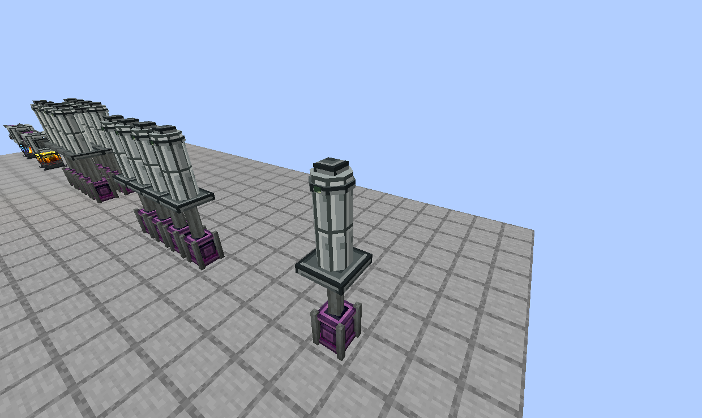
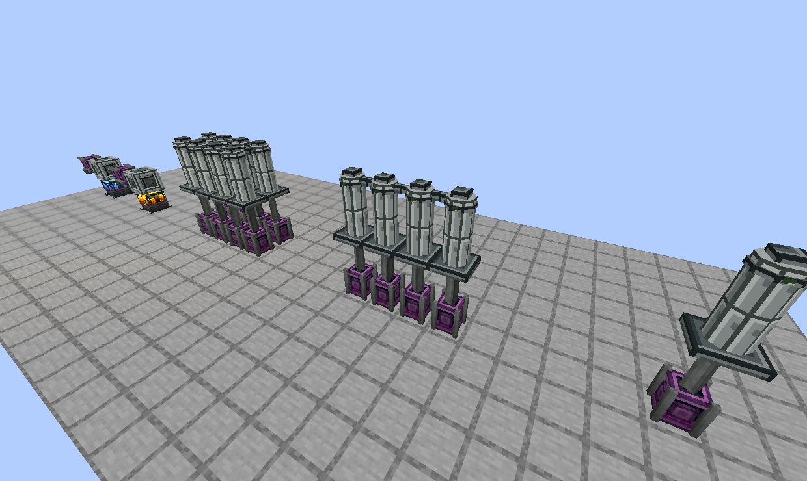
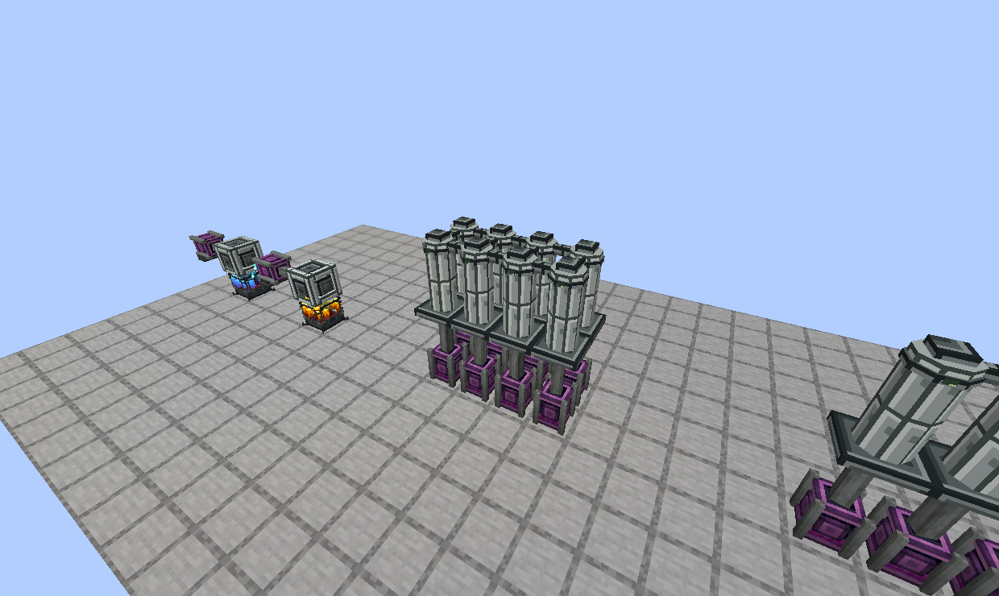
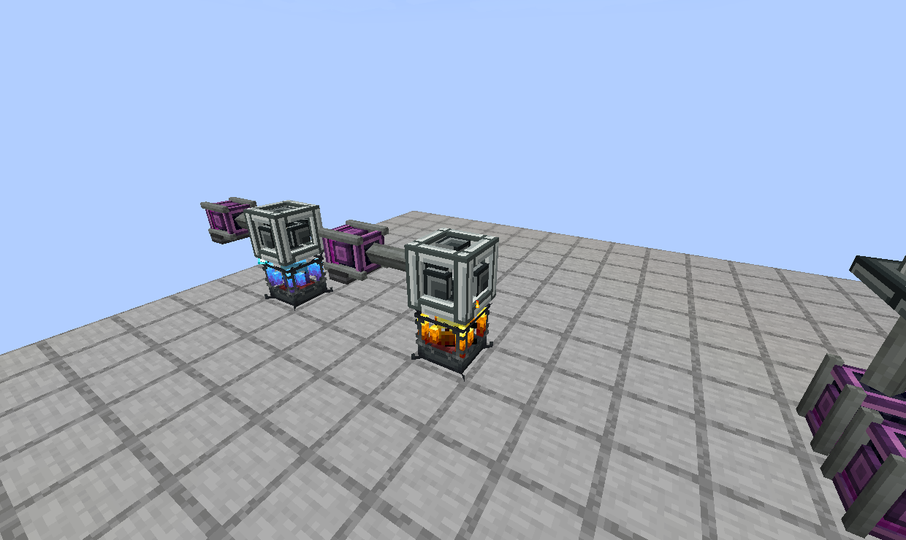
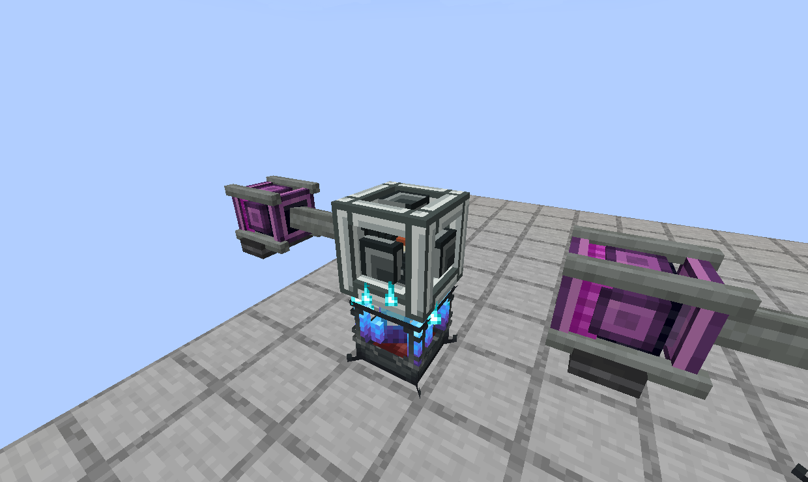

# ガス遠心分離機カスケードとキュービックプレス

実装コミット：`df99a244ff7c5cde22dc53bf188e8b134c5a41a7`

`docs/specs/centrifuge-cascade-and-cubic-press.md`に従い、ガス遠心分離機をふた付き槽の内部部品から専用装置へ移し、人工ダイヤモンド用プレスを追加した。作業元は最新 main の `4c6708d6`。Claude ブランチの噴霧器変更は既に main に同等の変更が入っているため、それを再マージして後続修正を戻すことはしていない。

## 実装

- `GasCentrifugeBlock`：1アイテムで上下2ブロックを設置し、どちらを壊しても1アイテムだけ返す。上半分の出口には在庫を持たない BlockEntity を置き、Create の標準ポート探索から認識させる。
- `GasCentrifugeBlockEntity`：同じ高さの水平隣接を最大16台でグループ化。台ごとに原料・主製品・副製品を各4,000 mB保持し、代表1台だけが処理する。接続変更時に探索と capability 更新を行い、毎tickの全探索は行わない。未ロードチャンクを強制ロードしない。探索の上限は256台で、完了できない場合は停止する。
- `CubicPressBlockEntity` / `CubicPressRecipe`：Create の `StandardProcessingRecipe` と超高温判定を使用。開始時に材料を支払い、抽選済みの返却触媒と出力を保存する。熱・回転不足では進捗を保持し、未完了で壊すと支払材料を返す。
- 返却触媒は触媒入力スロットへ戻す。その分の空きを処理中に確保し、出力1スロットはダイヤモンド専用にする。返却品は実際に投入したタグ対応アイテムのコピーを使う。
- 水平軸以外の側面と上面で漏斗・シュート・アーム用の標準アイテム capability を公開し、Create のアーム接続点も登録した。手持ちの右クリックで挿入、空手で出力を回収できる。
- ゴーグルは最大4行、詳細は Display Link。JEI、3言語の名称・停止理由・字幕、メカニカルクラフト、Ponder を追加・更新した。
- 旧ローター登録、モデル、テクスチャ、レシピ、翻訳、槽の専用分岐と旧Ponderを削除。1×1槽の固定ふたと保管、3×3槽の撹拌翼・バスケット・棚段を維持した。

モデルと16×16テクスチャの生成元は `tools/generate_centrifuge_and_press.py`。画像生成AIは使用せず、各テクスチャは4色、16 px/m。円筒は静止し、運転灯と底面シャフトで回転を示す。プレスは通常モデルの鋼製フレームと、6方向の可動金床、小さな白熱試料からなる。遠心分離機のシャフトは Flywheel Visual、プレスは通常の BlockEntityRenderer で描画する。

## 数値

各レシピの入出力量・時間は既存 `ProcessRecipe` から変更していない。必要段数はヘリウム1、重水2、ウラン4、小型炉用8。各台32 RPM以上で1段と数え、処理速度は `min(4, 稼働段数 / 必要段数)`。応力は1台32 SU/RPMなので、8台×64 RPMで16,384 SU。

プレスは64 RPM以上、256 SU/RPM（64 RPMで16,384 SU）。黒鉛＋ニッケルは400 tick・75%返却、鉄は600 tick・50%返却。速度倍率は `min(4, abs(RPM) / 64)`。材料と出力の数値変更はない。

## 検証

- 関連 GameTest：76件すべて成功。段数・速度上限・代表処理・16台制限、入出力のシミュレーション、出力満杯、分割、保存復元、設置・上下破壊、旧NBT読込、応力、ネイティブ配管と漏斗、熱・回転停止、レシピ読込、サバイバル到達性、既存槽とPonder構造を含む。
- Ponder：144シーンのヘッダー・字幕を日英中で検証。96追加シーン、512字幕、236部品リンク、28製造系列の構造参照が成功。
- 実クライアントのPonder：日本語で新規2シーンの実行時翻訳と描画を確認。`clientQualityTargets=gas_centrifuge,cubic_press`、検査結果は[JSON](../quality/centrifuge-cubic-press/client-quality-ja_jp.json)。
- 新テクスチャ：16×16、各24色以下を検査（実際は各4色）。
- ビルド：`./gradlew --no-daemon build`成功。原子炉制御テストと物理テスト1,668検査も成功。

フッ化物は既存の材質制約に従う。配管試験ではニッケル合金ポンプ・パイプとふた付き槽を使い、原料2,000 mBから濃縮物250 mBと劣化物1,750 mBを実際の Create 流体ネットワークで回収した。通常の Create ポンプ・銅配管でも重水工程の搬送と物量保存を確認した。

同時生産試験は6,000 world tick、4回の有限投入を使用。硝酸800 mB、硫酸2,000 mB、塩酸4,000 mB、劣化UF6 7,000 mB、HF 3,000 mB、濃縮二酸化ウラン4個を回収した。冷却器から分留塔への試験接続は、現在の冷却済みガスを要求するよう更新した。

## 実画面

NVIDIA GeForce RTX 4060、OpenGL 4.6、ハードウェア描画を `mc-debug glxinfo -B` で確認。`HighStressClientCheck` は明示的なシステムプロパティでのみ有効になる実ワールド用検査配置で、通常プレイでは作動しない。検査配置中のPキーで、新規2シーンの既存クライアント品質検査へ進める。

## 次回の注意

保存試験は保存NBTを同じ装置へ再読み込みし、支払い・進捗・物量が保たれることを確認する方式。実際の複数チャンクをまたぐアンロード・再ロード操作と、外部Mod固有の触媒データを伴う運転は今回自動化していない。

旧ローターを装荷したNBTは未知のアイテムとして読み込まれてもクラッシュせず、保管用の槽へ戻る。互換登録・自動置換は作らない。[旧実装レポート](compact-centrifuge.md)と旧品質記録は履歴として残した。

この実行環境にはOpenALの音声出力デバイスがなく、運転音の聴取は未確認。最初の実クライアント実行は画面確認・ワールド保存後のウィンドウ終了時にX11エラー（終了コード1）となったため、GradleのrunClient全体が正常終了したとは扱わない。
