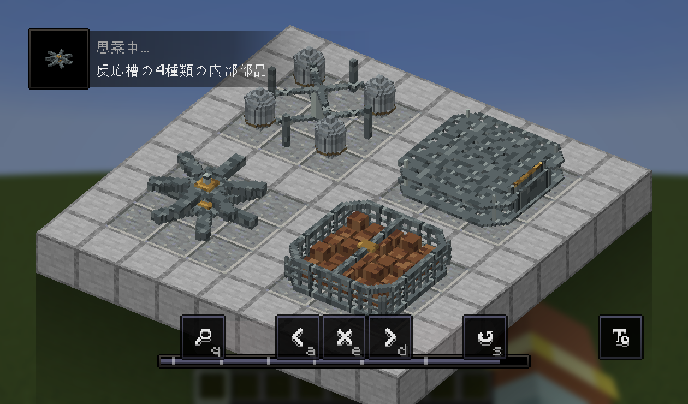
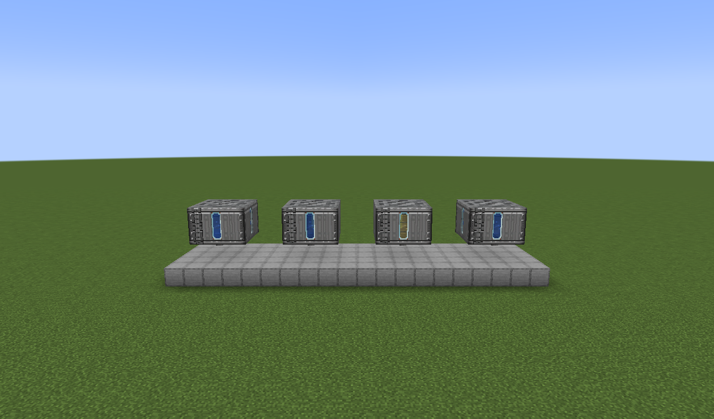

# 小型RBMK用5%燃料・ふた付き槽の液面と内部部品 完了報告

作業日: 2026-11-09。開始コミット: `98b83496`。実装コミット: `12b7b67d9c50fd662266ca016f4f6444723c363d`。
Minecraft 1.21.1 / NeoForge 21.1.219 / Create 6.0.10 / Java 21。`AGENTS.md`、`DESIGN.md`および[先行試験](compact-rbmk-minimum-size-test.md)を読んだうえで実装した。

## 実装

### 小型炉用燃料

- `compact_enriched_fuel_rod`（小型炉用高濃縮燃料棒・5%）を追加した。短い銀色の棒と黄銅色の識別帯2本を持つ16×16アイコンで、通常棒と区別する。日英中の名称、5%系列の粉・ペレット、モデルとレシピ、クリエイティブタブ、JEIにつながる既存工程を追加した。
- `ReactorFuel`に燃料種類ごとのゲーム内反応度価値を持たせた。通常・MOXは従来の `FUEL_WORTH = 0.12`、新燃料は `0.165`。共通定数、漏れ、制御棒の価値、定格校正は変更していない。
- 各棒の追加寄与は `(種類の価値 − 0.12) × 残存燃料率`。有効な新燃料の実本数を集計し、従来の軸方向・半径方向の重みと同じ正規化で炉心へ加算する。混載時に通常棒・MOX棒の価値を変えない。出力分配と燃料エネルギーは既存と共通である。
- 3段炉のエネルギーは通常・新燃料とも1本12 GJ。4本を混載して12 GJ消費すると、各棒に9 GJずつ、計36 GJ残る。NBT往復後もその残量を保ち、計48 GJ消費した時点で全4本が既存の使用済み燃料棒になることを試験した。使用済み燃料のプール・再処理経路は共通。
- 高さ制限はチャネルのアイテムハンドラーとキャップの既存装荷処理で判定する。7段炉へ新燃料を挿入しても、シミュレーション・実行とも未消費で返す。拒否時に制御区画の種別を変えない。装荷中の高さ変更を拒否する既存制約も保った。
- プールとクレーンの把持中にも燃料種類を保存する。従来の `Mox` / `CarriedMox` を読み込み、通常・MOXの種類を引き継ぐ。クレーンは候補燃料を受け付けるキャップだけを選び、互換性のない燃料を倉庫・プールから取り上げない。プールの同期は種類を設定してから在庫更新を送る。

製造は既存の4%六フッ化ウランから分岐する。ガス遠心分離機で1,000 mBを5%側789 mBと既存の劣化側211 mBに分け、5%フッ化ウラニル → 5%二酸化ウラン → プレスした未焼結ペレット → 水素・超加熱条件で焼結したペレットと進める。ペレット7個と既存のジルカロイ被覆管2個で短い棒1本を組む。体積はゲームの整数mBへ丸めたレシピ値で、新しい装置やGUIは追加していない。全固定工程・全撹拌反応の実行試験に新レシピも含めた。

5%という題材は[AM-1の初期燃料の記録（ロスアトムの原子力史資料）](https://www.biblioatom.ru/core-systems/nuclear-reactors/obninsk/)を参考にした。ゲーム内価値0.165は下記の炉心モデルで校正した値であり、実在炉の反応度計算値ではない。

小型炉Ponder `rbmk_compact_core`に、識別帯、3段専用の装荷条件、既存製造工程への分岐を日英中で追加した。新しい棒・中間素材からも同じ教材へ入れる。Ponderの共有テキストではASCIIの `%` が書式として解釈されるため、日本語・中国語は全角 `％`、英語は `percent` と表記する。

### ふた付き槽

液面を `2/16 + clamp(液体合計 / 表示容量, 0, 1) × (槽の高さ − 4/16)` とし、内容量に応じて槽全高の内側を上下させる。満水では天板下面へ達する。少量でも一律1 px厚にする下限も取り除いた。

工程バッファの満杯8,000 mBを大きな外槽容量で割っていたため、反応設備では満杯でも浅く見えていた。表示容量は、液体の入った各工程バッファ8,000 mBの和と、必要な貯蔵槽容量で求める。普通の貯蔵槽・撹拌槽では貯蔵容量を含み、その他の内部部品では残留する貯蔵液がある場合に含む。空の工程バッファ・気体は液面の分母に加えない。読込直後も、形成フラグではなく保存済みの内部部品から表示容量を決める。在庫容量、物資移動、圧力計算は描画変更の対象にしていない。

3×3・高さ2の既定設定では、貯蔵槽が144,000 mB、撹拌槽に水を入れた表示の全量が152,000 mB（工程8,000 + 貯蔵144,000）。半量の実配管搬入と満量の搬入で50%・100%の高さを確認した。触媒槽と遠心分離機は水、反応生成物分離塔は受け入れ可能な冷却済み水素化処理生成物を使って確認した。受け付ける原料の条件は各設備の既存条件に従う。

装着モデルは3×3槽の内径44 pxに合わせた。素材は既存の鋼色・黄銅・触媒のテクスチャを再利用し、16 px/ブロックの密度を保つ。

| 内部部品 | 装着時の寸法・構成 |
| --- | --- |
| 触媒籠 | 外形42 px、格子と触媒充填部 |
| 撹拌翼 | 回転外径40 px以内。従来の2段×6枚を保って拡大 |
| 分離棚 | 外形44 px、孔と交互の下降流路 |
| 遠心管 | 4本の中心間隔28 px、外枠40 px。支持枠に回転管の逃げを確保 |

撹拌翼と遠心管は実入力回転に追従する。インベントリ表示倍率を調整し、Ponderの原寸展示も同じ装着用モデルで表示する。




## 60,000 tick運転試験

先行試験の条件を使用した。全燃料装荷、制御棒全挿入で開始し、実際の給水細管束と128 RPMのクリエイティブモーターで駆動する。給水は270 ℃。循環流量は `165,888 × 燃料本数 / 397 × 燃料部高さ / 7` mB/t（整数に四捨五入）を毎tick出口から抜く。10 tickごとに、出力98%未満かつ反応度0.001未満なら目標挿入率を1%下げ、反応度0.002超または出力102%超なら1%上げる。`setAutomaticTarget`を使用し、59,400 tickでAZ-5、60,000 tickで終了した。

`@ExplicitGameTest` の専用タスクに分離し、通常のGameTestには長時間試験を登録しない。Minecraft標準のtick sprintで待ち時間を短縮したが、各ワールドtick、燃耗、給排水、物理刻み0.05 sはそのまま。各炉でゲーム内50分相当を進めた。

指定の1%刻みの操作は通常燃料の比較炉にも周期的な出力変動を起こす。そのため、単一時点を「定格保持」の根拠にせず、50,000～59,399 tickの全9,400 tickから平均・最小・最大を記録した。自動判定は定格平均の±10%と瞬間最低70%以上を継続運転の判定帯とし、新燃料にはキセノン0.95以上・挿入率0.15以上を追加している。**出力が瞬間ごとに98～102%へ収まったという結果ではない。** 数値の幅も以下に示す。

| 炉・燃料 | 燃料/制御本数 | 循環 mB/t | 定格 MW | 終盤平均 MW | 終盤最小～最大 MW | 最小Xe | 最小挿入率 | 最高燃料温度 K |
| --- | ---: | ---: | ---: | ---: | ---: | ---: | ---: | ---: |
| 円形5・3段・5% | 44/8 | 7,880 | 36.337 | 37.671 | 31.809～42.830 | 0.9654 | 0.1999 | 1616.5 |
| 角形5×5・3段・5% | 89/11 | 15,938 | 73.499 | 77.909 | 59.752～90.916 | 0.9696 | 0.3203 | 1786.8 |
| 円形7・3段・5% | 99/13 | 17,729 | 81.758 | 85.456 | 62.949～113.359 | 0.9902 | 0.3997 | 1708.1 |
| 円形13・3段・通常 | 397/51 | 71,095 | 327.857 | 332.256 | 299.777～363.412 | 0.9628 | 0.1999 | 1799.2 |
| 円形5・7段・通常 | 44/8 | 18,386 | 84.786 | 88.177 | 70.886～103.096 | 0.9624 | 0.2400 | 1631.3 |
| 円形13・7段・通常 | 397/51 | 165,888 | 765.000 | 802.156 | 743.829～1002.967 | 0.9731 | 0.4900 | 1804.2 |

| 炉・燃料 | AZ-5直前 MW | 120 tick後反応度 | 600 tick後反応度 | 600 tick後 MW | 最終挿入率 |
| --- | ---: | ---: | ---: | ---: | ---: |
| 円形5・3段・5% | 36.299 | -0.12104 | -0.12706 | 0.185 | 1.0000 |
| 角形5×5・3段・5% | 72.187 | -0.08115 | -0.08715 | 0.570 | 1.0000 |
| 円形7・3段・5% | 83.336 | -0.06281 | -0.06881 | 0.839 | 1.0000 |
| 円形13・3段・通常 | 320.122 | -0.08415 | -0.08983 | 2.435 | 1.0000 |
| 円形5・7段・通常 | 101.683 | -0.11964 | -0.12574 | 0.445 | 1.0000 |
| 円形13・7段・通常 | 775.819 | -0.04230 | -0.04809 | 11.844 | 1.0000 |

AZ-5の新燃料の判定は、全挿入・最終反応度−0.05以下・出力がAZ-5前の5%未満。通常燃料の比較炉は既存の値を保持していることを確認し、反応度−0.04以下とした。7段・直径13の通常炉は−0.05の目安よりわずかに浅い停止反応度となるので、実測値を表に残す。新燃料はこの通常炉へ装荷していない。

## 既存自動制御による冷態起動（測定のみ）

`ReactorAutomaticControl.nextTarget`は変更していない。同じ給水・循環条件で10 tickごとに既存則を呼び、各構成を最大10,000 tick、または炉心構造を失うまで観察した。以下の4試験は診断データの収集であり、試験メソッドの成功を安全運転の意味には使わない。

| 構成 | 燃料 | 尖頭出力 MW | 最高燃料温度 K | 観察結果 |
| --- | --- | ---: | ---: | --- |
| 円形5・3段 | 通常 | 11,979.8 | 1924.1 | 10,000 tick観察、停止状態 |
| 円形5・3段 | 5% | 62,948.7 | 2634.5 | 669 tickで構造喪失 |
| 角形5×5・3段 | 通常 | 28,087.8 | 2281.0 | 10,000 tick観察、停止状態 |
| 角形5×5・3段 | 5% | 86,616.9 | 2693.1 | 590 tickで構造喪失 |

5%燃料では行き過ぎが悪化した。既存自動制御則による安全な冷態起動は成立していない。連続運転試験の出力フィードバック操作とは区別する。

## 検証と再実行

- 関連GameTest: 46件 + 51件 = **97件すべて合格**。混載、燃耗・使用済み化、保存・高さ変更、キャップ・ハンドラー・実クレーンの装荷、プール、通常RBMKの回帰、製造工程、槽の気液・加熱・清掃などを含む。
- 専用長時間GameTest: **運転6構成と起動診断4構成**。判定結果・ビルド結果は下記実行記録を参照。
- GPU: `mc-debug glxinfo -B` でNVIDIA GeForce RTX 4060のハードウェア描画を確認。
- 実クライアント: 日本語・英語はPonder全131シーンのタイトル・共有テキスト検査に合格。槽4種類の50%・100%・排出後の同期、実シャフト回転と窓の描画も日本語クライアントで確認した。MCPでも実際のPonder画面を目視した。
- 中国語は今回更新した `rbmk_compact_core` のタイトル・共有テキスト・実描画に合格。全Ponder検査は既存の `plant_rubber_mixing.header` の中国語欠落で停止したため、対象を明示して検査した。既存の不足は変更していない。
- 新規5アイテムの16×16画像、モデル範囲、日英中の翻訳、アセット再生成の一致、`git diff --check`を確認。

| 実行 | 終了コード | 所要時間（秒） |
| --- | ---: | ---: |
| fuel-short-final | 0 | 32.87 |
| vessel-process-final | 0 | 28.60 |
| long-final | 0 | 260.85 |
| build-final | 0 | 14.90 |

再実行（Java 21）:

```sh
# 燃料・RBMK・クレーン・プールの46件
bash gradlew --no-daemon -I tools/compact_fuel_checks.gradle runGameTestServer

# 反応工程・槽・燃料製造などの51件
bash gradlew --no-daemon -I tools/compact_fuel_checks.gradle \
  -Dcreateplant.testClasses=ReactorGameTests,VesselBasinGameTests,VesselClimateGameTests,VesselFoulingGameTests,FusionFuelGameTests \
  runGameTestServer

# 6構成の60,000 tick運転と4構成の起動診断
bash gradlew --no-daemon runCompactFuelGameTestServer

bash gradlew --no-daemon build
```

今回、既存の `run/world` でワールド保存のディスク書込待ち（`RegionFile.write`、`pwrite0`、`submit_bio_wait`）を2回観測した。試験用のgameDirectoryをtmpfsの `/tmp/createplant-compact-fuel-tests` に切り替え、その後の最終試験は完走した。短時間試験の補助スクリプトは必要なら `-Dcreateplant.testDir=/tmp/任意の試験用ディレクトリ` を指定できる。通常の開発ワールドは削除していない。

専用運転試験のJSONは、既定で実行ディレクトリ内の `compact-fuel-results/` へ保存する。`createplant.compactFuelReportDir` をサーバーのsystemPropertyで指定すれば変更できる。この報告と同じ[10ケースの生データ](compact-enriched-fuel/)には1,000 tickごとのサンプル、終盤の全tick集計、流量、燃料価値、ワールドseed・開始tick・コントローラー座標を保存した。

## 未確認・範囲外と次回の注意

- 物理制御卓・自動制御盤を含むプレイヤー設備による冷態起動、タービン・復水器まで含めた閉循環運転は検証していない。給水と排水は試験側、動力はクリエイティブモーターである。
- 新燃料を直径9以上の3段炉へ全装荷した運転、混載での60,000 tick運転、60,000 tickを超える全燃焼までの寿命試験、チャンクを実際にアンロードした状態からのクレーン搬送再開、マルチプレイは未確認。NBT往復による燃料残量・種類の保存と実クレーン搬送はそれぞれ確認済み。
- 燃耗と反応度計算は既存の燃料負荷キャッシュ規則を共用する。今回、通常燃料の再計算規則やエネルギー校正は変更していない。
- 先行報告のRBMKと無関係な3失敗（精錬設備のタグ、既存の翻訳キー不足、TFMGのBasinレシピ）は対象外として未変更。全GameTestの再実行はしていないので、97件の合格を全体合格とは報告しない。
- 次に運転の安全性を改善する場合は、今回未変更の冷態起動制御則を優先する。新燃料をその既存則で安全に起動できるとは案内しない。

## 主な変更箇所

- `nuclear/ReactorFuel.java`、`ReactorCore.java`: 種類別価値と本数・燃耗の加重。
- `FuelChannelBlockEntity`、`RodCapBlockEntity`、`FuelPoolBlockEntity`、`CraneDriveBlockEntity`: 受入れ制約・種類・保存・搬送。
- `CEUranium`、`CENuclear`、`ProcessRecipe`、新規データレシピ: 既存の濃縮・製造への分岐。
- `LiddedVesselBlockEntity`、`LiddedVesselRenderer`、`generate_lidded_vessel.py`: 液面容量と3×3内部モデル。
- `CompactFuelGameTests`、`CompactFuelLongGameTests`、既存の関連GameTest、`VesselContentsClientCheck`: 機能・長時間・GPU検証。
- `generate_compact_fuel.py`、`generate_compact_rbmk_ponder.py`、Ponder・日英中アセット、[RBMK説明](../rbmk-reactor.md)、[反応プラント説明](../reaction-plant.md)。
