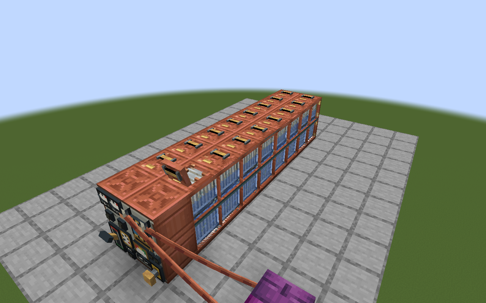
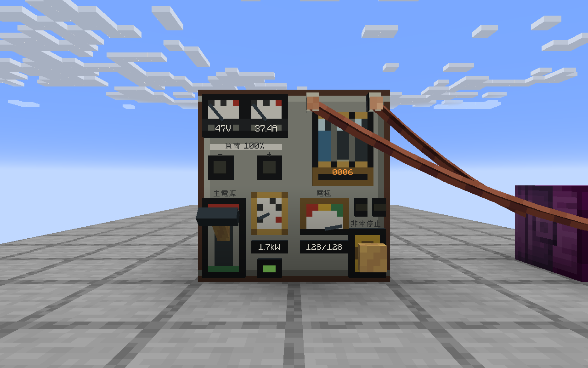

# フィルタープレス型電解槽 実装完了レポート

- 日付：2026-11-11 UTC
- 実装コミット：`3c7c80ea9003c0961fcae88d626db0c803dddcbb`
- 作業開始時点：`c4c05c156479452636649b06c616cf8a1f50a387`。開始前と完了前にoriginを確認。
- 環境：Minecraft 1.21.1、NeoForge 21.1.219、Create 6.0.10、Create: Electro Energetics 1.1.4、Java 21。

## 完了した内容

`electrolysis_cell` と `electrolysis_cell_controller` を追加。縦2×2、水平1～8マスのセル本体と、端面に取り付ける外向き2×2制御盤が1施設になる。最大32セル＋制御盤4個。4方向に対応し、欠損・9マス以上・余計な制御盤を拒否する。

内部の接続面を消し、2ピクセル厚の中空壁、連続する締付フレーム、窓、点検ハッチ、装填枚数に対応する積層電極を実装。窓は実在庫に比例する水位と稼働時の気泡を描く。鋼材の明暗・粒状感、青緑のフレーム、銅の母線、陶器の端子を16×16のピクセル画像で作成した。ハッチはアニメーションで開閉する。

上面の開いたハッチから極板・隔膜を手動装填し、Createのファンネルでも投入できる。上段1セルにつき極板8枚、最大128枚。下段から給液、上段の2列から別々のガス、下段側面から苛性ソーダを搬出する。実際のCreateポンプ・ファンネルの接続を試験した。

制御盤は実物ボタンで運転・停止、25～100%負荷、計器試験・解除、読取り、緊急停止を操作する。計器・ボタン・ランプが状態に応じて変化し、V/A/kW、生成量、装填数を表示する。計器面をクリックしても下のボタンは反応しない。構築用ブロックを持っている間は通常の配置へ渡す。専用GUIは追加していない。

CEEの回路へ実抵抗を登録し、2端子間の実測電圧から仕事を受け取る。電線抵抗による電圧降下も反映する。FEや固定の無条件給電はない。ゴーグルを4行以内へまとめ、Display Linkにも同じ所有者から各計測値を公開した。

水・重水・塩水・フッ化水素の既存比率、通常極板50 J／ニッケル35 J、隔膜の増産と摩耗を維持。満杯や開放ハッチでは反応前に止める。流体と極板を各セルで保存し、採掘したブロックにも保存して再設置で戻す。電気仕事と負荷設定を保存する。

旧電解槽の蓋、鉢連結、旧専用処理・描画・レシピ・アセットを撤去。Createの鉢を本来の独立した挙動へ戻した。新しい専用Ponderと、水素・塩素アルカリ・重水素の製造系列Ponder、JEI、日英中の翻訳と関連文書を更新した。出荷するPonderの全パレットとアセットJSONに旧蓋の参照が残らないことを確認した。

## 計算と保存

- 400 V・100%設定では、通常極板1枚160 Ω・1 kW、ニッケル1枚約228.57 Ω・700 W。
- 受取仕事は `V²/R/20 J/t`。有限の40 kJバッファから実際の処理分を支払う。
- 1枚でも25%負荷なら400 V・250 Wとなり、平均4 tickに1回処理する。
- 水3 → 水素2＋酸素1、重水3 → 重水素2＋酸素1、塩水2 → 水素1＋塩素1＋苛性ソーダ2、HF2 → 水素1＋フッ素1。量はmB。
- 隔膜では苛性ソーダを4分の1増量。塩水10000 mBごとにアスベスト1個を消費し、端数と摩耗をアイテムへ保存する。
- 物資は各セルの4×1000 mBとアイテムハンドラーが所有し、形成・分割で移し替えない。シミュレーションでは消費しない。
- 構造探索を32セルへ制限。同一tickの整合性と極板集計を再利用し、再形成は20 tick単位、同期は10 tick単位で変更をまとめる。比較ベンチマークは未実施。

## 確認結果

関連GameTest **46件すべて合格**、別実行の硝酸プラント結合試験 **1件合格**。`build` も成功した。再現用のinit script・JSON・画像は[確認資料](../quality/filter-press-electrolysis/README.md)に保存した。

| 条件 | 結果 |
| --- | --- |
| 水・通常極板1枚・400 V・100 tick | 水300消費、水素200、酸素100、仕事5000 J |
| 水・通常極板1枚・200 V・100 tick | 水75消費、水素50、酸素25、仕事1250 J |
| 実物ボタンで25%設定・1枚・400 V・100 tick | 同じく水75、水素50、酸素25、1250 J |
| 塩水10000・隔膜あり | 水素5000、塩素5000、苛性ソーダ12500、隔膜1個消費 |
| 2×2×8・4方向・全装填 | 各32セル、128枚、400 Vの1回で128サイクル・水素256 mB |
| 採掘→通常のアイテム再配置 | 水321 mBとニッケル極板3枚を保存し、配置アイテムを1回だけ消費 |
| 実Createポンプ | 有限の水4000 mBについて、搬入先＋元タンクの合計4000を保持 |
| 実Create上向きファンネル | 開いたハッチへニッケル4枚を投入。閉鎖後は同じ取得済みポートからも挿入・抽出できない |
| 開いたハッチ・製品満杯・緊急停止・赤石 | 給液と仕事を消費せず停止 |

### 実クライアント

NVIDIA RTX 4060のハードウェア描画を確認。日本語・英語・中国語で、新機械と3製造系列、合計4種類のPonderの題名・字幕と描画を確認した。日本語・英語では実ワールドでも2×2×8、極板128枚を装填し、CEEのクリエイティブ電池と通常の銅線で運転した。

48 V電源に対して、槽の端子で **46.699749 V、1744.693244 W** を実測。観測時点の在庫は水 **25661 mB**、水素 **226 mB**、酸素 **113 mB**。初期給水26000 mBからの消費と、3:2:1の比率が一致する。ハッチを開けると電力・処理が0になり、閉じると再開した。

### 硝酸プラントの結合試験

新セルで40枚の極板を使い、18750回のサーバー側stepで、水 **2250000 mB**、仕事 **37.5 MJ** から水素 **1500000 mB**、酸素 **750000 mB** を生成。その水素・酸素を既存の空気分離、ハーバー・ボッシュ、オストワルト、吸収の工程へ渡し、硝酸 **200 mB** まで製造した。詳細は `nitric-plant.json`。手動stepを使った有限資源の結合試験であり、実時間の長期運転試験とは区別する。

## 主要な実装箇所

- 構造・操作：`ElectrolysisStructure`、`ElectrolysisCellBlock`、`ElectrolysisControllerBlock`。
- 物資と仕事：`ElectrolysisCellBlockEntity`、`ElectrolysisControllerBlockEntity`、`ElectrolysisProcess`。
- CEE：`compat/electro/ElectrolysisCellDevice`、`ElectroDevices`。
- 描画：`ElectrolysisCellRenderer`、`ElectrolysisControllerRenderer`。
- Ponder：`ElectrolysisCellPonderScenes`、`ManufacturingPonderScenes`と3製造系列のNBT。
- 生成元：`tools/generate_electrolysis_cell.py`、`generate_electrolysis_ponder.py`、`generate_manufacturing_ponder.py`。

## 制約・未確認事項

- 旧鉢式の保存内容を自動変換する処理はない。更新前に原料・製品・極板を回収し、新セルで組み直す。旧登録の互換用エイリアスも残していない。
- 電力・容量・反応量はゲーム用の既存校正。実機の電極電圧や熱収支を再現した値ではない。CEEの線の発熱・許容電流は変更しておらず、最大装填・高電圧では適切な配線が必要。
- 全MODの全GameTest、複数時間の実時間運転、マルチプレイヤー、大規模工場の比較性能測定は行っていない。
- 別の広い試験選択で `CraftingRecipeGameTests.dioriteCasingUsesCreateHandApplicationAndBothCasingsFitTheMachines` が、変更していない `item_application/diorite_casing` の取得で `No value present` となった。電解と無関係なため修正していない。関連47件の合格と、この全体試験の状態を混同しない。
- 実物資料は[設計・利用手順](../filter-press-electrolysis.md#実物の参考資料)に記載。旭化成、ZSW、thyssenkrupp nuceraの写真を目視して構造を参考にし、元写真をゲームのテクスチャへ転用していない。
