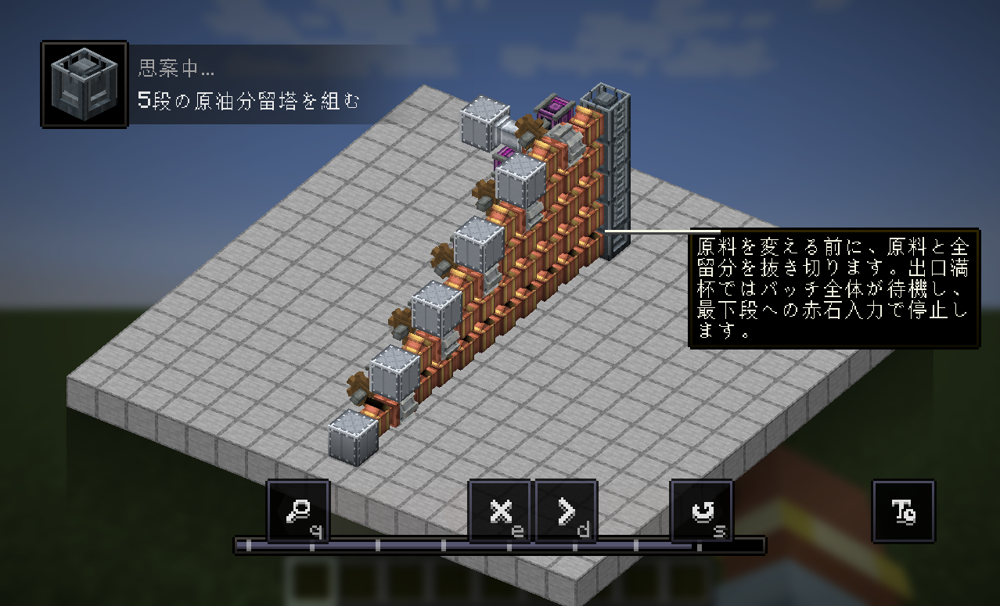
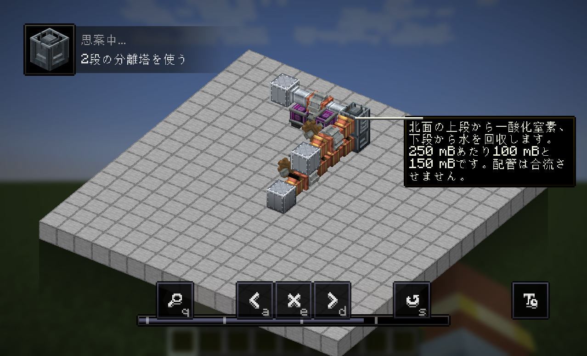
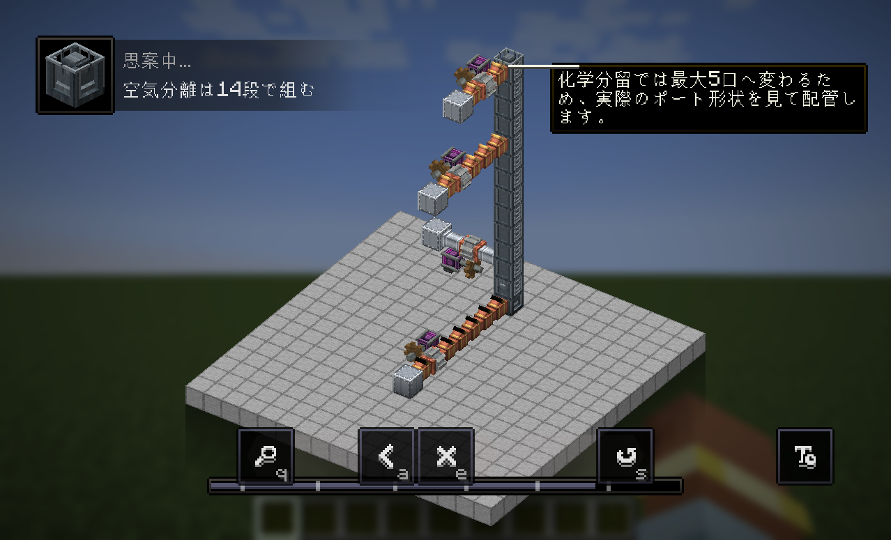

# 分留塔の短縮と全マルチブロックPonderの見直し

作業日：2026-11-11。基点：`666f772902659775f0a862f82061143d61d1776e`。

実装コミット：`6ba0362575f3e367119e53ab50d7620042c3c7fb`。

## 分留塔

空気分離だけを14段必須として維持し、化学分離は工程の生成物数に応じて最低2～5段で成立させた。断面は従来の1×1・2×2・3×3で、最低高さから14段まで選べる。

| 工程 | 最低高さ | 1断面の処理時間 |
| --- | --- | --- |
| 一酸化窒素混合物の分離 | 2段 | 60 tick |
| オレフィンの分離 | 2段 | 60 tick |
| 合成混合物の分離 | 3段 | 60 tick |
| 水素化脱硫反応液の分離 | 3段 | 60 tick |
| 水素化分解反応液の分離 | 4段 | 80 tick |
| 原油分留 | 5段 | 100 tick |
| 空気分離 | 14段 | 100 tick |

最低高さは `max(2, 生成物の種類数)`。原料は東面3段目、高さ2段の塔では東面2段目から入れる。軽い生成物から上の北面出口へ割り当てる。14段塔では従来の14・10・7・4・1段を維持する。中間高さの出口は `max(種類数−出口番号, 基準段×(高さ−1)/13 の切捨て)+1` 段目。基準段は13・9・6・3・0、出口番号は1から。

並列数は幅²、各バッファ容量は `幅²×高さ×1,000 mB`。短縮によって滞留容量は小さくなるが、バッチの原料量・生成量・温度条件・時間は変えない。工程切替には全在庫を空にする。搬入のシミュレーションは工程を選択せず、実搬入で選択する。構造や工程の変更時には既存のポート無効化を使う。さらにCreateの`FluidPropagator.propagateChangedPipe`へ通知し、既設の配管を再探索させる。短縮塔で原料を初めて選んだあと、出口が配管網へ認識されず搬出できない問題を実動作試験で検出し、修正した。

5段・1×1の原油1バッチは1,000 mBで、上からガソリン200、ナフサ200、軽油300、潤滑油100、重油200 mB。原油の予熱条件620 K以上も維持した。この最低高さはゲーム内の生成物分岐に合わせた設定で、実設備の理論段数を計算したものではない。

主な変更は`DistillationProfile`、`FractionatingColumnBlockEntity`、JEIの説明、`docs/distillation-plant.md`、DESIGN.md。

## Ponderの共通変更

登録済み136シーンを対象に、共通の説明表示を作り直した。23個のシーンクラスとカタログ方式の教材が同じ表示処理を使う。

- 長文を文・節で短いページへ分け、各ページにCreate標準のキーフレームを付けた。日本語は670説明項目・928ページ、英語は同670項目・985ページ。
- 説明ページ自身が読む時間を持つ。旧来の重複待機を除き、操作の実演に必要な待機は残した。
- 直方体の構造を下から積み上げて表示する。復水器・PID・燃料サイクル・核融合炉保守では設備ごとの表示順へ変更し、一括出現を避けた。
- ボイラー・吸収棚段付き槽・電解炉・出荷設備は本体や供給経路を説明順に表示する。
- 組立途中に完成時の状態が先に見えないよう、既存の形成前状態の適用順を修正した。

ページは`build.gradle`の`processResources`で生成する。正本は通常の翻訳JSONで、生成キーをソースへ大量に複製しない。整形引数の番号を保持し、説明中のパーセント表記による書式エラーも防ぐ。

## 施設ごとの教材範囲

| 現役設備 | 対象シーンと案内 |
| --- | --- |
| 分留塔 | 5段原油・2段二成分・14段空気の3教材。原料条件、独立した出口、空にして切替、ゴーグル |
| ヘリウム液化器 | 新しい専用組立教材。3×3×3鋼材外殻、中央再生器、正面軸、上面ガス・下面液体、左右冷却水 |
| ふた付き槽 | 3×3槽、2×2貯蔵、内部部品、鉢の加工、圧力・冷却・清掃 |
| 撹拌・触媒固定床・遠心・吸収 | 各専用教材。底面駆動または圧力供給、原料、生成物、冷却、安全弁 |
| 電解セル | 2×2セルの連結、制御盤、電極、標準搬送、電力と運転操作 |
| アルミ電解炉 | 外殻・陽極・母線・電力・装荷・溶融条件・金属搬出 |
| 往復式圧縮機・アンモニア分離器 | シリンダーと軸、吸排気、設定、冷却と気液の出口 |
| 工業用加熱器・ラジエーター・熱交換器 | 最小構成、拡張、反応プラントへの接続、媒体と回転・熱の条件 |
| RBMK標準炉・小型炉 | 炉心、冷却、燃料、制御棒、物理制御盤、AZ-5。小型専用燃料の教材も維持 |
| 核融合炉 | トカマク、制御盤、電動発電機、遠隔保守の各教材 |
| 蒸気タービン | 高圧・低圧、組立・蒸気口・回転出力・復水の教材 |
| 復水器・自然通風冷却塔 | 管束と外殻、温水・冷水・補給水、気候・蒸発、状態表示 |
| PID計装 | 送信器とDisplay Link、ラック、設定、弁、制御ループ |
| 核燃料再処理 | 抽出塔、各留出口、MOX加工、ガラス固化炉と廃棄物容器 |
| 開放槽 | 基本教材と直径4～32の拡張例、計30シーン |
| 横置きタンク・管束ボイラー | 接続方向、断面1×1・2×2・3×3、水・加熱・過熱蒸気 |
| 伸縮ガスホルダー | 多層胴と貯蔵量、1×1～7×7、ガスの混入とパージ |
| 燃料プール・門型クレーン | 構造・供給・駆動、燃料交換、採掘フレーム、核融合炉保守 |
| 転炉 | フレーム、傾動容器、接着、酸素・排ガス、鋼の回収 |
| その他の接続設備 | フレア、流量・圧力計、材質別タンク・配管、出荷設備、フライホイールなど |
| 製造系列 | 29教材。実レシピの入力・出力を維持し、化学分留の短縮条件も案内 |

ヘリウム液化器は既存の製造ライン用構造を再利用した。最初の1,000 mBは循環用、最低32 RPM、4.2 Kへの予冷と有限冷却水という実装どおりの条件を説明する。新しい装置やGUIは追加していない。

既存の製造系列に登場する14段塔は有効な拡張例として残し、最低2・3・5段でもよいと説明を更新した。専用の短縮塔とは別テンプレートを使い、再生成で座標や配管が混ざらないようにした。

構造アセットの検査で、存在しないUF₆バケツ、不正なプレスのaxis、圧力計などのwaterlogged、流体バルブのaxis指定を検出し、NBTと生成元の双方を修正した。

## 検証

再実行手順は`docs/quality/multiblock-lessons/README.md`。結果データは同ディレクトリへ保存した。

| 確認 | 結果 |
| --- | --- |
| 最終GameTest | **23件すべて合格** |
| Gradle build | **成功**。既存の化学・相変化・原子炉物理・制御のチェックも通過 |
| 最低高さ | 6工程×1×1・2×2・3×3の18構成で正常分離 |
| 高さと出口 | 全工程の最低高さ～14段で重複せず、最低高さ未満の原料を拒否 |
| 既存設備 | 14段塔の全工程、空気の圧力・温度条件、在庫と切替、既存ポートを維持 |
| 保存 | 5段原油塔で処理途中の実コントローラー交換・再読込、重複処理なし |
| 実配管 | 専用PonderのNBTをワールドへ置き、6台の実Createポンプを64 RPMで駆動。原油1,000 mBを5タンクへ200/200/300/100/200 mBで回収し、元タンク・塔の残量ゼロ |
| 構造アセット | カタログ98件＋専用38件の登録ブロックと状態、説明用アイテムを検査 |
| 日本語クライアント | 全136シーンの翻訳・見出しと初回描画を検査。最終調整後も全136件をコンパイル・翻訳検査し、変更した11教材を再描画 |
| 英語クライアント | 全136シーンの翻訳・見出し・描画を検査 |
| GPU | NVIDIA GeForce RTX 4060、OpenGL 4.6、direct rendering Yes |

サーバー・クライアントの完了ログ抜粋は`verification.txt`、ビルドログは`build.txt`、クライアントの機械可読結果は`client-ja-all.json`・`client-en-all.json`・`client-ja-final.json`。`pagination.json`はページ数と翻訳の検査結果。説明の書式引数が分割で壊れていないことも検査した。

## 実画面

## 制約・未確認事項

- Ponderは組立・操作の教材で、全設備の実ワールド長時間運転試験ではない。全シーンの全フレームを人間が見たとは扱わない。
- 日本語・英語の説明は全項目を検査した。既存中国語には未翻訳の共通文343項目が残り、説明ページは英語へフォールバックする。中国語クライアントの全シーン描画は未確認。
- 描画検査を完了したあと、プライベートX11画面の終了時にX Errorが発生し、GradleのrunClient終了値は1になった。翻訳・全シーン描画の完了記録と終了エラーは区別する。音声出力は環境で確認できていない。
- 機械の材質・テクスチャや既存の原子炉校正、自動制御則などは今回の変更対象に含めない。

次に教材を追加するときは、共通の短文表示と段階組立を使い、`PlantTutorialGameTests`の専用構造一覧も更新する。古い生成スクリプトを実行した場合は、最後に`generate_multiblock_lessons.py`を実行して組立順の追加データを復元する。
