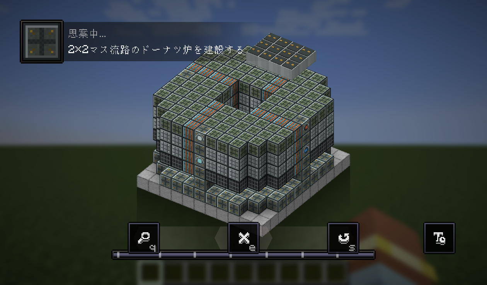

# 全テクスチャを描き直し依頼前へ復元

2026-11-08。ユーザーの「テクスチャ全部元の状態に戻して、変えてって依頼する前まで」という指定に従い、全テクスチャをDESIGN対応の描き直し前へ戻しました。

実装コミット: `bf2ee635a7fed0fd4ea7f4a84a54a4beec9a2b38`

## 復元先と内容

復元先は`cce6b43c30e5db11b672077ab3837ba9d8a2aa86`です。DESIGN対応の最初の核融合炉外装改修`52d64fe5`の直前で、2×2流路の11×11×8核融合炉と、それ以前に制作した高密度のタービン羽根を含みます。全設備改修直前の`6c10f6fc`は既に核融合炉だけが描き直された後なので、今回は使いません。

- 核融合炉・制御卓・保守ハッチを含む全558 PNGを原本へ復元。
- 削除されていた元の画像22枚を復旧し、後から追加した共通材質・接続アトラス・専用スキン28枚を削除。
- 全1272モデルの元の素材参照を復元。変更された243モデルは素材参照だけの差分で、全モデルの形状・UVは作業開始時の`263350ee`と一致。
- 後付けの`FusionCasingModels`・`PlantSurfaceModels`とクライアント登録4行を撤去。改修前からあるパイプやタンクの接続描画は維持。
- 元の描画生成スクリプトへ復元し、後付けの一括描き直し・集約・専用保護ヘルパー7本を撤去。

原画像・素材参照の復元であり、後続の試運転ワールド、起動補助、機械の構造・大きさ・動作・数値は巻き戻していません。サーバー側Java、レシピ、BlockState、翻訳、Ponder等は作業開始時と一致します。主要な確認元は、復元した`textures/`・`models/`、`ElectrolysisClient.java`、元の`tools/minecraft_style.py`と各描画生成スクリプトです。

## 確認結果

- 画像558枚、モデル1272個が復元先とファイル集合・バイト単位で完全一致。
- 全モデルの形状・UVが作業開始時と一致。実行時コードの変更は後付けの外観CT2クラスと登録4行だけ。
- 描画生成元33本が原本とバイト一致。`validate_visual_identity.py`は、元画像で外観を共有していた既知4組を`shared_parts`へ明示した差分だけを許可し、それ以外のASTが原本と一致することを独立監査。
- 完成アイテム285個、バケツの本体・内容物、共通金属、耐火材の検査に合格。
- Java 21の単独`build`が成功（14秒）。既存の化学プロセス・炉制御・炉物理チェックも成功。
- 配布JARの全2766資源（Gradleが展開するtoml・packを除く）が生成元と一致。削除した28 PNGとCT2クラスの混入なし。

元画像の共有4組は、復水器冷却入口/出口、冷却塔の基底/塔壁、冷却塔の3種の流体口、空/固化済み廃棄物容器です。元の外観を保持するため、検査に合わせて画像を描き替えることはしていません。

- NVIDIA RTX 4060のハードウェア描画で、核融合炉、核融合制御盤、小型コンプレッサー、反応槽、クレーン、パルス抽出塔、電解炉、往復コンプレッサーの8対象を1260×740で撮影。日本語の見出し112件の検査も合格。

[原画像・モデル・生成元・配布JARの独立監査](../quality/full-texture-restore-audit.json)と[実クライアントの結果](../quality/full-texture-restore-client.json)を保存しています。

## 原本と次回の注意

旧タンク等には、改修前から供給済みPNGと旧生成スクリプトの出力が一致しない箇所があります。今回はGitに保存された原画像を正本とし、全生成スクリプトの一括実行は行っていません。原画像の扱いは[外観の保持](../quality/block-surfaces.md)を参照してください。

今回のユーザー指定をDESIGN.mdへ明記し、既存画像を新しい外装方針で自動的に描き替えないよう整理しました。以前の改修の報告・参照資料・画像は履歴として残っています。

8枚の撮影と`CLIENT QUALITY PASSED: 112 scenes, ja_jp`の記録後、クライアント終了時に既知のNVIDIA `libEGL_nvidia.so.0+0xb56ae`内のSIGSEGVが再発しました。Minecraftの終了コードは134です。撮影・表示検査の完了とクライアントの正常終了は分けて扱います。今回このドライバ異常は修正していません。

今回の確認は外観の復元に対応したものです。機械の長時間運転を再試験したという意味ではありません。

配布ファイル: `create-heavy-indusstry-original-textures-bf2ee635.jar`（4,724,723 bytes）。SHA-256: `d64d953ff318f079546d4a63a9323f1e183b01bc043afbd137b16bc21be0c27a`。
