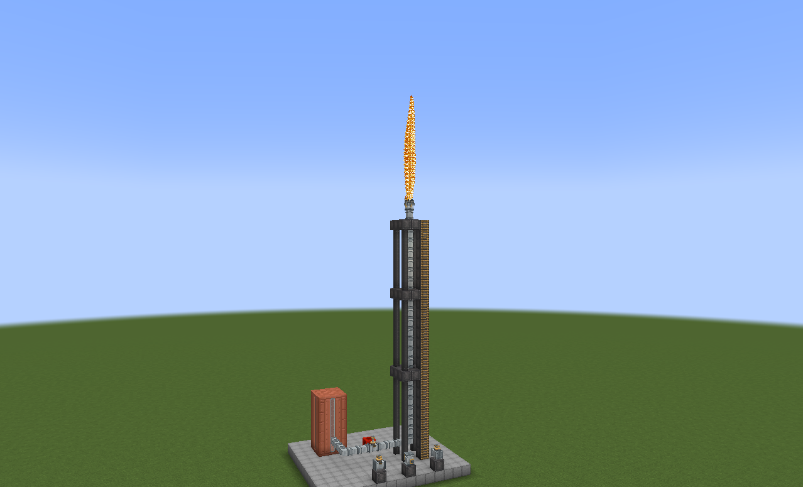
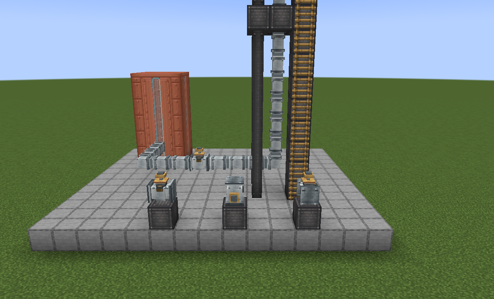
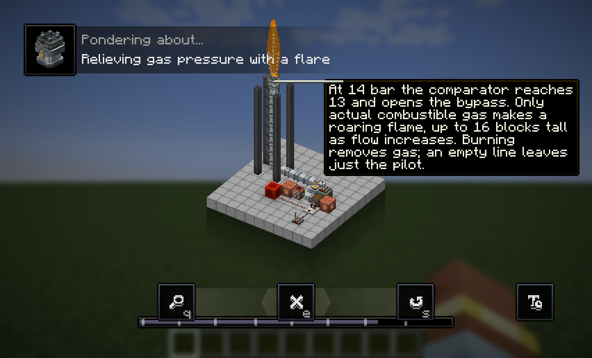

# ガス過圧・フレアスタック実装 完了レポート

作業日：2026-11-10。基準コミット：`212aec0f0287192c64a64fa0d5dd975c6b3d59cc`。実装コミット：`af1e039d794d452271e5319eb4ebaaac87126dab`。ブランチ：`main`。

## 実装内容

- 既存の配管圧力計をアナログ化。比較器へ0〜15を出し、従来の二値警報も維持。隣接するタンク・ガス配管の静圧を、流れがなくても読む。
- 信号式逃がし弁を追加。電源で弁棒が動き、Createポンプと受動ガス配管の両方を開閉する。
- 種火付きフレア先端部を追加。既存の支柱・金属ブロック・配管で煙突を組み、下から実際の気体を供給する。未形成・上方閉塞・水没時は受入れを拒否し、保有在庫を残す。
- 可燃性ガスの実消費に応じ、最大16マスの炎・煙・轟音を出す。窒素などは燃えず、ガスが尽きると種火だけになる。燃焼量・排出量を保存する。
- 16 barのガス配管に過圧ひずみ・破裂を適用。破裂時は在庫を一度だけ放出。通常の流体配管も、破裂したとき上流の実在庫から有限量を引き抜き、流れの表示だけからガスを作らない。
- 可燃性の漏出雲に松明・点火中のブレイズバーナー等による引火と爆発を追加。毒性の雲は別に保持し、燃焼で毒性を無条件に消さない。
- 日英中の翻訳、サバイバルレシピ、Display Link項目、組立Ponderを追加。既存の全体テクスチャは変更せず、火口・アクチュエーターだけ16×16で新規作成。

## 計算と操作

詳細な組立・設定・資料出典は [ガス過圧とフレアスタック](../flare-stack.md)。

| 項目 | 実装値 |
| --- | --- |
| 比較器 | `floor(15 × 圧力 / 設定しきい値)`、0〜15に制限 |
| 安全回路の例 | 全目盛16 bar、比較器側面の基準13。14 barで開き、低下すると閉じる |
| ガス配管 | 100 mBの実容積、16 bar定格、2倍以上で即時破裂。耐圧超過の継続でも破裂 |
| フレア受け部 | 実容積4,000 mB、圧縮上限1,024,000 mB、300 bar定格 |
| 排出 | 5 tickごとに保有量の半分を切上げ、最大80,000 mB。最大16,000 mB/t |
| 炎高 | `min(16, 1 + 15 × sqrt(流量 / 8000))` |
| 稼働条件 | 直下の接続済み縦配管3本以上、開けた上空、燃焼には手動点火した種火 |
| 種火の消火 | 素手の右クリック、雨、水没 |
| 可燃性の雲 | 半径4マスまで。希釈・近接した同種ガスの合流・保存。爆発強度1〜12 |
| 音 | 独自作成した6秒のループ。フレアのみ96マス、既存機械は32マス。共通上限24ループ |

標準Createポンプのガス昇圧上限は既存の2 barを維持する。高圧はコンプレッサー・高圧貯蔵・加熱によって生じる。貯蔵量の表示上限まで詰めることと、安全圧力で運転することは別。

気体在庫・累計・種火は保存する。炎は再読込後の実燃焼から再開し、古いハンドラーで撤去済みの先端部へ搬入できない。GasNetworksのふた付き槽用の実容積は、表示用の液面容量ではなく物理容量を参照するよう修正した。

## 自動試験

**関連回帰83件、最終のフレア14件、負荷試験1件が全成功。** 回帰83件にはフレアの13件が含まれるため、通常の関連試験は重複を除くと84件。最後に可燃性物質の追加に影響する毒性・搬送25件も再確認して成功した。

| 確認 | 結果・数値 |
| --- | --- |
| 比較器 | 16 bar全目盛で0 / 8 / 14 / 16 bar → 0 / 7 / 13 / 15。既存警報は17 barで作動 |
| 実際の比較器と無線リンク | 3個の基準ダスト、ネイティブの送受信リンクで、12 bar閉 → 14 bar開 → 12 bar閉 |
| ガス弁の物資保存 | 閉止時は相手タンクへ流れず、開放すると流通。タンクと配管の合計48,000 mBを維持 |
| Createの機械式ポンプ | 閉弁時の搬送0、開弁時は水を搬送。両タンクの合計6,000 mBを維持 |
| 燃焼・再読込 | 80,000 mBの有限水素。最初の40,000 mB消費で炎高16。その状態から再読込し、最終燃焼量80,000 mB、在庫0、種火のみ |
| 未点火と不燃ガス | 未点火の水素10,000 mBは可燃性の雲になる。窒素10,000 mBは燃焼せず、可燃性の雲にもならない |
| 化学プラントの既存物質 | 圧縮合成ガス10,000 mBを実際に燃焼処理 |
| 閉塞・水没 | 上空を塞いでも10,000 mBの在庫が消えず、撤去後に処理再開。水没で種火を消し搬入を拒否 |
| 点火操作 | ファイヤーチャージを1個消費。点火済みへの再操作で二重消費しない |
| ガス配管の破裂 | 100 mB容積へ水素4,000 mBを保持させ、32 bar超で破裂。放出は実在庫以下で一度。松明でガス雲を消費し爆発 |
| 通常配管の漏出 | ネイティブのポンプ流路をたどって実際の上流在庫を減らす。空の在庫から追加のガスは出ない |
| 生産レシピ | 2種とも実クラフト入力から期待するブロックを生成。素材タグとレシピ衝突を検証 |
| 既存設備 | GasPipe / Pressure / PressureStageTwo / PressureAndFreezing / ToxicGas / TransportQuality / GasCompression / VesselGauge / VesselNitrogen / DisplayIntegration |

GameTestが置く透明な天井バリアは光を通すが排気を妨げるため、フレア試験では自分の排気列だけ開ける。再読込試験は撤去によるガス放出と区別し、ブロックを壊さずBlockEntityを入れ替える。

`bash gradlew build` も成功。既存のFluidPhase 25チェック、HaberBoschProcess 1,019チェック、ReactorPhysics 1,670チェック、Reactor controlの検証を含む。

## 実クライアント

`mc-debug glxinfo -B` でNVIDIA GeForce RTX 4060のハードウェア描画を確認。

- 有限量 **6,000,000 mB** の水素を3×3×6のCreateタンクへ入れ、信号弁と実配管で24マスの煙突へ供給。表示用の架空ガスや架空の炎は使っていない。
- 炎高8マス以上、累計消費の同期、SoundManagerのループ開始を確認。最終確認の閉弁時の累計は **1,035,898 mB**。閉弁後に管内・先端の残留ガスを消費し、種火のみ・無音・閉弁になることを確認した。
- 弁の3方向、火口、長い炎、停止した種火を実画面で確認。支柱では支持できないはしごの配置も修正した。
- 日本語・英語・中国語で変更した2シーン（フレア、配管計器）の実行時タイトル・翻訳・描画を確認。別途、既存のPonder言語検証105件も成功。
- 音は `ALSOFT_DRIVERS=null` でSoundManagerの開始・停止を検証。実スピーカーでの聴感は未確認。







## 負荷比較

同一の試験コードを基準コミットと実装後の独立したworktreeで実行。JDK 21、`-XX:ActiveProcessorCount=2`、単独GameTestサーバーで、128本の気体配管と64個の気体雲を配置した。200 tickのウォームアップ後、約2,000 tickのループ間隔を計測。クライアント等の重い処理とは同時実行していない。

| 指標 | 変更前 | 変更後 |
| --- | --- | --- |
| サンプル数 | 2000 | 1999 |
| 平均 | 0.324734 ms | 0.507860 ms |
| p95 | 0.528290 ms | 0.726431 ms |
| 最大 | 2.736888 ms | 59.559345 ms |

平均増加は約0.183 ms。変更後には59.56 msの外れ値もあった。高速実行するGameTestサーバーのループ間隔であり、本番ワールドのMSPT・TPS保証や、クライアントのフレーム時間の測定ではない。基準側も同数・同NBTの雲を配置し、追加した着火監視だけがない状態と比較した。

探索は既存ガス網256本、破裂時の在庫探索256箇所、雲は半径4・高さ4層、10 tick間隔。読み込まれていないチャンクをロードしない。炎は最大40段×4面で描画し、煙は5 tickごとに2個。大規模な稼働プラント全体のネットワーク送信量や長時間のフレーム時間は未測定。

## 主なファイル

- `block/entity/FlareTipBlockEntity.java`：有限在庫・排出・保存・種火・形成条件。
- `block/RedstoneReliefValveBlock.java` と対応BE：信号、接続通知、弁の動き。
- `block/entity/PipeGaugeBlockEntity.java`：静圧とアナログ出力。
- `safety/FlammableGas.java`、`safety/ToxicGas.java`：引火する有限雲と毒性。
- `transport/PipeGasLeak.java`、`PipeWearBehaviour.java`、`thermal/PressureVesselBehaviour.java`：実在庫からの漏出と破裂。
- `transport/GasNetworks.java`、`mixin/PassiveFluidNetworkMixin.java`：バイパスの開閉、停止時の圧力観測。
- `client/FlareTipRenderer.java`、`RedstoneReliefValveRenderer.java`、`MachineSounds.java`：表示と音。
- `ponder/FlarePonderScenes.java`、`gametest/FlareGameTests.java`、`GasSafetyLoadGameTests.java`：組立説明と検証。
- `tools/generate_flare_assets.py`、`generate_flare_ponder.py`：新規部品だけのアセット生成。

## 再実行

JDK 21を使用。通常のGameTestにも短い14件は登録される。関連クラスだけを実行する場合は一時initスクリプトを使う。

```groovy
// /tmp/flare-tests.gradle
allprojects {
    afterEvaluate {
        extensions.getByName('neoForge').runs.named('gameTestServer') {
            gameDirectory.set(new File('/tmp/createplant-flare-check'))
            systemProperty 'createplant.gameTestClasses', System.getProperty('testClasses', 'FlareGameTests')
        }
    }
}
```

```sh
bash gradlew --no-daemon -I /tmp/flare-tests.gradle runGameTestServer
bash gradlew --no-daemon -I /tmp/flare-tests.gradle -DtestClasses=GasSafetyLoadGameTests runGameTestServer
bash gradlew --no-daemon build
```

負荷試験は `@ExplicitGameTest` のため、クラスを明示したときだけ実行する。既定の出力先は試験のゲームディレクトリの `gas-safety-load.json`。GPU確認は `-Dcreateplant.clientQualityCheck=true` 等をclient runへ渡す既存ハーネスを使う。`FlareClientCheck` がワールドの確認、`ClientQualityCheck` の対象は `flare_tip@flare_stack` と `redstone_relief_valve@flare_stack`。

## 未確認・制約・次回の注意

- 実際の混合気の可燃限界、風による移流、酸素消費、反応生成物、放射熱、放射性水素の除染は計算しない。種火は点火で維持するゲーム上の状態。
- 他MODの可燃性流体は自動判定しない。登録済みの当MODの気体だけが今回の対象。
- マルチプレイ、チャンク境界をまたぐ長期運転、256本を超える配管、専用サーバーに実クライアントが接続する場合の音・同期は未確認。NBTと統合サーバーの同期試験で代替した範囲を混同しない。
- フレアは有毒ガスの無害化装置ではない。排出量が生産量に追いつかない・種火が消える・煙突が詰まる場合は保護できない。
- ガス配管へ新しく16 bar定格が適用されるため、以前の高圧配管には耐圧の見直しが必要。300 barラインは従来の超耐圧配管と定格の合う弁を使う。
- 既知の対象外3件（精錬設備タグ、既存の翻訳キー不足、TFMGのBasinレシピ）は変更していない。全GameTestの成功は主張していない。

ビルド成果物：`create-heavy-indusstry-0.1.0.jar`、5,916,146 bytes。SHA-256：`98533c2ff00f4bacb86616a0b827a43d8906edb9e12cb188a3cf2983fbc92d80`。
