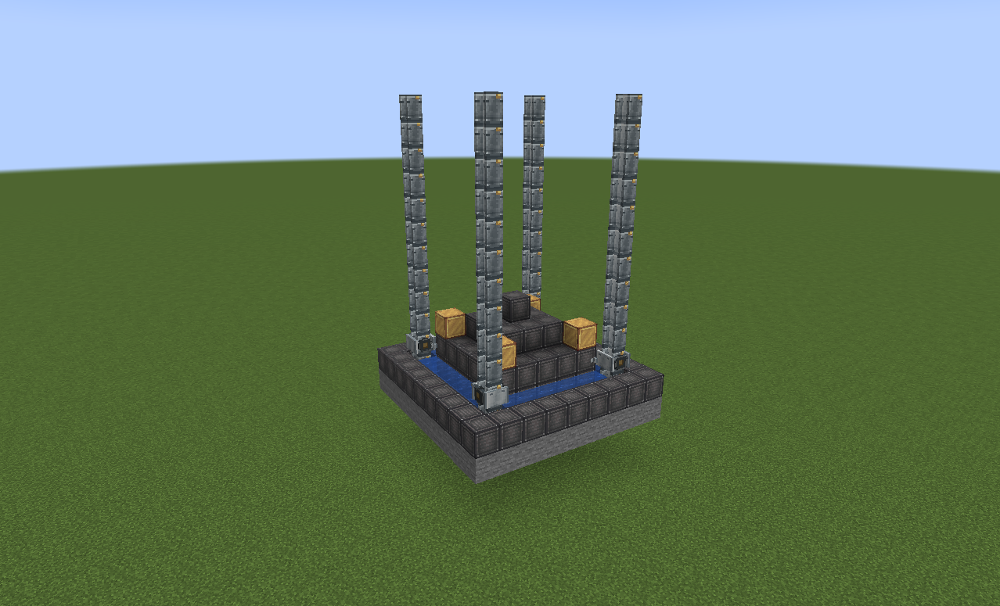
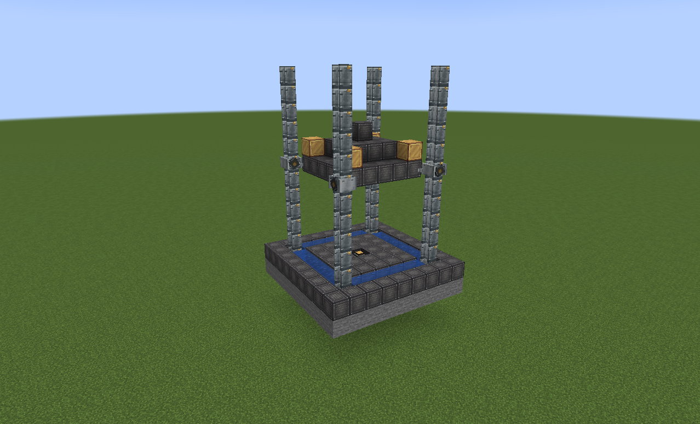
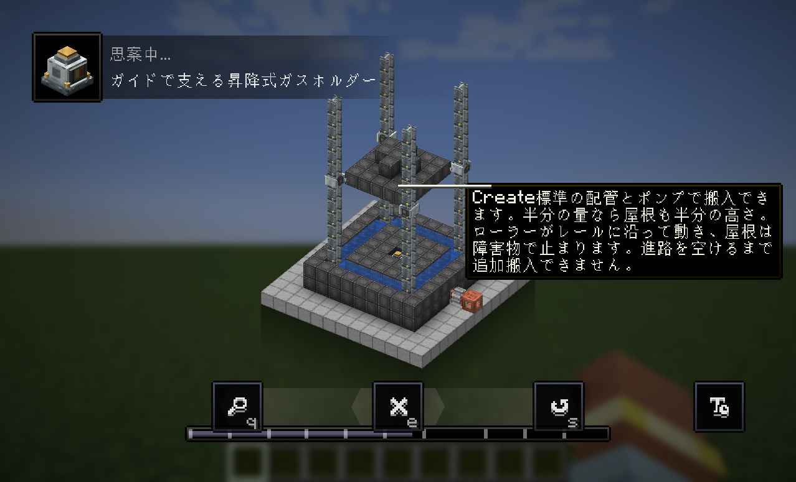

# ガイド付き昇降式ガスホルダー：完了レポート

> このレポートの外付けレール方式は、後続のユーザー指定で[白い3段伸縮式](../gas-bell.md)へ置換済み。以下は旧版の検証記録です。

実施日：2026-11-10。実装コミット：`a9580e44a3a855fda80312055ce9f82d2f5cbac6`。

Minecraft 1.21.1 / NeoForge 21.1.219 / Create 6.0.10 / Java 21。変更前は `15def7bd5634b8d553cd10c48a3fba67746e02c8`。組立条件・計算式・操作は[設計と使用方法](../gas-bell.md)を正本とする。

## 実装した内容

- `gas_holder_anchor` と `gas_holder_guide_rail` を追加。基点直上にユーザーが接着した屋根をCreate本体の実コントラプションとして組み立て、ガス量で上下させる。専用モーター、RPM、GUIは不要。
- 幅3〜15の奇数マスの正方形、上昇量2〜24マス。四隅の連続ガイドと水源の水封を要求する。ガイドを失うと屋根を通常ブロックへ戻し、在庫を漏出させる。障害物では解体せず停止し、除去で再開する。
- 基点の下面・側面に標準流体ハンドラーを公開。Createの通常パイプ・ポンプと既存のガス配管で入出力できる。設置順による接続不良を避けるため、形成時に能力と隣接接続を更新する。
- 別ガスが入ると元の残量も含めて汚染混合ガス化。混合後の量・質量・モル数・顕熱、可燃性・毒性をFluidStackの保存可能な成分として引き継ぐ。希釈しても危険フラグは消えない。
- 可燃性ガスと酸素・空気の実搬入時に即時反応。ネイティブの屋根解体、水封除去、`Level.explode` を行う。シミュレーションでは一切変更しない。既存の爆発無効設定にも従う。
- 0 mBまでの搬出、またはShift＋レンチによる実ガス放出でパージする。Shift操作は基点の回収にしない。空での通常レンチ操作は解体。
- フレアは点火中なら汚染混合ガスも処理する。不活性混合物から大きな炎や燃料エネルギーを作らない。従来の `Burnt` 保存値は保持し、表示名を実態に合う「フレア処理量」に変更。
- 日英中の名称・状態・Ponder、サバイバルレシピ、戦利品、モデルを追加。ゴーグル4行、標準Display Linkへ量・温度・圧力・高さ・昇降範囲・状態を公開。新規パネルとローラーは16×16、鋼材・枠・真鍮は既存の共有素材。既存設備の外装は変更していない。

指定例の `mhic:*` は実在するリポジトリの登録IDではないため、既存の `create_heavy_indusstry:hydrogen_gas` / `oxygen_gas` と、新規の `create_heavy_indusstry:contaminated_gas` を使う。既存の球形ガスホルダーは別の現役設備として維持する。

## 主要ファイル

| ファイル | 役割 |
| --- | --- |
| `block/entity/GasHolderAnchorBlockEntity.java` | 在庫、形成、衝突、昇降、反応、レンチ、保存・同期 |
| `contraptions/GasBellContraption.java` | Create本体による接着屋根の探索・移動構造 |
| `block/GasBellStructure.java` / `event/GasBellEvents.java` | 容量、ガイド、水封、変更監視と解放 |
| `chemistry/WasteGas.java` / `registry/CEGasBell.java` | 混合物性・危険フラグの永続成分、流体・部品登録 |
| `transport/GasNetworks.java` / `thermal/PressureVesselBehaviour.java` | 可変容積の低圧受け側と異種ガス搬入への接続 |
| `client/GasHolderAnchorRenderer.java` | 屋根に追従するガイドカラーとローラー |
| `ponder/GasBellPonderScenes.java` | 組立・運転・異常・パージの動く説明 |
| `gametest/GasBellGameTests.java` / `GasBellLoadGameTests.java` | 20件の機能試験、明示指定の16基負荷試験 |

Javaパスは `src/main/java/net/createplant/` からの相対パス。アセット生成元は `tools/generate_gas_bell_assets.py` と `tools/generate_gas_bell_ponder.py`。

## 機能試験の数値結果

| 条件 | 結果 |
| --- | --- |
| 3×3・8 m、実屋根9ブロック | 容量576,000 mB。288,000 mBで4 m、全搬出で0 m |
| 最大15×15・24 m、実屋根225ブロック | 容量43,200,000 mB。21,600,000 mBで12 m |
| 水素10,000＋窒素4,000 mB | 汚染混合ガス14,000 mB。質量誤差 `< 1e-12 kg`、顕熱誤差 `< 1e-7 J` の検証に合格 |
| 1 mBの残留水素＋窒素1,000 mB | 全量1,001 mBが汚染。完全排出後の窒素1,000 mBは清浄 |
| 水素10,000＋酸素1,000 mB | SIMULATEでは水素10,000 mB・屋根を保持。EXECUTEで即時反応し、屋根解体・水封喪失 |
| 水素10,000＋窒素5,000 mBを保存・読込後、酸素投入 | 希釈後も反応。在庫を二重に作らない |
| Create本体の機械式ポンプから異種ガス搬入 | 供給元＋ホルダーの合計26,000 mBを保存し、ホルダー内を汚染 |
| パッシブガス配管から異種ガス搬入 | 供給元＋配管＋ホルダーの合計50,000 mBを保存し、ホルダー内を汚染 |
| 可燃性の汚染混合ガスをフレア処理 | 15,000 mBを全処理 |
| 窒素＋アルゴンの不活性汚染混合ガスをフレア処理 | 3,000 mBを全処理。大きな炎なし |
| 支持レール欠損 | 屋根9ブロックが1回だけワールドへ戻り、ガスを放出 |
| 障害物での停止・除去 | 288,000 mBを失わず保持。停止中の追加搬入を拒否、除去後に4 mへ復帰 |
| 基点と屋根をともにNBT保存・再生成 | 元のUUID、9ブロック、288,000 mB、4 mへ復帰。基点だけの再読込も屋根1体を維持 |
| 形成前に設置したCreateポンプ・配管 | 形成後に配管の置き直しなしで搬送。元在庫16,000 mBを保存 |
| アンモニアを含む混合物 | FluidStackのNBT後も毒性を保持し、有毒雲を生成 |
| クラフト | 実レシピの検索・組立で基点1個、ガイド4個を確認 |

関連13クラスの回帰試験は **111/111合格**。その後の監視キャッシュ、混合物性の配管参照、建築上限、表示調整を含む最終版では、関係する7クラスを再実行し **71/71合格**。新規20件は両方に含まれ、件数を合算しない。全GameTestの一括成功を意味しない。

最終 `build` は成功。併せてFluidPhase 25項目、HaberBoschProcess 1,019項目、ReactorPhysics 1,670項目、Reactor controlの既存検証が成功した。既存の他MOD由来のロード警告は残るが、この作業のGameTest失敗はない。

## 実クライアント

`mc-debug glxinfo -B` でNVIDIA RTX 4060の直接描画を確認し、`mc-debug ... runClient` で実ゲームのネイティブ屋根を撮影した。5×5・10 m・容量2,000,000 mBを使った統合ワールドの検証結果：

1. 水素1,000,000 mB → 屋根5 m。サーバー値だけでなく、クライアントに存在する実エンティティの高さも照合。
2. 窒素100,000 mBを追加 → 汚染混合ガス1,100,000 mB、5.5 m。
3. パージ → 0 mB、0 m。
4. 窒素を再装荷して5 mまで上げ、支持レールを撤去 → 解体と漏出がクライアントへ同期。

この統合ワールドでは流体ハンドラーを直接操作し、実ポンプとの接続は別の専用サーバーGameTestで検証した。初回のクライアント試行は空状態の屋根エンティティ到着を待ちきれず失敗したため、検証側に最大300 client tickの初期待機と診断を追加した。その後の実ワールド試験に合格した。全種類のネットワーク遅延を検証したものではない。

Ponderは日・英・中とも実クライアントで表示確認に合格。ガイドの先端が画面外に出た構図は修正し、日本語で再撮影した。翻訳検証は106シーンの日英ヘッダー・共有文と、中国語22シーンを通過。今回追加した状態・Ponderの30キーは3言語で揃っている。モデル4点のUV・範囲、新規画像2点の16×16も検証した。







## 負荷測定

専用の明示指定GameTestを単独実行した。数値は高速実行するGameTestサーバーのtick間隔であり、本番ワールドのMSPT・TPS保証ではない。生データは [data/gas-bell](data/gas-bell/) に保存。

| 条件 | サンプル | 平均 ms | p95 ms | 最大 ms |
| --- | ---: | ---: | ---: | ---: |
| 変更前：ガス配管128・有限の可燃雲64、200 tick予熱 | 2,000 | 0.488222 | 0.724898 | 2.596405 |
| 変更後：同条件 | 2,000 | 0.485799 | 0.807233 | 11.363625 |
| 新ホルダー16基、9ブロック屋根、静止 | 400 | 0.316857 | 0.414477 | 2.314180 |
| 同16基、40 tickごとの装荷・搬出で反復昇降 | 800 | 0.289948 | 0.431709 | 2.651762 |

変更前後の平均はほぼ同じだが、p95と最大値は増えた。単回測定から性能改善は主張しない。静止と昇降の平均の逆転も、JITや測定ばらつきを含むため高速化の根拠にしない。16基の試験では供給プールとホルダーの合計 **4,608,000 mB** を保存し、全屋根が接続を維持した。

高頻度処理はガイド・水封の最大164点監視、変更時と20 tick間隔の確認、段を跨ぐ際の支持確認に限定。監視解除には逆引きを使い、全ホルダーの監視点を走査しない。毎tickの屋根再探索・全NBT送信は行わない。

## 再実行

Java 21を用意したリポジトリのルートで次を実行する。専用の `run-gas-bell-verification` を使用し、通常のクライアントセーブを対象にしない。

```sh
bash gradlew --no-daemon -I docs/reports/data/gas-bell/verification.init.gradle runGameTestServer build
bash gradlew --no-daemon -I docs/reports/data/gas-bell/verification.init.gradle -DgasBellTestClasses=GasBellLoadGameTests runGameTestServer
python3 tools/validate_ponder_language.py
```

負荷試験のJSONは `build/gas-bell-load.json`。`GasBellLoadGameTests` は `@ExplicitGameTest` で通常の全件実行には登録しない。通常20件は既存のGameTestにも登録される。

## 未確認・制限・次回の注意

- 正方形のピストン屋根、水源の存在条件、固定の低圧1.02 barへ縮約している。実在の円筒多段ベル、スカート、水頭、重量、摩擦、圧力過渡、凝縮、反応速度の物理モデルではない。
- 危険な組合せは既知の可燃性ガスと酸素・空気。外部MODの全ガスを網羅しない。混合物は平均物性と危険フラグを保存し、元成分を回収する機構は作らない。
- BEと実屋根のNBT復元は試験したが、実セーブを終了して別プロセスで再起動する試験、チャンク境界の反復ロード・アンロード、遠隔マルチプレイ、多人数・高遅延は未確認。
- 統合画面の全Display Link項目切替、窓口ごとのゴーグル実描画の網羅確認はしていない。公開する数値は設計文書と上記ソースを参照。
- 爆発試験は専用サーバーで実行し、実クライアントで爆発の全演出を撮影したものではない。爆発設定を無効にした場合にも構造喪失と反応消費が残る。
- 存在しない屋根UUIDを100 tick後に無限待機させない仕様のため、極端に遅いエンティティ読込では漏出停止となる。今後この猶予を変える際は、二重の屋根を生成しない制約を維持する。
- 在庫は基点だけが所有し、屋根には複製しない。Create更新時は `IControlContraption`、エンティティの保存とクライアント位置補間、衝突・通常解体を再確認する。

生成JAR：`create-heavy-indusstry-0.1.0.jar`。SHA-256：`9a9e24d4008030cb7fa1d45835d70c8c88ddfb3ca4da45b2ca7cee48d07c49c3`。
