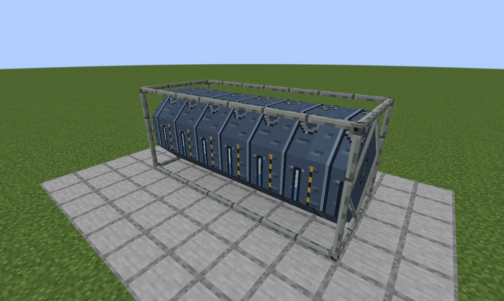
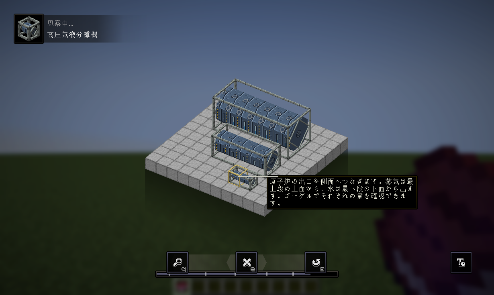

# 高圧気液分離機とRBMKの湿り蒸気

2026-11-25のユーザー指定：「RBMK型炉からは液体交じりの蒸気が出てくるようにしてください。専用の高圧に耐えられる気液分離機を必要とするようにしてください。ガスタンクがありますが現在の実装上ではタンクで代替できて必要ないのでこのガスタンクのテクスチャを改造して気液分離機っぽくしてこれを高圧用の気液分離機としてください」

## ゲーム内画像

断面3×3、長さ7ブロックで組み上げた高圧気液分離機。

3サイズを並べた日本語Ponder。

## 実装内容

- RBMKの出口（`ReactorCore.outlet()`）は、全チャネルの冷却材を1本の気液二相の流れで出す。
  - 水は高圧（圧力段階12）の沸点の液体で、乾き度（気体の割合）は各チャネルの蒸気の質量割合を、取り出した量で重み付けして平均し、1/8に丸めた値（`TwoPhase.mark`）。
  - 以前の4つの出口（加圧水・高圧蒸気・温水・水）は廃止した。タンクは1つ。
  - 乾き度が0（沸騰前）なら温度に応じた液体の水、1以上なら高圧蒸気を、二相の印なしで出す。
  - 取り出しは、チャネルの比エネルギーを変えずに量だけ減らす（`FuelChannelBlockEntity.takeWet`）。
- 新ブロック`high_pressure_separator`（高圧気液分離機）。ガスタンクコンテナの枠・モデル・ブロックステートをそのまま使い、同じ大きさ（1×1×2、2×2×5、3×3×7）でだけ完成する。
  - 側面：二相の流れの入口。液体は最下段の下面、気体は最上段の上面から出す。二相でない流れも、相に応じて入る。
  - 分け方は`TwoPhase.divide`。通常の気液分離機（`AmmoniaSeparatorBlockEntity`）の分け方を共通化して移した。
  - 定格は高圧（20〜200 bar、`TankGrade.SEPARATOR`）。
- 通常の気液分離機は、20 barを超える二相の流れを受け付けない（`ratedFor`）。RBMKの流れは高圧なので、高圧気液分離機だけが受けられる。レシピで処理する経路は変えていない。
- テクスチャ：ガスタンクの鋼の胴を青灰色の圧力容器に塗り直し、胴の側面に液面のぞき窓と黄黒の帯、上面にノズルのフランジ、両端にボルト留めのマンホールを描いた（`tools/generate_high_pressure_separator.py`）。
- レシピ：鋼鉄インゴット4・鉄板2・ガスタンクコンテナ2・圧力タンク1で1個。施設の実績「スチームドラム」、Ponder「高圧気液分離機」、クリエイティブタブ、翻訳（3言語）を追加した。RBMKとほかの分離機のPonder文も更新した。

## 主要ファイル

- `block/HighPressureSeparatorBlock.java`、`block/entity/HighPressureSeparatorBlockEntity.java`、`block/entity/GasTankContainerBlockEntity.java`（型を差し替えられる引数を追加）
- `thermal/TwoPhase.java`、`block/entity/AmmoniaSeparatorBlockEntity.java`、`thermal/TankGrade.java`
- `nuclear/ReactorCore.java`、`block/entity/FuelChannelBlockEntity.java`
- `tools/generate_high_pressure_separator.py`（`nbtlib`が必要）

## 確認

- javac：クラスパスの揃わない環境で、変更前との差分を比較。新規のエラーは、変更前から出ていた種類（`getCapability`・`BlockEntitySupplier`）だけ。
- `tools/validate_translations.py`は通過。
- GameTestサーバーを実機で全件実行（765件、最終実行は全件通過）。新規の高圧気液分離機・RBMK湿り蒸気・通常分離機の拒否テストは通過。追加・更新したGameTest：`HighPressureSeparatorGameTests`、`TwoPhaseGameTests`、`RbmkGameTests`、`CompactFuelLongGameTests`。
- この実行で、先行コミットの回帰を修正：削除した `preheat_water` レシピに依存していた撹拌容器系テスト5件（`ReactorGameTests`×2、`ReactionTemperatureGameTests`、`DriveLessVesselGameTests`×2）を、プロピレン＋合成ガス供給（ブチルアルデヒドのレシピ）に移行。
- `leaching_oxidants` タグが `compressed_air` を `air_gas` に置き換えたため、加圧していない空気が浸出レシピの供給として丸ごと入り、`stirredGasProductLeavesBelowTheLighterGas` が失敗していた。タグを廃止し、浸出6レシピは `air_gas`（圧力レベル8以上）または `oxygen_gas` の複合材料にした。
- 全件実行で `ReactionTowerGameTests.solidFeedFillsTheLowestTrayFirstAndKeepsCatalystsOut` が1回だけ失敗したが、単独実行では全11件通過し、全件の再実行では765件すべて通過（不安定なテストの可能性）。
- 実装コミット `7df64c6` のMinecraftクライアントで、3×3×7の組み上がった外観と、3サイズを並べた日本語Ponderを撮影した。

## 制約・次回の注意

- 蒸気タービンは二相の流れを受け付けないため、RBMKの出口からタービンへ直結する既存のワールドは、間に高圧気液分離機が必要になる。
- 分離機の内容物は、壊すと失われる（ガスタンクコンテナと同じ）。
- 高圧気液分離機は、完成していない並びでは配管を受け付けない。
