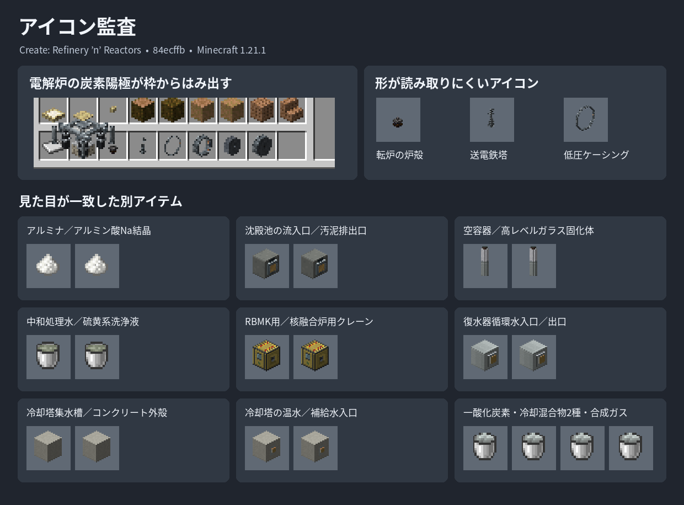

# Create: Refinery ’n’ Reactors アイコン監査

2026-11-26、`chemicreate-sub` の `84ecffb` を確認。Minecraft 1.21.1、NeoForge 21.1.219、Create 6.0.10、標準リソース、NVIDIA RTX 4060で検証した。

## 表示が崩れる・形が読み取りにくいもの

| アイテム | 登録ID | 確認した症状 |
| --- | --- | --- |
| **電解炉の炭素陽極** | `electrolysis_furnace_anode` | 通常の持ち物欄とホットバーで、横のスロットと上段にかぶる。1ブロックより大きい設置用モデルを参照し、GUI専用の縮尺を持たない。 |
| 転炉の炉殻 | `converter_shell` | 16px相当のアイテム描画で本体が約5×6pxになり、黒い点に近い。GUIモデルの縮尺は0.30。 |
| 送電鉄塔 | `transmission_tower` | 16px相当のアイテム描画で幅約3～4pxの細い線に見え、標準の持ち物欄で鉄塔の形を読み取りにくい。 |
| 低圧タービンケーシング | `low_pressure_turbine_casing` | 外縁のみが細い点線状に見える。同じ持ち物欄の高圧ケーシングでは枠の厚みが読める。 |

参照元は[炭素陽極のモデル](../../src/main/resources/assets/create_refinery_n_reactors/models/block/furnace/anode.json)、[転炉のアイテムモデル](../../src/main/resources/assets/create_refinery_n_reactors/models/block/converter/item.json)、[送電鉄塔のアイテムモデル](../../src/main/resources/assets/create_refinery_n_reactors/models/item/transmission_tower.json)、[タービン部品の描画](../../src/main/java/net/createplant/client/TurbineSectionItemRenderer.java)。

## アイコンの表示ピクセルが一致するもの

デフォルト状態で、別の登録IDを持つ9組・20種類が同じ絵になっていた。沈殿池、冷却水系、容器の組は、アイテム名を表示するまで入口・出口や空・充填済みを見分けられない。

| アイテム | 登録ID |
| --- | --- |
| アルミナ／アルミン酸ナトリウム結晶 | `alumina`、`sodium_aluminate_crystals` |
| 沈殿池の底面流入口／汚泥排出口 | `clarifier_feed_port`、`underflow_drain` |
| 空の固化体容器／高レベルガラス固化体容器 | `empty_waste_canister`、`vitrified_waste_canister` |
| 中和処理水入りバケツ／硫黄系洗浄液入りバケツ | `neutralized_wastewater_bucket`、`sulfur_scrubber_liquor_bucket` |
| RBMK燃料交換クレーン駆動部／核融合炉保守クレーン駆動部 | `crane_drive`、`fusion_crane_drive` |
| 復水器循環水の入口／出口 | `condenser_cooling_inlet`、`condenser_cooling_outlet` |
| 冷却塔集水槽／冷却塔コンクリート外殻 | `cooling_tower_basin`、`cooling_tower_shell` |
| 冷却塔温水入口／冷却塔補給水入口 | `cooling_tower_hot_inlet`、`cooling_tower_makeup_inlet` |
| 一酸化炭素／冷却済み一酸化窒素混合物／冷却済みアンモニア混合物／合成ガスのバケツ | `carbon_monoxide_bucket`、`cold_nitric_oxide_mixture_bucket`、`cold_synthesis_mixture_bucket`、`synthesis_gas_bucket` |

産業用アームは別MODとの比較でも同じ問題がある。このMODの`industrial_arm`とCreateの`create:mechanical_arm`は、Create 6.0.10のアイテムモデル `create:block/mechanical_arm/item` を同じ設定で参照している。[産業用アームのモデル](../../src/main/resources/assets/create_refinery_n_reactors/models/item/industrial_arm.json)

復水器の入口・出口と空・充填済みの固化体容器などは[外観復元時に記録された共有](full-texture-restore.md)にあたる。冷却塔冷水出口は温水入口と資源上の形状を共有するが、ゲーム画面で出口の色が異なっていた。銑鉄と赤熱した未完成鋼も素材参照を共有するが、実画面では茶色と橙色に分かれている。

## 実績欄で確認した欠落

空気・酸素・窒素など気体の実績39件がロードされず、実績欄にアイコンが出ない。データ内で親実績を `fluids/gass` と指定しているが、登録されているのは `fluids/gases`。起動ログに同じ39件の未ロードが記録された。[アルゴンの実績](../../src/main/resources/data/create_refinery_n_reactors/advancement/fluids/argon_gas.json) · [気体実績の親](../../src/main/resources/data/create_refinery_n_reactors/advancement/fluids/gases.json)

## 検証範囲

登録アイテム494種類をゲームの持ち物欄用描画で表示し、通常のクリエイティブタブに載る478種類も照合した。紫と黒の欠落モデルは0件。アイテムモデルJSON 502ファイルの親と使用テクスチャも照合した。比較画像の左上は実際のクリエイティブ画面、ほかは同じゲーム描画から切り出した画像。JEI専用の流体表示、手持ち、設置後の外観、リソースパック併用時の見た目はこの調査の対象外。既存の外観検証スクリプトはバケツ登録型の検査で停止したため、結果は実画面と個別の資源照合に基づく。
