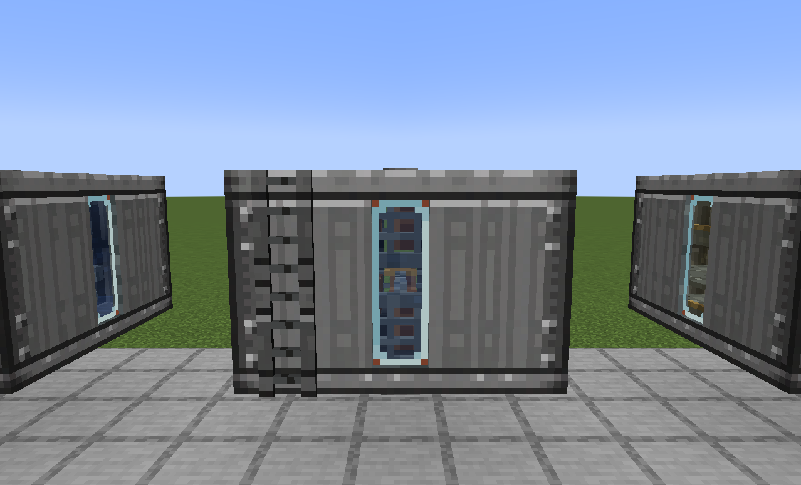
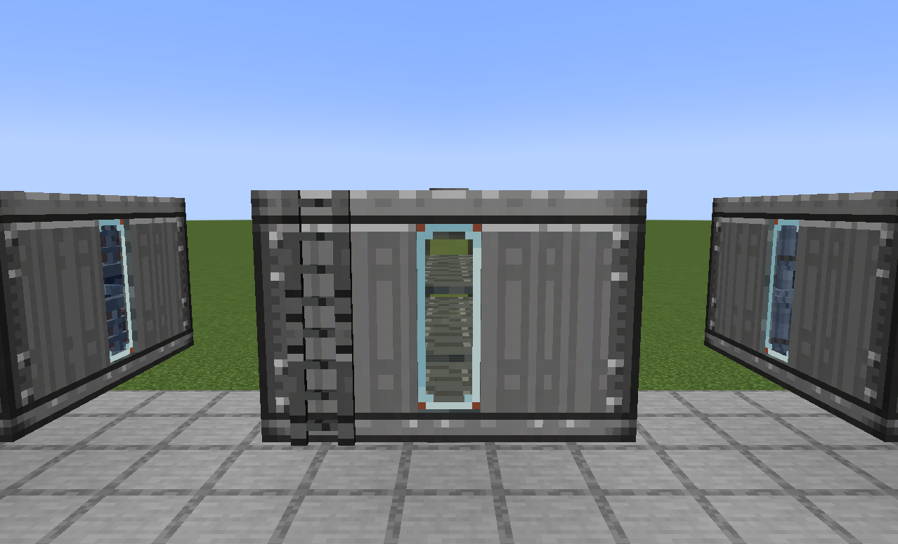

# ふた付き槽：底面中央入力と水没した内部部品の描画

実施日：2026-11-10。実装コミット：`1c205b1e9778df05594f0e143a9d29580c655e69`。

Minecraft 1.21.1 / NeoForge 21.1.219 / Create 6.0.10 / Java 21。作業開始時とプッシュ前にorigin/mainを確認した。

## 変更内容

### 回転入力

側面からの回転入力を削除し、3×3の最下段・底面中央1ブロックの下面だけを入力にした。側面・上面・底面のほかの8ブロックには接続しない。1×1・2×2は引き続きタンク専用で、回転入力を持たない。最低32 RPMは従来どおり。

従来は `LiddedVesselBlock.shaft` が軸に合う外側面を許可し、配置時のクリック面やレンチでX/Z軸を選べた。接続判定を下面中央だけにし、実際の回転軸をYに固定した。配置時もYで、レンチによるX/Zへの切替は行わない。側面レンチは覗き窓、上面レンチは内部部品の取外しに使う。

既存の `axis` プロパティを保存形式から削除せず、読込時の接続更新でYへ正規化する。旧側面部材に残った回転元・速度を入力として扱わず、不正な接続は既存の解除処理で取り除く。シャフトと軸受の描画も同じ接続判定を参照するため、側面には表示されない。既存の側面駆動設備は底面中央へ配線をつなぎ直す必要がある。

### 流体越しの内部部品

従来は内部部品より先に流体ボックスを描き、流体面の元の不透明度によって水没した部品が隠れた。内部部品・ふた・内容アイテムを先に描き、その後に流体を描く順番へ変更した。

覗き窓を有効にした槽では、流体の頂点アルファを元の1/3にする。水や不透明な工程液が入っていても、触媒充填バスケット、撹拌翼、分離棚段、遠心ロータを確認できる。液面の高さ、液量に比例する上下動、流体の色とテクスチャは従来の値を使う。窓を無効にした場合は元の不透明度を使う。流体・内部部品の描画面数を増やす変更ではない。

### Ponder・文書

ふた付き槽、4種類の内部部品、触媒反応槽・撹拌槽・分離塔の関連字幕を日英で更新した。新しい翻訳キーは追加していない。中国語は従来どおり該当字幕の英語フォールバックを使う。

`vessel_basin` の駆動モーターを東側面から底面中央へ移し、中央を避けた8か所の床下をブレイズバーナーにした。`vessel_maintenance` の元構造と生成元も合わせて更新。撹拌槽Ponderの入力を示す矢印も底面中央へ移した。使用方法は[パイプとタンク](../pipes-and-tanks.md)と[反応プラント](../reaction-plant.md)へ反映した。

## 確認結果

| 確認 | 結果 |
| --- | --- |
| 関連GameTest 5クラス | **57/57合格** |
| 四方向に実際の128 RPMモーターを置く | 全側面部材0 RPM・応力0、工程停止。待機原料1,200 mBを消費しない |
| 続けて底面中央に実モーターを置く | 128 RPMで運転し、入力部材だけに16 SU/RPMの負荷。既存のバッチが出力槽へ800 mBを生成 |
| 底面9か所にモーターを置き、中央を撤去 | 中央以外は駆動せず、撤去後は工程停止・原料保持 |
| X軸・旧回転元を持つ保存データ | 接続更新でYへ正規化し、旧側面の速度で工程が進まない。原料・触媒を保持 |
| 過負荷 | 底面中央の入力が停止し、負荷を無動力のコントローラーへ逃がさない |
| 実バーナーの燃料・混合・容器返却 | 底面駆動＋周辺バーナーで合格。原料・生成物・空容器の既存の原子的処理を維持 |
| 最終ビルド | `bash gradlew --no-daemon build` 成功 |
| Ponder翻訳検証 | 日英106シーン、中国語既存22シーンの検証に合格 |

5クラスは `DriveLessVesselGameTests`、`LiddedVesselGameTests`、`LiddedVesselPlacementGameTests`、`ReactorGameTests`、`VesselBasinGameTests`。全GameTestを実行したという意味ではない。最初の回帰試験では、加熱試験の旧側面モーター配置が停止した。試験側を底面中央の実モーターへ更新し、上記57件を再実行して合格した。

### 実クライアント

`mc-debug glxinfo -B` でNVIDIA RTX 4060の直接描画を確認。実ゲームの3×3×2槽を4基組み、各種類の内部部品を2段ずつ装着して検証した。Computer Useによる実画面観察と、既存の統合クライアント確認機構による撮影を行った。

- 各槽で液量比0.5、1.0、0.0の同期と、実際の窓のモデルに穴があることを照合。
- 空の状態で4基とも底面中央から実モーターで回転させ、入力速度が0でないことを確認。
- 満液の各槽へ近寄り、触媒バスケット・撹拌翼・棚段・遠心ロータが流体越しに見えることを確認。分離塔には `cooled_hydrotreater_effluent`、ほかの3基には水を使用。
- 拡大撮影中の分離工程による液量変化を避けるため、撮影段階ではモーターを撤去して満液を保つ。初回の拡張検証ではここを止めず、分離塔の液量が0.5へ変わって失敗したため、試験条件を修正して再実行した。
- `VESSEL CONTENTS PASS` と、日本語 `vessel_basin` の `CLIENT QUALITY PASSED` を確認。Ponder内の実在庫・窓・撹拌状態の確認も通過。





## 主要ファイルと再確認方法

- `block/LiddedVesselBlock.java`、`block/entity/LiddedVesselBlockEntity.java`：下面中央だけの接続、固定Y軸、保存済み接続の更新。
- `client/LiddedVesselRenderer.java`：内部部品・内容アイテムを先に描き、窓付き流体を透過表示。
- `client/VesselContentsClientCheck.java`：4種類の満液状態の拡大確認を追加。
- `ponder/VesselBasinPonderScenes.java`、関連NBT・字幕と生成元：実際の底面入力に合わせた説明。

Javaパスは `src/main/java/net/createplant/` からの相対パス。関連サーバー試験は、リポジトリに保存済みのクラス指定用init scriptを使って再実行できる。

```sh
bash gradlew --no-daemon -I docs/reports/data/gas-bell/verification.init.gradle -DgasBellTestClasses=DriveLessVesselGameTests,LiddedVesselGameTests,LiddedVesselPlacementGameTests,ReactorGameTests,VesselBasinGameTests runGameTestServer build
python3 tools/validate_ponder_language.py
```

実画面確認はclient runへ `createplant.clientQualityCheck=true`、`createplant.vesselContentsClientCheck=true` を渡す既存の開発用経路を使う。Ponderの確認には `createplant.vesselClientCheck=true`、対象 `lidded_vessel@vessel_basin`、seek 800を指定した。

## 制限・未確認事項

窓越しの観察を優先する表示設定のため、現実に不透明な流体も窓が有効なら半透明になる。Shader MOD併用、遠隔マルチプレイ、実セーブを別プロセスで再起動する確認は未実施。大量設置時のFPS・GPU時間の変更前後測定も行っていない。性能改善は主張しない。

JARのSHA-256：`90096c5fe82f929ab6e49c2627c712d64c3734edefd3d5b126fbe5c27aca7dfc`。
