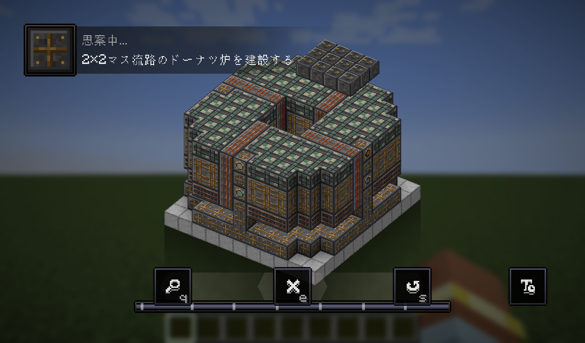

# 材質・差し色テクスチャ更新の再実行

2026-11-08。ユーザーの「再実行して」の指示により、前回の生成・検査・ビルド・ゲーム内撮影を再実行しました。

対象ソースは`2c4a9533d865d6b981b59a0a2586f7e536b6b4e6`、テクスチャの実装コミットは`5c7504a843c9ab09912c2688d28a071340b3cf53`です。前回の材質の割当と参照資料は[元の実装報告](material-accents.md)を参照してください。

## 結果

| 確認 | 今回の結果 |
| --- | --- |
| `tools/generate_block_surfaces.py` | 正常終了。画像・モデル・付随メタデータ1836ファイルが再実行前とバイト単位で一致 |
| `tools/validate_block_surfaces.py --revision 2c4a9533` | ブロックPNG 450枚、保護222枚、モデル形状・UV 1269個の検査に合格。今回の描き替え差分は0枚 |
| `tools/validate_visual_identity.py` | 完成アイテム285個、共通材質、バケツ等の検査に合格 |
| 独立監査 | 既存PNG 564枚のバイト・RGBA・寸法・透過形状が一致。保護222枚のハッシュ、前回更新88枚の色数、モデル1272個とテクスチャ以外のソースを確認 |
| 単独`build` | Java 21で成功（6秒）。既存の化学プロセス・炉制御・炉物理のチェックも成功 |
| 配布JAR | 全1836資源が生成元と一致。SHA-256も前回の配布物と一致 |
| 実クライアント | NVIDIA RTX 4060のハードウェア描画で8対象を1260×740で再撮影。日本語のシーン見出し112件と翻訳検査に合格 |

再撮影した対象は、核融合炉、核融合制御盤、小型コンプレッサー、反応槽、クレーン、パルス抽出塔、電解炉、往復コンプレッサーです。鋼の骨格、真鍮の保持帯・カラー、銅巻線、塗装部・断熱材の区別を確認しました。今回の実画面は次の画像です。

[機械可読の再実行記録](../quality/material-accents-rerun.json)に、生成差分、独立監査、配布JARの照合、実画面検査と終了状態を記録しています。主要な確認元は上記3つのPythonスクリプトと既存の`client/ClientQualityCheck.java`です。画像・モデル・動作の追加変更はありません。

## 終了時の異常と確認の範囲

`CLIENT QUALITY PASSED: 112 scenes, ja_jp`と8枚の新しい撮影結果を記録した後、クライアント終了時に前回と同じNVIDIA `libEGL_nvidia.so.0+0xb56ae`内のSIGSEGVが再発しました。Minecraftの終了コードは134、Gradleの`runClient`終了コードは1です。撮影・翻訳検査の合格、単独ビルドの成功、クライアントの正常終了は分けて扱います。この描画ドライバの異常は今回修正していません。

今回の実行は外観の再生成・表示確認です。長時間のプラント運転や全装置の全状態を再検証したという意味ではありません。次回も、生成後のファイル一致と、実クライアントの撮影完了・終了状態を別々に確認してください。

配布ファイルは`create-heavy-indusstry-material-accents-rerun-5c7504a8.jar`、容量4,694,708 bytes、SHA-256は`e2f5afc348973724b1bdd448edb962738bd504f25fa6dfcb6d693070f5b89cf0`です。
