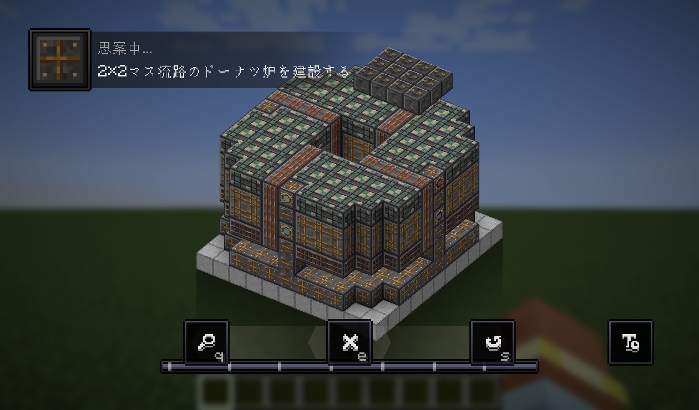
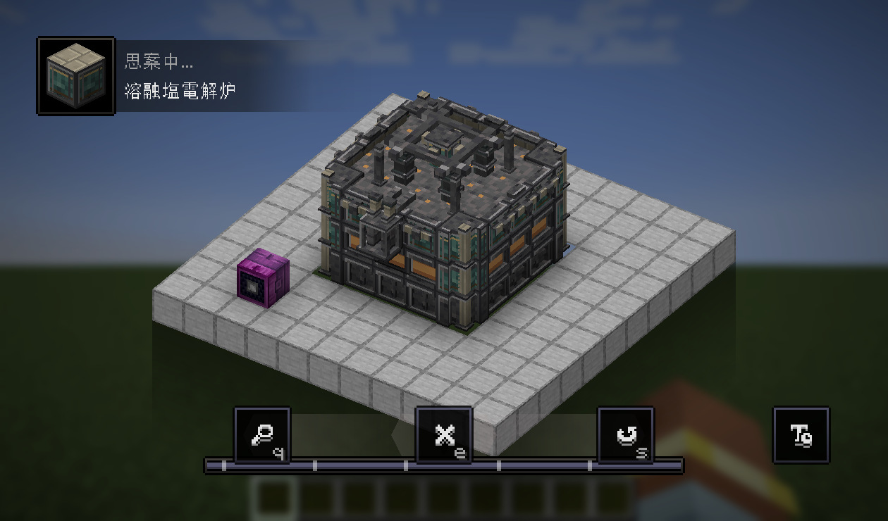

# 設備と核融合炉の材質・差し色の更新

2026-11-08。鋼材を参考にした前回の外装は、広い灰色面と暗い金属色へ偏り、設備ごとの素材と機能の区別が弱くなっていました。鋼の骨格を保ち、真鍮・銅・塗装・断熱材を既存の部品へ配分し直しました。前回の`e63d4bd1`を基準にブロックPNG 88枚を更新しています。

実装コミット: `5c7504a843c9ab09912c2688d28a071340b3cf53`

## 参照と描き直した箇所

ユーザー指定のTFMGとCreate Decoについて、それぞれ1.2.3・2.1.2の原画像と現行モデルを調べ、依存Create 6.0.10とも比較しました。TFMGの灰色の骨格と茶色の内面、真鍮ポンプや計器のまとまった色面、Create Decoの鉄・真鍮・銅の明確な材質差を参考にしています。出典・版・ライセンスは[参照記録](../quality/material-accent-references.md)を参照してください。参考MODの画像を切り貼りせず、このMODの描画関数で独自に描いています。

| 設備・部位 | 材質と差し色 |
| --- | --- |
| 核融合炉の補強部と真空容器 | 鋼の圧力板に、既存の幅のある真鍮保持帯・締結部 |
| コイルと熱伝導部 | 橙色の銅巻線、暗い側面、明るい縁 |
| ブランケット | 鋼の格子の内側に、緑の塗装部とクリーム色の断熱材 |
| 核融合炉のポート・制御卓 | 真鍮のカラーと縁、銅の配線部、元の識別色と計器盤面 |
| 圧縮機 | 青い鋳造カバー、露出した鋼のフィン・摺動部、真鍮の継手 |
| 電解炉 | 緑の外板、鋼の柱と下部、真鍮色の既存の外板縁、耐火材と銅の給電部 |
| クレーン | 黄土色の塗装部材、鋼のレールと巻胴、真鍮の軸受。採掘用は赤錆色の塗装を区別 |
| 更新対象の反応塔・アンモニア分離槽 | 元の鋼材面と識別模様に、銅・真鍮の連続した保持帯 |
| 更新対象の配管・継手・計器 | 銅・真鍮の明度と色相の差を強め、象牙色の計器を塗装カバーとカラーに収める |

差し色は、既存の保持帯、軸受、巻線、外板、制御カバーなど、まとまった部品へ配置しました。共通の鋼・鋳鉄そのものの灰色は維持し、完成設備に組み上がったときの材質差を確認しています。16px相当の密度、外枠1px、面取り1px、左上の明部と右下の影、2px単位の5階調の粒も維持しています。

主要な生成元は`tools/minecraft_style.py`、`generate_fusion_assets.py`、`generate_crane_assets.py`、`generate_compressor_assets.py`、`generate_electrolysis_furnace.py`、`generate_process_surfaces.py`、`generate_plant_tank_assets.py`、`generate_plant_systems.py`、`generate_misc_block_surfaces.py`です。入口は既存の`generate_block_surfaces.py`を使います。PNGだけの手修正はありません。

## 維持した範囲

復元指定済みのラジエーター、RBMK炉と制御盤、蒸気タービン、角型分留塔、旧パイプ・タンクなど、保護対象222画像は元のファイルと一致しています。更新した反応塔・アンモニア分離槽は、保護された旧タンク6種類とは別の対象です。

既存PNG全564枚の寸法と透過マスク、フライホイール17種類の全画素、10組のON/OFF状態差、表示灯・警告帯・ポート記号・窓・炉内発光など28箇所を独立して確認しました。核融合炉のプラズマと保守ハッチ3材質も維持しています。全1272モデルのファイルと、テクスチャ以外のリソースに差分はありません。構造、UV、回転、入出力、レシピ、Ponder、温度・出力などの仕様は変更していません。

## 検証結果

- `validate_block_surfaces.py --revision e63d4bd1`: ブロックPNG 450枚、更新88枚、保護222枚、1269個のモデル形状とUVの検査に合格。
- `validate_visual_identity.py`: 完成アイテム285個と共通材質・バケツなどの検査に合格。
- 独立監査: 変更画像は各面24色以下、CTは各タイル最大15色。12アトラス×47文脈、計564条件の接続外枠・内角を確認。
- 共通金属4材質は5階調、2×2pxのまとまった粒を維持。同色の最大連続領域は各12px。見た目の判断は、この数値だけでは行っていません。
- 実クライアントの代表設備と核融合炉の組立表示を撮影し、通常の表示距離で材質の分かれ方を確認。

- 再生成: 画像・モデル1833ファイルがバイト単位で一致。
- `build`: Java 21で成功。既存の化学プロセス・炉制御・炉物理のチェックも成功。
- 配布JAR: テクスチャ・モデルと付随メタデータ1836ファイルが生成元と一致。旧画像の混入なし。
- 実クライアント: NVIDIA RTX 4060のハードウェア描画で、核融合炉・核融合制御盤・小型コンプレッサー・反応槽・クレーン・パルス抽出塔・電解炉・往復コンプレッサーの8対象を1260×740で撮影。日本語のシーン見出し112件の検査にも合格。
- `git diff --check`: 合格。

[材質・保護範囲・状態表示の監査](../quality/material-accent-audit.json)、[接続面と機能領域の監査](../quality/material-accent-ct-audit.json)、[再生成結果](../quality/material-accents-regeneration.json)、[実クライアント結果](../quality/material-accents-client.json)、[配布JARの照合](../quality/material-accents-jar-validation.json)を保存しています。

配布ファイル: `create-heavy-indusstry-material-accents-5c7504a8.jar`（4,694,708 bytes）。SHA-256: `e2f5afc348973724b1bdd448edb962738bd504f25fa6dfcb6d693070f5b89cf0`。

## 制約と次回の注意

外観だけの更新です。代表的な組立表示を確認したもので、全装置のすべての状態や長時間のプラント運転を再検証したという意味ではありません。鋼材色だけを全材質へ広げず、部品の役割と材質の組合せを維持してください。再生成は設備ごとの生成元から行い、保護された旧外観を上書きしないでください。

今回も撮影と`CLIENT QUALITY PASSED: 112 scenes, ja_jp`の記録後、クライアント終了時に既知のNVIDIA `libEGL_nvidia.so.0`内のSIGSEGVが発生し、`runClient`は終了コード134になりました。撮影・表示検査の完了と、クライアントの正常終了は区別して記録します。その後の単独`build`は成功しています。
