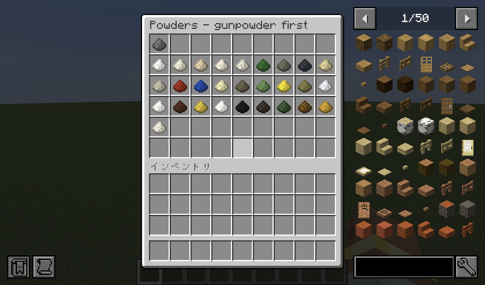
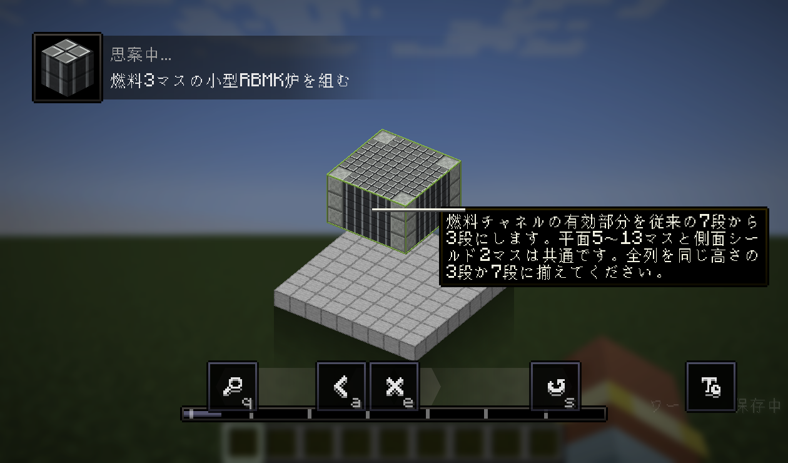
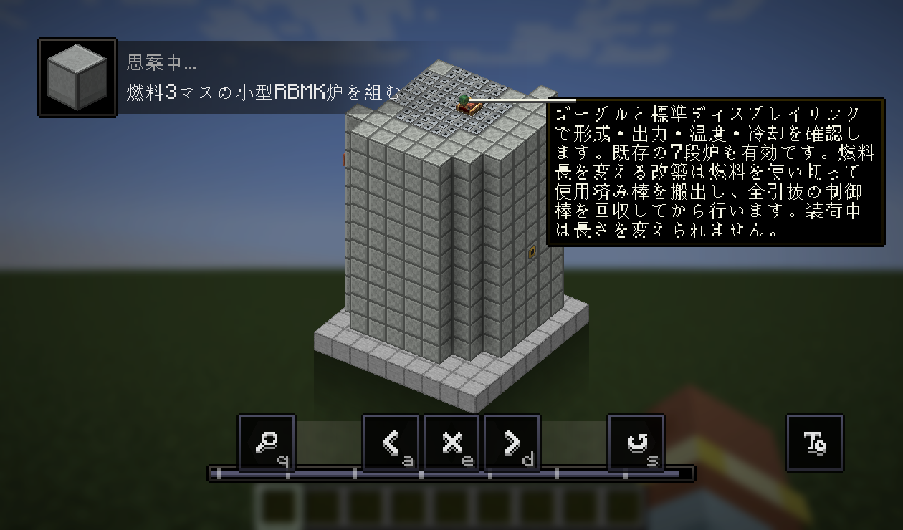

# 粉末形状・小型原子炉・稼働音の統合報告

実装コミット：`022c6fe462609bfb9593e10852ef07481571c9c9`。作業日：2026-11-09。

開始時にリモートを取得し、液体設置・炭化の2コミットを含む`4aded29b`までfast-forwardしてから統合しました。既存の機械外装・閃緑岩ケーシングは変更していません。

## 実装した3点

**粉末28種類**をMinecraft 1.21.1の火薬と同じ16×16輪郭・88不透明画素・7段階の粒陰影へ揃えました。硝安・ANFOも含み、色は物質ごとに維持しています。24種に色付き画像を用い、既存4種の火薬参照＋実行時着色を保持しました。酸化鉄充填材2種は手持ちアイテムだけを変更し、設置ブロックの形・動作は維持しています。成形触媒・ペレット・ガラスフリット・鉱物塊など72種を区別し、粉化していません。9個の既存生成器も共通の粉末処理へ接続しました。[詳細](powder-item-shapes.md)。



[変更前後の一覧](../quality/powders-compact-sounds/powder-before-after.png)と[棚卸し結果](../quality/powders-compact-sounds/powder-audit.json)も保存しました。火薬はチェストの左上、各粉末はその下に並べています。表示は開発時だけ開くバニラのチェスト画面で、製品の独自GUIは追加していません。

**燃料部3マス・全高11マスの小型RBMK炉**を、従来と同じ部材で作れるようにしました。7マス燃料部・全高29マスの大型は維持しています。小型は下部3＋有効炉心3＋上部4＋キャップ1マス。横寸法5～13マス、側面遮蔽2マスは共通です。制御棒、上部キャップと細管、給水、出口、保守クレーンの行程・描画も実際の長さへ追従します。

同じ燃料チャネル数なら出力・燃料エネルギー・冷却容量・熱容量・伝熱面積は3/7です。最大397チャネルの構成は約327.857 MW、従来大型の最大765 MWは維持します。装荷中の異なる高さへの改築を拒否し、燃料を伸ばして残存エネルギーが増えることを防ぎます。空構造の拡張では追加材を293.15 Kとして混合し、余剰蓄熱を保存します。旧配置の出口リンク・動力負荷を解除し、取得済み出口も現在の炉室への所属を再検証します。[組立説明](../rbmk-reactor.md)、[計算・保存・専用試験](compact-rbmk-core.md)。





**10種類の運転音**を追加しました。原子炉、核融合炉、高圧・低圧タービン、圧縮機、撹拌・遠心機構、高温処理、流体処理、冷却ファン、クレーンを区別しています。既存の同期済み稼働状態に連動し、設備のコントローラーが一音を担当します。停止・破損・ミュート・距離外・アンロード・ワールド切替で終了し、再び稼働条件を満たすと再開します。音量は標準の「ブロック」で調整できます。[対象と条件](../machine-sounds.md)。

音源は外部録音を用いない独自合成、各6秒・モノラル・22,050 HzのOgg Vorbisです。Createの固定SoundScapes列挙へ独自音を追加する公開拡張点が無いため、Minecraft標準の`AbstractTickableSoundInstance`を使用しました。探索は読み込み済みの近傍へ限定し、5 tickごとに最大4チャンク・128 BEを分割確認、32マス内・最大24音です。サーバーに音の再生状態を保持しません。

## 検証結果

| 確認 | 結果 |
| --- | --- |
| ビルド | Java 21の`build`成功。最終の`build runClient`も正常終了 |
| 既存数値検査 | FluidPhase 25、HaberBoschProcess 1,019、ReactorPhysics 1,670、ReactorControl合格 |
| 関連GameTest | 40件中39件合格。小型炉8件、従来炉、クレーン、製作レシピの対象はすべて合格。全登録監査1件は後述の既存問題で失敗 |
| 小型炉の専用8件 | 3/7型併存、無効/混在高さ拒否、キャップと純正入出力、燃耗・熱応答・保存、破損修復、装荷中改築拒否、空熱構造の改築と旧出口/負荷解除、実回転・AZ-5の3マス行程を検査 |
| 粉末・既存素材 | 28粉すべて同じ輪郭と粒配置。非対象の既存1,806画像/モデルは原本とbyte一致。物質100種を28粉＋保持72へ分類 |
| 検証器の回帰 | 15件合格。新しい未分類材料・粉の輪郭破損も検出 |
| Ponder・言語・識別性 | 既存の構造/言語/アイテム検査に合格。中国語が完備していたタービン教材にも新しい音説明を追加 |
| OGG実デコード | 全10種が6秒・mono 22,050 Hzで正常。最大peak 0.63150、最大絶対DC約0.000198、clipping 0、ループ境界の検査も合格 |
| 実SoundEngine | 実モーターと有限水1,000 mB入りファンバンクで開始/停止/再始動、一設備一音、BLOCKSミュート/復帰、距離外/復帰、実チャンクのアンロード/再読込、破損・cleanupにすべて合格 |
| 実クライアント表示 | RTX 4060で121シーンを検証。全28粉の実モデル、小型炉の炉心3段と全体、従来炉、タービンを撮影 |

[音源実測値](../quality/powders-compact-sounds/audio-validation.json)、[SoundEngine検証結果](../quality/powders-compact-sounds/sound-client-result.json)、[Ponder検証結果](../quality/powders-compact-sounds/client-result.json)を保存しました。

初回のビルドでMinecraft 1.21.1の`ChunkStatus`移動先へのimportを修正しました。言語検査では既存中国語教材への新caption不足を修正。実クライアントの音検査は、音声機器が無い環境でOpenALが起動しなかったため`ALSOFT_DRIVERS=null`のNo Outputで同じ再生検査を実行しました。アンロード検査は`ClientChunkCache.hasChunk()`が常にtrueを返すため、`getChunk(..., FULL, false)`で実ロード状態を確認するよう修正しました。製品側の探索は元から後者を使い、検査を省略して合格させていません。

## 既存問題と検証の限界

`AuditGameTests.everyRegisteredEntryHasAssetsTranslationsAndLoot`は、取り込み済みの液体ブロック44種類の`block.create_heavy_indusstry.*`翻訳キーが英日両方で未定義のため失敗しました。基準`4aded29b`にも同じキーが無く、今回失われた既存言語キーは0件です。別作業の対象外問題として記録し、液体登録や翻訳を便乗変更していません。

音は仮想OpenAL出力の実SoundEngine状態と波形・リソースの検査で確認しました。物理スピーカーからの実聴評価や、全種類のプラントを同時に稼働させる長時間試験は未実施です。稼働音のライフサイクルを実モーター付きファンバンクで試験し、各設備への割当は既存の稼働状態から行っています。

GPUコンテナの検証では、既知の終了時ドライバー問題を避けるため`__GL_THREADED_OPTIMIZATIONS=0`を付け、ハードウェア描画・保存・正常終了まで確認しました。Modの通常起動に仮想音声出力を強制する変更はしていません。

## 再生成・再実行と注意

```sh
python3 tools/generate_powder_items.py --check
python3 tools/validate_machine_sounds.py --require-definitions
python3 tools/validate_ponder_language.py
python3 tools/test_ci_validators.py

bash gradlew --no-daemon --max-workers=2 -I tools/white_factory_checks.gradle \
  -Dcreateplant.whiteTestDir=/tmp/createplant-compact-tests \
  -Dcreateplant.gameTestClasses=CompactRbmkGameTests,RbmkGameTests,CraneGameTests,CraftingRecipeGameTests,AuditGameTests \
  runGameTestServer
```

GameTestには新規の一時ディレクトリを指定します。実クライアント確認は既存の`createplant.clientQualityCheck=true`に`createplant.machineSoundClientCheck=true`と`createplant.powderItemsClientCheck=true`を併用します。小型教材は`reactor_fuel_channel@rbmk_compact_core`。炉心画像は未装荷チャネル束で、実燃料棒を装荷して運転中の写真ではありません。

追加した開発用fixtureは通常プレイで動かず、新しい製品GUIも登録していません。ログ・画像・JARは`/workspace/outputs/powders-compact-reactor-sounds/`、粉の元比較資料は`/workspace/outputs/powder-shapes/`へ保存しています。
