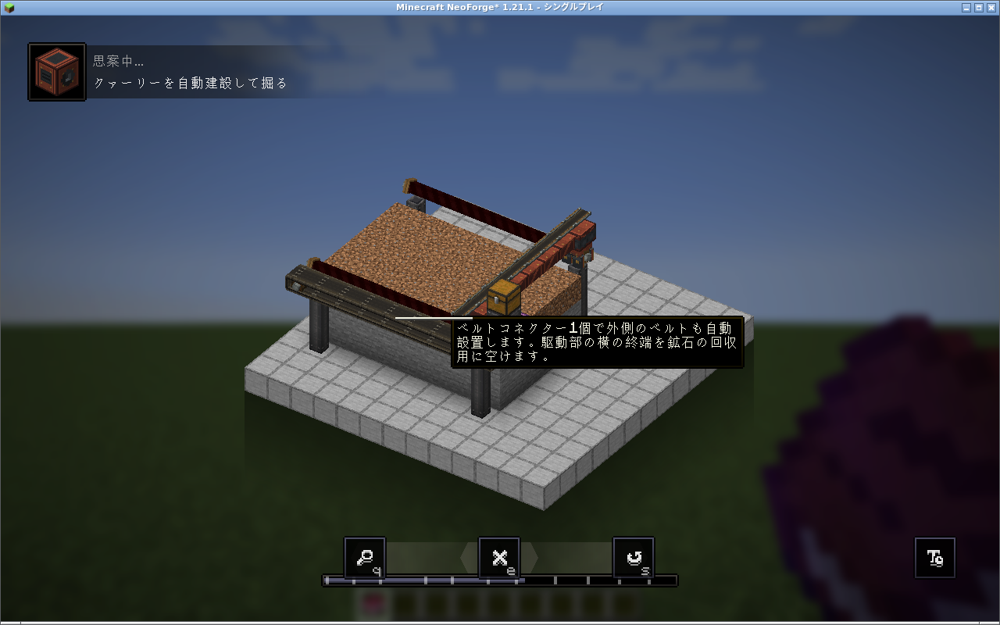

# クァーリーの不足素材表示・4倍速化・Ponder更新

2026-11-15。開始時にmainを `d3cadb4a` までfast-forwardで取り込んだ。

実装コミット：`29ca2792d6b7103c710b2cb0ae193d97127ceef4`。

## 変更内容

### 全体の不足素材

クァーリー駆動部のゴーグルに、自動建設とドリル装着に必要な次の4種類を表示する。

- ガントリーシャフト
- 鉄骨
- メカニカルドリル
- ベルトコネクター

設置済みの正しい脚・レール、装着済みドリル、敷設済みベルトと駆動部の在庫を差し引く。起動信号や回転がなくても計算する。範囲マーカーを変更したときも読み直す。未ロードで必要数を確認できないときは、確定した不足数として表示しない。

不足がある間は「状態」「不足シャフト・鉄骨」「不足ドリル・ベルト」「建設進捗または障害物位置」の最大4行。枠の完成後もドリルとベルトの不足を表示する。稼働時も通常・Shiftとも4行以内とし、Shiftでは在庫概要を確認できる。表示の照会や搬入シミュレーションは在庫を消費しない。

### 4倍速

`QuarryDriveBlockEntity.WORK_STEPS = 4` とし、移動・掘削を1ワールドtickあたり最大4ステップ進める。ブロックの硬さ、RPM、採掘順序は従来の計算を使う。自動建設とベルト経路の整地も、従来の2 tickに1工程から1 tickに2工程へ変更した。

ドリルヘッドから橋までのシュートと橋上の搬送も4倍の作業時計で進める。荷の位置の描画も同じ時計で補間する。外側の本物のCreateベルトは、従来どおり入力RPMに従う。搬出先が詰まると荷を保持し、ヘッドが満杯なら採掘を止める。

1ワールドtick中の複数の同期要求をまとめ、まとめて1回だけ送る。未ロード、停止、満杯時の同じ操作を4回繰り返さない。大規模工場のMSPT改善を測定したという意味ではない。

### Ponder

「クァーリーを自動建設して掘る」を次の順で作り直した。

1. 駆動部の軸をレールと直角に置き、隣のマーカーを採掘側へ向ける。
2. レンチで長さ・幅を設定する。
3. 起動前にゴーグルで4種類の不足数を確認する。
4. 上のチェストからCreateシュートを通して材料を補給する。
5. 採掘場の内側から回転を入れ、側面のレバーで起動する。
6. 脚・レール・側面ベルトの自動設置と、在庫からのドリル自動装着を見る。
7. 採掘、蛇腹シュート、橋の搬送、側面ベルト終端の回収を見る。
8. 信号による一時停止と、回転停止の違いを確認する。

日英中の字幕は `tools/data/ponder_lessons.json` を正本とする。`tools/generate_crane_assets.py --quarry-only` で対象の図と翻訳だけを生成し、既存の筐体画像や他設備を再生成しない。各字幕は1〜2文とし、物理式は載せない。



## 確認結果

| 確認 | 結果 |
| --- | --- |
| Gradle build | 合格 |
| Quarry・速度・Crane・PlantTutorial | **15/15件合格** |
| 固定条件の掘削比較 | 下表の45ブロックを全て掘削 |
| 5×3の枠・ベルト | シャフト10＋鉄骨12の22部材とベルトを**13 tick**で準備 |
| 翻訳 | 日英中各**4,602キー**、書式・重複チェック合格 |
| Ponder | 全**141シーン**のコンパイル・実行時翻訳合格。クァーリーの3時点を描画 |
| 生成の再実行 | 追跡ファイルの差分なし |

同じ5×3・土3層・64 RPMの設備で、作業ステップ数だけを1と4にして比較した。計測は枠・ベルトの完成後、ドリル装着から45ブロックを掘り終えるまで。外部ベルトでの最終搬出時間は含めない。

| 作業ステップ / tick | 掘った土 | 掘削時間 | ゲーム内時間換算 |
| --- | ---: | ---: | ---: |
| 1（従来の処理頻度） | 45 | 658 tick | 32.90秒 |
| 4（今回） | 45 | 165 tick | 8.25秒 |

比は**約3.99倍**。ワールドtick単位への切り上げを含め、4倍の処理頻度に対応する。速度試験は164〜166 tickの範囲を合格条件にした。

関連試験は、起動前の不足数、設置済み部材の再利用、範囲変更、補充、クライアント同期、4行表示、読取の無変更、保存・再読込後の在庫と不足数、枠完成後の不足表示、実チェスト→シュート搬入を確認した。既存の正逆回転の搬出、15個の土の全数回収、搬出閉塞と部分受入れも合格した。

記録：[verification.json](../quality/quarry-drive/verification.json)、[クライアント結果](../quality/quarry-drive/client-result-ja_jp.json)、[クライアント設定](../quality/quarry-drive/client.gradle)。ログは `/workspace/outputs/quarry-baseline-test.log`、`quarry-final-test.log`、`quarry-client01.log`。

JDK 21での再現例（新しい試験ワールドを指定する）：

```sh
bash gradlew --no-daemon build -I docs/quality/compact-centrifuge/verification.gradle \
  -DtestDir=/dev/shm/createplant-quarry-final \
  -DtestClasses=QuarryGameTests,QuarrySpeedGameTests,CraneGameTests,PlantTutorialGameTests \
  runGameTestServer
python3 tools/validate_translations.py
python3 tools/validate_ponder_language.py
python3 tools/validate_plant_tutorials.py
```

## 主な変更箇所と制約

- `block/entity/QuarryDriveBlockEntity.java`：不足数、クライアント同期、作業頻度、1 tick内の同期の集約。
- `client/QuarryRenderer.java`：搬送時計の補間。
- `ponder/CranePonderScenes.java`：実配置と操作を示すシーン。
- `gametest/QuarryGameTests.java`、`QuarrySpeedGameTests.java`：不足・搬入・速度の回帰。
- マーカーの長さは、敷設する側面ベルトがCreateの最大長を超えない必要がある。既定では採掘長19まで。この既存制約をPonderで案内した。
- 大規模・深層・複数クァーリーのMSPT比較や、搬送中の荷を含めた実ワールドの再ロードは新たに測定していない。全GameTestの再実行は行わず、関連試験に絞った。
- 実クライアントはNVIDIA RTX 4060・日本語。`CLIENT QUALITY PASSED: 141 scenes, ja_jp` の後に、既知の `libEGL_nvidia.so` のSIGSEGV・終了値134が発生した。品質確認の合格と正常終了は区別する。音声出力装置がないため、音の実再生は未確認。
