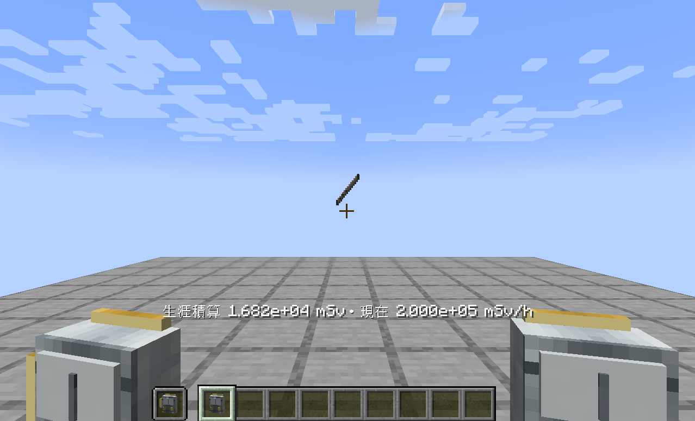
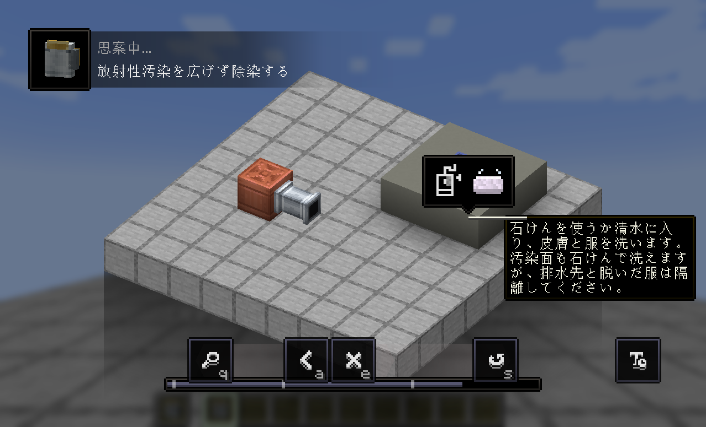

# 共通放射線・汚染モデルへの置換

実施日: 2026-11-12。依頼文: `docs/specs/codex-radiation-prompt.md` の枠内。作業ブランチ: `main`。開始点: `8c96369a`。

実装コミット: `51792a0b5b9edc114a7d24756fbb4230f3beb232`。プッシュ前にリモートの鋼材・蛍石更新 `e3eaaa3a` までを取り込み、`b9822f23` で統合した。さらに鋼鉄素材分離 `94b19ad6` までを `f66e7ab3` で取り込み、鋼鉄壁のプールを含め再検証した。翻訳3ファイルはキー単位で両方の変更を保持した。このレポートの追記は別コミット。

## 実装したこと

RBMK専用の6面開口率と `ReactorPhysics.doseRate` を廃止し、共通の線源索引・経路遮蔽・個人被ばく管理へ置換した。炉の出力計算・燃料エネルギー・765 MWの校正は変更していない。旧プレイヤー線量は初回に生涯積算へ移し、既存の急性症状用データは急性損傷状態として使う。

| 担当 | 主なファイル・動作 |
| --- | --- |
| 物質の共通登録 | `nuclear/RadiationSources.java`。アイテム、流体、ブロックの表。使用済み燃料、制御棒、ターゲット、ブランケット、ダイバータ、廃液、ガラス固化体、新燃料・ウラン物質を登録 |
| 減衰・保存 | `Radionuclides.java`、`RadiationPhysics.java`、`registry/CERadiation.java`。短寿命・Cs相当・長寿命αの3群を、基準tickとともにData Componentへ保存 |
| 保管・搬送 | `RadiationContents.java`、燃料チャンネル・プール、`VitrificationCanisterBlock.java`。チェスト、Createタンク・Vault・Basin、ふた付き槽、燃料プール、携帯容器、バケツ、落下物、所持品を評価 |
| 場と遮蔽 | `RadiationField.java`、`RadiationShielding.java`。チャンク索引、逆2乗、実経路の厚さ、材質タグ、プールの仮想水体、変更で失効する有界キャッシュ |
| 汚染 | `RadiationWorldData.java`、`RadiationContamination.java`、`ToxicGas.java`、`ReactorCores.java`。流体放出、容器破損、炉心爆発、靴・皮膚・衣服への移染、石けん・水による洗浄 |
| 人体と測定 | `Radiation.java`、`item/RadiationMeterItem.java`。外部線量、預託内部線量、急性症状、生涯積算、個人線量計、β窓付きサーベイメーター |
| 学習・外観 | `RadiationPonderScenes.java`、新しい2シーン、既存燃料プール説明、計測器用3D JSONモデル、レシピ、日英中翻訳 |

炉心も同じ `RadiationField.Source` として扱う。運転中はγ・中性子、停止後は運転履歴と既存 `DECAY_SHARE=0.002` に基づくγ成分が残る。6面漏れ率の表示を廃止し、Display Linkは炉ポート位置のmSv/hを読む。

使用済み品の取り出し・実在庫への投入・液体充填で履歴を付ける。SIMULATEは在庫を変えない。異なる冷却履歴の液体は、3群の量を体積で加重して混ぜる。設置した放射性液体の汲み取り、ガラス固化体の設置・回収、燃料プールの保存・回収でも履歴を保つ。3ブロックで1本のガラス固化体は線源を1回だけ数える。

防護服はβ線・皮膚汚染を軽減し、γ線・中性子は軽減しない。フィルターが有効なガスマスクは吸入を98%軽減する。衣服の汚染は脱いでも残る。石けんは90%、水中では1秒ごと20%を洗浄し、除去物は直下の排水格子へ移す。受けた線量や預託線量は洗い流さない。

線量計の積算は取り外し・死亡・再接続でも維持する。急性症状は1/2/4/6/8 Svの5段階を残し、低線量率の急性損傷への寄与を小さくした。がんリスクは名目5%/Svの統計表示のみで、死亡判定には使わない。独自GUIは追加していない。

Mixinは通常の通知だけでは覆えない、全ブロック変更、インベントリ変更、標準アイテム保管への投入、標準タンク充填、液体の同一性判定、バケツ設置の6か所に限定した。液体の同一性では放射性物質の冷却履歴成分だけを比較から除き、温度等の他成分は通常の比較に残す。

## 数値と根拠

[利用方法と定数の一覧](../radiation.md)に全線源の初期値を記載した。

- 使用済み燃料棒は指定どおり、1 mでγ 5,000 Sv/h、β 500 Sv/h（空気減衰前）。これはゲームの燃料棒1本に対する代表設定値で、特定実機の測定値ではない。手持ちの遮蔽なしの搬送は危険で、遠隔・水中で扱う。
- 減衰は `N(t)=N0×2^(-t/T)`。半減期は8.02日、30.05年、24,110年。`TIME_MULTIPLIER=1`。1秒は20 tickで、日・年はMinecraftの昼夜周期ではなくこの物理秒で数える。倍率は放射性崩壊だけに適用し、炉の出力・燃耗や生体の回復速度を変えない。
- γ半価層は依頼文の初期案をそのまま採用: 水0.09 m、コンクリート0.05 m、鋼0.016 m、蛇紋岩・生体遮蔽0.04 m。材質は `radiation_shielding/` ブロックタグで差し替え可能。
- 指数減衰と密度・厚さによる評価の参考は [NISTの光子減弱係数](https://www.nist.gov/pml/x-ray-mass-attenuation-coefficients)。依頼文の4値がNIST表と厳密に一致するとは扱わない。
- 汚染のγ換算は [IAEA TECDOC-1925](https://www-pub.iaea.org/MTCD/Publications/PDF/TE-1925web.pdf) 2.4.3のCs-137点線源の代表値0.08 mSv/h/GBq、1 mを使用し、`0.08e-3/(3600×1e9) Sv/s/Bq` に換算した。長寿命α群から外部γ線を作らない。
- [CDCの遮蔽・防護の説明](https://www.cdc.gov/radiation-health/safety/)を、防護服と透過放射線を分ける参考にした。[NRCの使用済み燃料の説明](https://www.nrc.gov/regulations-legislation/fact-sheets-brochures/backgrounder-on-radioactive-waste)は危険度の参考で、同資料の「10年後・表面」の値と本実装の「取り出し直後・1 m」を同じ条件として引用していない。

## 自動検証

Minecraft 1.21.1、NeoForge 21.1.219、Create 6.0.10、Java 21。各試験は同時に複数のGradleを動かさず実施した。[主要ログの抜粋](../quality/radiation/server-results.txt)も保存した。

| 確認 | 結果 |
| --- | --- |
| `build` | 成功。FluidPhase 25、HaberBoschProcess 1,019、ReactorPhysics 1,668チェック、ReactorControlも合格 |
| 新規 `RadiationGameTests` | 15件合格。下記の内容を検証 |
| 放射線・RBMK・燃料プール・保存の関連試験 | 44件すべて合格。最終変更後も専用サーバーで再確認 |
| 通常の全GameTest | 最新mainとの統合後635件中634件合格、既知の槽清掃試験1件が失敗。新規15件はすべて合格 |
| 翻訳 | 日英中2,547キー、重複・空欄・書式引数の不一致なし |
| Ponder・構造検査 | 日英中140シーン。追加プラント100シーン、527対の説明、243コンポーネントリンク、27製造系統等の検査に合格 |
| 専用サーバー | GameTest専用サーバーで共通コード・Mixin・レシピ・保存の読み込みと試験実行を確認 |

新規15件は、逆2乗、水・鋼・コンクリート・生体遮蔽の半価層とキャッシュ失効、炉心遮蔽・停止後γ、数量比例、核種の減衰・保存、標準FluidTankの混合・SIMULATE、βだけを防ぐ衣服、脱衣後の汚染、靴の拡散・除染、マスク・測定値、低線量率と急性段階、プールの履歴・新燃料、落下燃料、落下バケツ・携帯容器、物理在庫投入時の履歴、設置ガラス固化体、α粉じん・死亡後の生涯記録を覆う。

全体試験の失敗は `VesselFoulingGameTests.aFouledProcessStopsThenResumesAfterOneManualBrush`。旧側面回転入力を使う既存fixtureに関する問題で、放射線変更前の[統合レポート](claude-branch-integration.md)にも記録済み。今回その設備・試験は変更していない。`runGameTestServer`全体の正常終了とは扱わない。

### 性能

同じ7×7燃料プール、49ラック、使用済み燃料196本、水1,127,000 mB、8人のサーバーFakePlayerを配置。被ばくによる退場を防ぐため生存モードのまま無敵にした。40 tickウォームアップ後、120回のlevel tickのPre/Post間を測定した。変更前は開始点の放射線処理に同じ測定fixtureを置き、変更後も同じ配置と計測区間を使った。最終測定では、リモートの素材分離に合わせてプール壁がCreateの工業用鉄から本MODの鋼鉄へ変わっている。寸法・水量・燃料本数・プレイヤー配置は同じで、両壁材のγ半価層は0.016 mとしている。

| 状態 | 平均level tick | 95パーセンタイル |
| --- | ---: | ---: |
| 変更前 | 0.93525 ms | 3.63977 ms |
| 変更後・最新main統合後 | 2.03347 ms | 7.69008 ms |

この条件では平均約1.10 msの追加負荷がある。旧処理はプール内の燃料の放射線を評価していなかったため、機能追加分を含む比較。処理が高速化したという結果ではない。全サーバーのMSPT、数百人の実通信、長時間の大工場性能を測ったものでもない。生データ: [変更前](../quality/radiation/benchmark-before.json)、[変更後](../quality/radiation/benchmark-after.json)。

線源はチャンク索引、プレイヤー評価は20 tickごと、半径64 m・強い順256候補・打切り1e-12 Sv/s。経路キャッシュは最大4,096件で、位置と通過チャンクの変更番号で失効する。在庫や温度だけの更新では幾何学キャッシュを捨てない。通信は本人に変更値だけ送る。計測値を装備アイテムの成分へ複製せず、ツールチップも本人用の添付データを読む。アイテムが保存する測定設定はβ窓の真偽値だけ。

### 実クライアント

`mc-debug glxinfo -B` でNVIDIA RTX 4060を確認し、日本語・1280×800で起動。線量値の受信、右クリックのβ窓切替、3Dアイテムモデル、測定・除染・既存プールのPonderを確認した。統合前の139シーンは実クライアント上でコンパイルし、日本語の共有説明・タイトルを検査した。全139シーンを目視したという意味ではない。リモート統合で加わった蛍石・フッ素の1シーンは、本作業では統合後の静的検査のみ。そちらの実画面結果は[既存の鋼材・蛍石検査](../quality/steel-fluorite-client.json)を参照。

| 実際にクライアントへ届いた値 | 値 |
| --- | ---: |
| 5 mでγ線量率 | 0.05555535 Sv/s |
| 1 mでγ線量率 | 1.38887671 Sv/s |
| 1 m/5 mの比 | 約25倍 |
| β窓を開けた1 mでのβ線量率 | 0.10416540 Sv/s |
| 線量計の生涯積算 | 15.59706660 Sv |

高線量での測定試験なのでクリエイティブで実施した。[受信結果](../quality/radiation/client-readings.json)、[Ponder検査結果](../quality/radiation/client-quality-ja_jp.json)、[起動・終了の状態](../quality/radiation/client-status.txt)を保存した。





`CLIENT QUALITY PASSED: 139 scenes, ja_jp` と結果保存の後、既存と同じ `libEGL_nvidia.so.0+0xb56ae` のSIGSEGVでJVM終了134、Gradle終了1になった。表示・受信検査の合格と、プロセスの異常終了を区別する。この終了クラッシュの原因を今回断定・修正したとは扱わない。

## 再実行

Java 21を使い、リポジトリ直下で実行する。長い性能試験は `@ExplicitGameTest` にして通常の全試験から外した。

```sh
bash gradlew --no-daemon build
bash gradlew --no-daemon -I docs/quality/radiation/server.gradle runGameTestServer
bash gradlew --no-daemon -I docs/quality/radiation/server.gradle -DtestClasses= -DtestDir=/tmp/createplant-radiation-all runGameTestServer
bash gradlew --no-daemon -I docs/quality/radiation/server.gradle -DtestClasses=RadiationBenchmarkGameTests -DtestDir=/tmp/createplant-radiation-benchmark -DbenchmarkOutput=/tmp/radiation-benchmark.json runGameTestServer
mc-debug bash gradlew --no-daemon -I docs/quality/radiation/client.gradle runClient
python3 tools/validate_translations.py
python3 tools/validate_ponder_language.py
python3 tools/validate_plant_tutorials.py
```

## 近似・未確認事項と次回の注意

- 3群・点線源・直線透過のゲーム用モデル。散乱線のビルドアップ、詳細な放射化・燃焼計算、エネルギー別の中性子輸送、核種別の生体動態は実装していない。半径64 m・候補256を超える寄与、未読込チャンク越しの寄与は評価しない。
- βは空気中4 mまで、容器の筐体は実効1 cmの近似。プール水は描画水位から作る仮想体積で、単一のラック内部に複数ある燃料の個別分布までは解かない。
- 汚染は4×4×1の粗い格子。破損容器の漏出は保管源の放射能の0.1%を代表的な混合組成として置く簡略化。表面の細かな向き、空気流・エアロゾル輸送、Minecraft液体流動の厳密な質量収支は扱わない。
- 内部被ばくは預託量と70日半減の残存線量で近似する。急性損傷の7日半減と低線量率の重みはゲーム用で、医療モデルではない。
- 標準Create/NeoForgeの搬送・保管と代表的なNBT携帯容器を対象にした。他MOD独自の非標準保管形式、移動コントラプションの全種類の貨物、異なる次元を跨ぐ大規模運用、数か月の連続稼働は未確認。
- レシピで別物質へ変換する際の詳細な核種収支は未接続。冷却履歴は保管・混合・回収で維持するが、再処理工程全体を核種ごとの保存則で解くものではない。追加レシピでは共通登録表と履歴の引継ぎを個別に確認する。
- 旧セーブに履歴がない使用済み品は最初の認識時を基準にする。時間倍率を変える場合は、この時計と保存成分を維持すること。空の照会・SIMULATEから基準時刻を変更しないこと。
- 他の物性・レシピ・原子炉制御則や、既知の清掃試験、EGL終了障害は本作業の修正範囲に含めていない。
