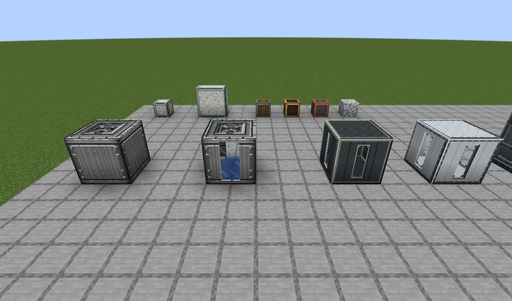
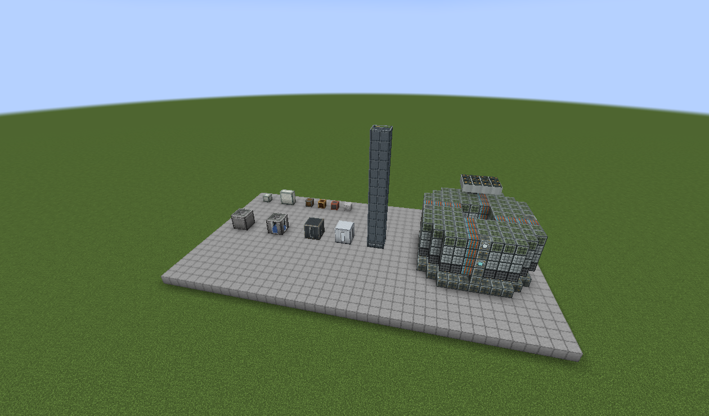
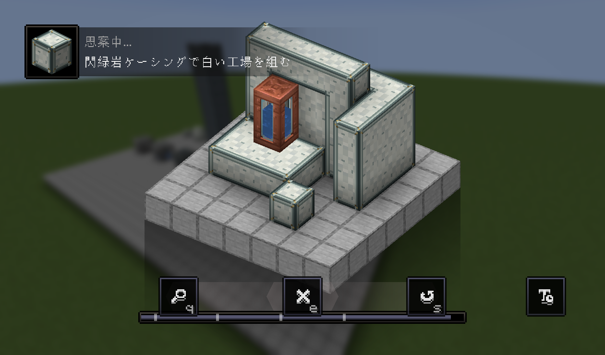

# 全体白化の撤回・閃緑岩ケーシングの保持

実装コミット：`f4d3c06b71e84f9240eab64fe967119d41991df5`。作業日：2026-11-09。

ユーザー指定「白っぽくしたの全部戻して、閃緑岩ケーシングは残して」に従い、既存設備は前回の白化前`c26c219873700d8aa1d99ae5c85f864d7bd39e0e`へ復元しました。開始時の`ab92d034`はfetch後のorigin/mainと一致し、他の変更はありませんでした。

## 変更と保持

- 白化した既存PNG74枚とモデルの素材参照194件を、原本のファイルへ戻しました。
- 共通白塗装画像`white_enamel.png`と、全体白化の生成器`generate_white_factory.py`・設定`white_factory_materials.json`を削除しました。実行可能なソース・ツールにその素材や生成器への参照は残っていません。
- 閃緑岩ケーシングの画像2枚・モデル2個・ブロック状態・登録・アイテム・採掘/ドロップ・英日表示・CT・Ponderを保持しました。手適用/Deployer製作、既存5レシピで安山岩ケーシングの代わりに使う機能も維持しています。
- 新しい`tools/generate_diorite_casing.py`はケーシング本体とCTシートの2画像だけを生成します。以前とバイナリまで同一のPNGを再現し、Git履歴や白化設定を必要としません。
- `DESIGN.md`と外観管理文書を現行方針に訂正し、以前の白化報告・画像は撤回済みの履歴と明記しました。

ゲーム処理、レシピ、CTのJava、Ponderの動作コードには今回の変更を加えていません。白い建材としての閃緑岩ケーシングはそのまま利用できます。[使い方](../diorite-casing.md)。

## 確認

| 項目 | 結果 |
| --- | --- |
| 原本照合 | 白化前に存在した全1,754アセット（574画像、1,180モデル/素材ファイル）がbyte単位で一致。独立監査でも復元漏れ0 |
| ケーシングの保持 | PNG・モデル・blockstate・Ponder NBTが追加時と一致。登録、製作、CT、既存5レシピとの互換を独立監査で確認 |
| 専用画像生成器 | `generate_diorite_casing.py --check`合格。出力は2枚だけ |
| クリーンビルド | Java 21で`clean build`成功（3分38秒）。11タスクを実行 |
| 既存数値テスト | FluidPhase 25、HaberBoschProcess 1,019、ReactorPhysics 1,670、ReactorControl合格 |
| ビルド済みJAR | 白塗装画像を含まず、ケーシングの画像・モデル・blockstate・Ponderを収録 |
| 静的検査 | Ponder構造/言語、アイテム識別性、差分検査合格 |
| 実クライアント | NVIDIA RTX 4060で7視点を撮影。槽・タンク・塔・炉の形成と窓を照合。118シーンの登録/日本語確認と新ケーシングのPonder撮影に合格 |

[原本照合データ](../quality/diorite-casing-restore/asset-verification.json)と[Ponder検査結果](../quality/diorite-casing-restore/ponder-result.json)を保存しました。

下は復元後の実画面です。奥の白いブロックが保持した閃緑岩ケーシング、手前は元の外装へ戻った槽とタンクです。右の極低温タンクは白化前から白い素材を使用しており、その原本へ戻っています。

## 制約と次回の注意

実クライアントは撮影と`CLIENT QUALITY PASSED`の後、終了処理で既知の`libEGL_nvidia.so.0+0xb56ae` SIGSEGV（exit 134）を起こしました。描画確認の合格と、`runClient`全体の正常終了は区別しています。この障害は今回の復元前にも記録されています。

全GameTestや長時間のプラント運転は再実施していません。今回変更したのは外装資産と開発用画像生成処理です。展示設備は停止状態で確認しました。`WhiteThemeWorldClientCheck`と`tools/white_factory_checks.gradle`は開発用の撮影・確認設定として残り、既存外装を白くする処理は持ちません。

ログ、全7視点とJARは`/workspace/outputs/restore-before-white/`へ保存しました。利用者への画像案内には、この報告のリポジトリURLを使えます。
