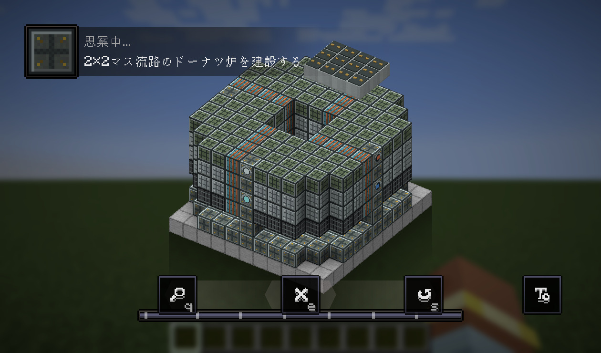
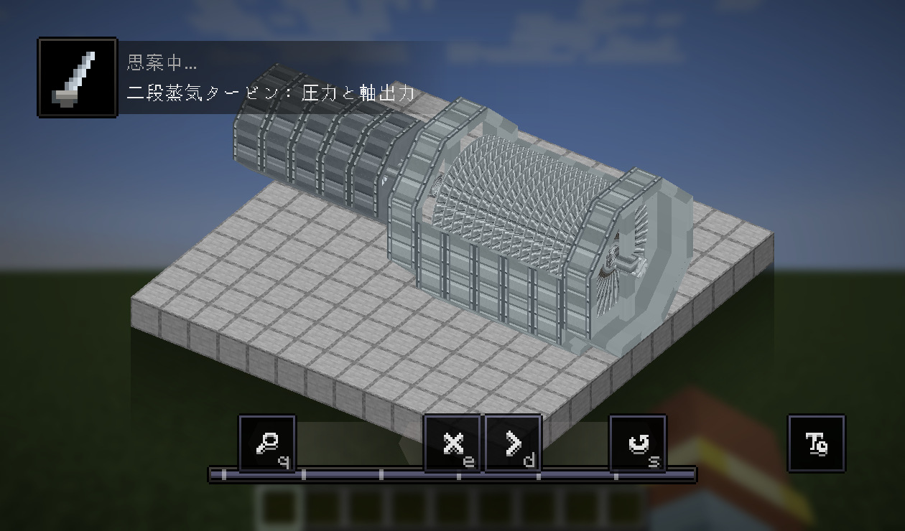

# 指定設備のテクスチャ復元

2026-11-08。ユーザーの「変えすぎ」「ラジエーター、核融合炉、RBMK型炉、蒸気タービン、角型蒸留塔、パイプ、タンクのテクスチャを元に戻してください」に対応した。

## 復元範囲

| 対象 | 画素の復元元 |
| --- | --- |
| 核融合炉・制御盤 | DESIGN対応前の`cce6b43c`。33枚と保守ハッチの元材質3枚 |
| RBMK炉・制御盤・燃料プール・蛇紋岩 | 全ブロック更新前の`6c10f6fc`。112枚 |
| ラジエーター・冷却ファン、角型分留塔、蒸気タービン・羽根アイコン | `6c10f6fc`。36枚 |
| 6種類のタンク、タンクケーシング、全材質のパイプ・管継手・計器 | `6c10f6fc`。73枚 |

合計257 PNG（ブロック255枚・羽根アイコン2枚）の寸法・RGBA画素が元画像と一致する。復元先の画像は`tools/restored_block_surfaces.json`に出典と画素ハッシュを記録した。PNG圧縮方式の差は外観の差として扱わない。

現在の核融合炉の11×11×8・2×2流路のドーナツ形状、モデルの形状とUV、機械の動作・数値、レシピ、BlockState、保存形式、Ponder組立手順は変更していない。指定外の機器は更新後の外観を維持した。同じtankフォルダにあるアンモニア分離器・反応塔16枚も維持する。

## 実装と再生成

- 元の画像と各設備の描画関数を復元。フライホイールの更新は維持した。
- 核融合炉の新しい6枚のCT atlas、専用ハッチ画像とCTラッパーを削除。タンクケーシングの新CTも削除し、元の32×32画像と接続時の描画へ戻した。既存の各タンク・ラジエーター・ステンレス管のCTは維持する。
- 対象モデルは元の素材参照を使い、指定外のモデルは新しい共有素材を使う。PVC継手のゴム材と核融合保守ハッチ3材質は専用パスに分離し、ほかの設備の共通材質を変更しない。
- `minecraft_style.legacy_pixels()`は旧合金の画素を再現する。更新後の共通パレット処理は維持する。
- 元タンク48枚等は歴史的な生成処理と原本が一致しないため、PNG原本を保持して上書きを止める。`generate_block_surfaces.py`は206モデルの元参照を保持し、参照される旧素材を削除しない。
- `validate_block_surfaces.py`は復元対象の画素を厳密照合する。その指定画像だけ旧パレットを許容し、ほかのブロックには既存の24色制限を適用する。

```sh
python tools/generate_block_surfaces.py
python tools/validate_block_surfaces.py --revision 36675902 --output /workspace/outputs/texture-restore-validation.json
python tools/validate_visual_identity.py
```

## 確認

- 原画像257枚のRGBA・寸法が一致。統合生成後も一致する。
- 統合生成を再実行し、1827画像・モデルがバイト一致。
- 1269モデルの形状・UVが開始時と一致。ゲームデータ、BlockState、翻訳、Ponderは変更なし。
- 指定外の画像は開始時とバイト一致。意図しない描き換えなし。
- 完成アイテム285件の識別性検査に合格。
- RTX 4060のハードウェア描画で、7系統の代表Ponderをキャプチャ。核融合炉・RBMK制御盤・高圧タービン・角型分留塔・ラジエーター・パイプ一覧・タンク一覧の元の外観を確認した。日本語見出し112シーンの実行時検査も合格。

## 制約

これは外観の復元であり、プラントの長時間運転試験ではない。全方向・全液面・全状態を総当たりしたとは扱わない。元の色数・模様・画像密度はユーザーの明示指定として保持する。

実クライアントは`CLIENT QUALITY PASSED`と7画像の保存・ワールド保存の後、終了時に前回と同じ`libEGL_nvidia.so.0`のSIGSEGV（exit 134）が発生した。表示検査の結果とプロセスの正常終了は区別する。配布JARは別の`build`で検証する。

## コミットと成果物

- 実装コミット：`a314e150`（指定7系統のテクスチャを以前の外観へ戻す）。
- 配布JAR：`create-heavy-indusstry-texture-restore-a314e150.jar`、4,674,388 bytes。
- SHA-256：`70f2df4f3effc14af087f6c88cf1a96bc26ae83138bfebbcb5f62a6e1c62b995`。
- 別実行の`build`は成功。JAR内の画像・モデル等1830ファイルをソースと照合し、全件一致。欠落、削除した8 PNGの残存、旧核融合CTクラスの残存はいずれもなし。
- 表示画像7枚と実行時検査結果を`/workspace/outputs/texture-restore-images.zip`へ保存した。実行時検査結果は`docs/quality/selected-texture-restore-client.json`にも保存。
- 独立監査でもGit履歴から原本を読み、257画像すべての画素一致、対象外の画像・モデルに変更がないことを確認した。
- その他の証跡は`/workspace/outputs/texture-restore-*`。再生成一致、モデル・データ不変、独立監査、ビルド、JAR照合の結果を含む。




