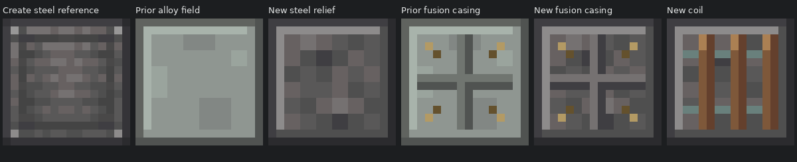
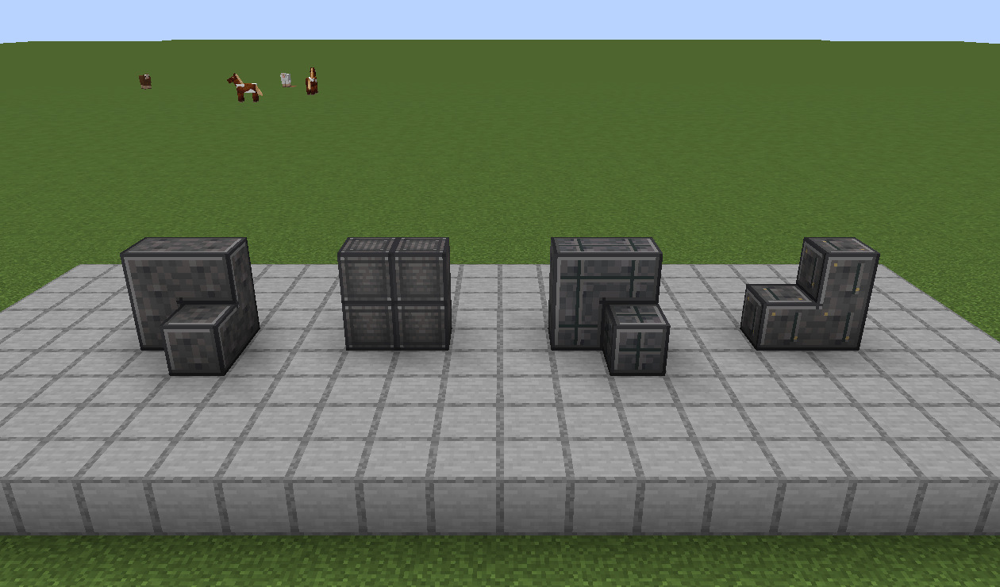
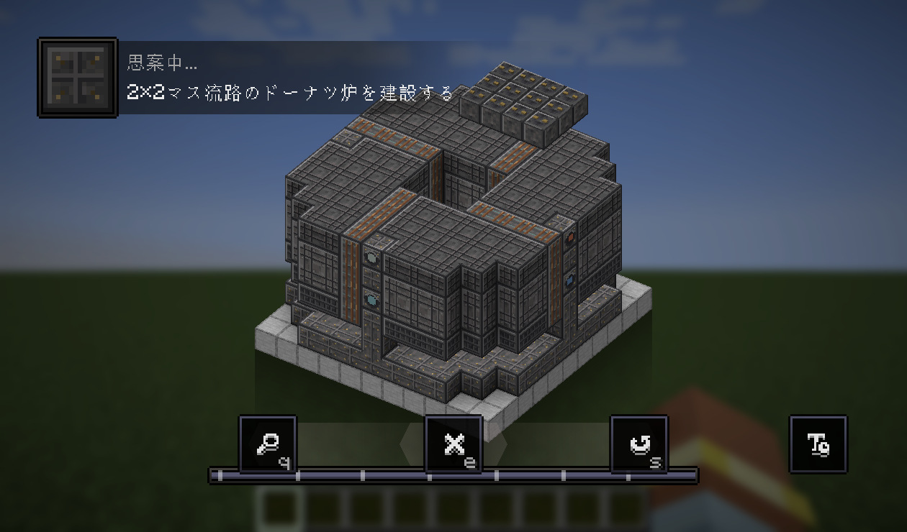

# 鋼材色と粒状の陰影による設備テクスチャ更新

2026-11-08。対象は、直前の安山岩合金調の更新対象設備と核融合炉です。Createの鋼材ブロックを参考に中間灰色へ改め、色替えに加えて、粒・溝・縁の明暗で平坦さを抑えました。PNG 193枚を更新しています。ブロック数ではありません。

実装コミット: `9232ad33831cd155ecddcb4ceadf1b77717bfe58`

## 見た目と参照

参照は実際に解決されたCreate 6.0.10の日本語名「鋼材ブロック」、`create:industrial_iron_block`です。柱型モデルが使う側面`industrial_iron_block.png`と端面`industrial_iron_block_top.png`を調べ、灰緑の安山岩合金から、彩度の低い鋼材の灰色へ切り替えました。既存画像を設備へ貼り付けず、各設備の生成元で描き直しています。

- 16px相当の密度、外周1px、内側1pxの面取り、12×12pxの凹面を維持。左上を明るく、右下を暗くします。
- 内面は5階調の2px単位の塊で構成。明るい小面と右下の影を対にし、広い単色領域を分割します。全面を1px乱数で埋めたり、広いグラデーションで照らしたりしません。
- 核融合炉は外装、真空容器、ブランケット、ダイバータ、コイル、制御盤の金属部分へ適用。既存の溝と補強材に明縁・暗縁を加え、巻線にも小さな階調差を付けました。
- クレーンも鋳肌を追加。測量用の帯、運転表示灯、窓、危険縞、方向矢印の識別色は保持しています。
- 銅・真鍮は暖色の材質を維持し、暗い内面に同じ粒の構成を使用。鉱物・耐火材・液体を鋼材へ塗り替えていません。

比較画像は参照の鋼材、変更前の共通面、変更後の共通面、変更前後の核融合外装、変更後のコイルです。上記は原寸ピクセルを拡大した素材比較で、ゲーム内の照明を再現する画像ではありません。

共通鋼材の中央12×12pxを同じ条件で測定しました。明度はRec.709係数によるRGBの加重和で、単色領域は上下左右に連続する同色画素の最大面積です。

| 指標 | 変更前 | 変更後 | 参照鋼材の側面 |
| --- | ---: | ---: | ---: |
| 内面の色数 | 3 | 5 | 7 |
| 平均明度 | 146.85 | 88.72 | 84.36 |
| 明度の標準偏差 | 6.90 | 11.29 | 14.76 |
| 最大の単色領域 | 108px | 12px | 12px |

## 主要ファイルと維持した範囲

- `tools/minecraft_style.py`: 鋼材のパレット、5階調の粒、共通の枠と面取り。旧外観用の`PALETTE`・`grain()`・`legacy_pixels()`は維持。
- `tools/generate_fusion_assets.py`: 核融合炉専用の材質、巻線、溝の陰影。形状・UV・構造・制御盤の配置は維持。
- `tools/generate_crane_assets.py`: クレーンの鋳肌と既存リブの陰影。透過形状と機能表示を維持。
- `tools/validate_visual_identity.py`: 既存の品質検査に、有限階調、2px粒、局所コントラスト、広い単色領域の検査を反映。
- `src/main/java/net/createplant/client/AllBlocksClientCheck.java`: 開発用の比較展示に実物の鋼材ブロックを配置。通常プレイの処理は変更しません。

復元指定済みのラジエーター、RBMK炉と制御盤、蒸気タービン、角型分留塔、パイプ、タンクなど、保護対象222枚は元のRGBA画素と寸法を維持しています。核融合のプラズマ、既存PNG全564枚の透過マスク、染色フライホイール17種類の染色部分も維持しています。1269個のモデルの形状とUV、BlockState、翻訳、Ponder、レシピとゲーム内の処理仕様に変更はありません。

## 確認結果

Java 21、Minecraft 1.21.1、Create 6.0.10、NVIDIA RTX 4060のハードウェア描画で確認しました。

| 確認 | 結果 |
| --- | --- |
| `tools/generate_block_surfaces.py` | 正常終了。再実行後も画像・モデル1833ファイルがバイト単位で一致 |
| `tools/validate_block_surfaces.py --revision 598ab333` | ブロックPNG 450枚、変更193枚、保護222枚、モデル1269個とUVの検査に合格 |
| `tools/validate_visual_identity.py` | 完成アイテム285個、共通素材、耐火材、バケツの検査に合格 |
| 独立した画像監査 | 変更画像は各面24色以下。機能色34箇所・染色4420画素を保持。共通金属4材質の最大単色領域は各12px |
| 接続テクスチャ | 12アトラス×47文脈、計564パターンの枠・内角・基本タイルを検査 |
| 実クライアントの一覧 | 登録ブロック196種類を9ページ、加えて接続面の比較ページを撮影。鋼材の実物と隣接して色・凹凸・縁を確認 |
| 実クライアントのPonder | 核融合炉、核融合制御盤、小型コンプレッサー、反応槽、クレーン、パルス抽出塔、電解炉、往復コンプレッサーの8対象を撮影。日本語のシーン見出し112件も検査に合格 |
| `build` | 成功。既存のプロセス・炉制御・炉物理チェックも成功 |
| 配布JAR | 全テクスチャ・モデルと付随メタデータ1836ファイルが生成元と一致。容量4,691,725 bytes。旧画像の混入なし |
| `git diff --check` | 合格 |

[独立した色・保護範囲の監査](../quality/steel-final-reference-audit.json)、[接続面・粒・機能表示の監査](../quality/steel-final-surface-audit.json)、[実クライアントのPonder結果](../quality/steel-surfaces-client.json)、[配布JARの監査](../quality/steel-surfaces-jar-validation.json)を保存しています。

左から復水器外装、Createの鋼材、チタン、ステンレスです。開発用展示の接続テストで、プラントの運転試験ではありません。

配布ファイル: `create-heavy-indusstry-steel-relief-9232ad33.jar`（4,691,725 bytes）。SHA-256: `497805d2a0f0902cc68c25fde4ee6256145abe141399a34bd661a6064e48e526`。

## 制約と次回の注意

今回の確認は外観の更新に対応したものです。Ponderは説明用構造、一覧は代表の初期状態であり、全設備の長時間運転やすべての状態遷移を検証したという意味ではありません。熱・流量・核融合性能などの再調整や旧試験の再実行は行っていません。

Ponderの撮影と`CLIENT QUALITY PASSED: 112 scenes, ja_jp`の記録後、クライアント終了時に既知のNVIDIA `libEGL_nvidia.so.0`内のSIGSEGVが発生し、`runClient`は終了コード134になりました。表示検査の合格と区別して記録します。比較展示のクライアントは撮影後に停止し、その後の単独`build`は正常に完了しています。

PNGのみを修正せず、設備ごとの生成元を変更して`generate_block_surfaces.py`から再生成してください。保護対象の旧外観を共通材質へ再統合しないでください。現在の鋼材参照を、過去の安山岩合金調の報告と混同しないでください。
