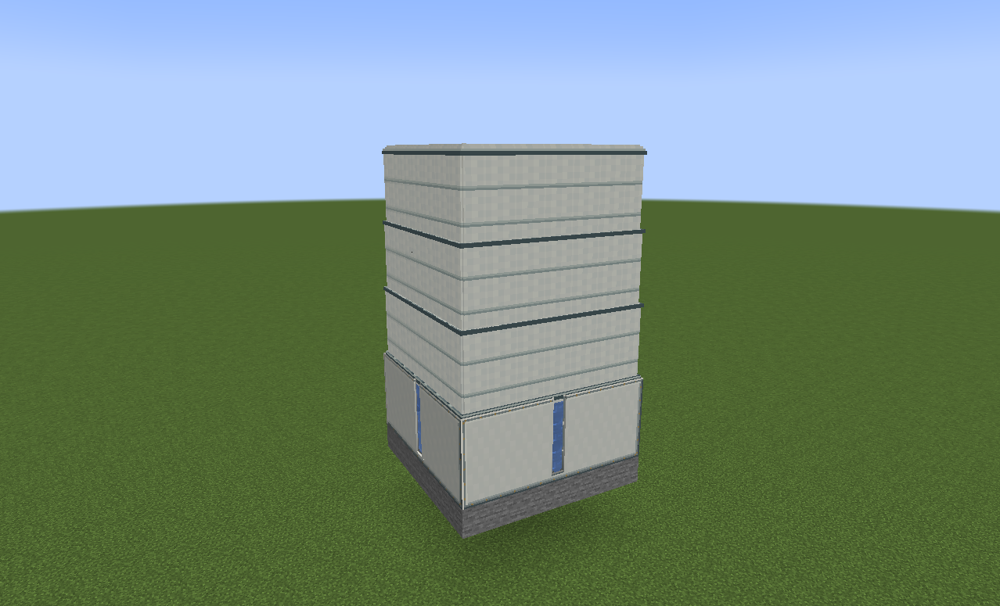
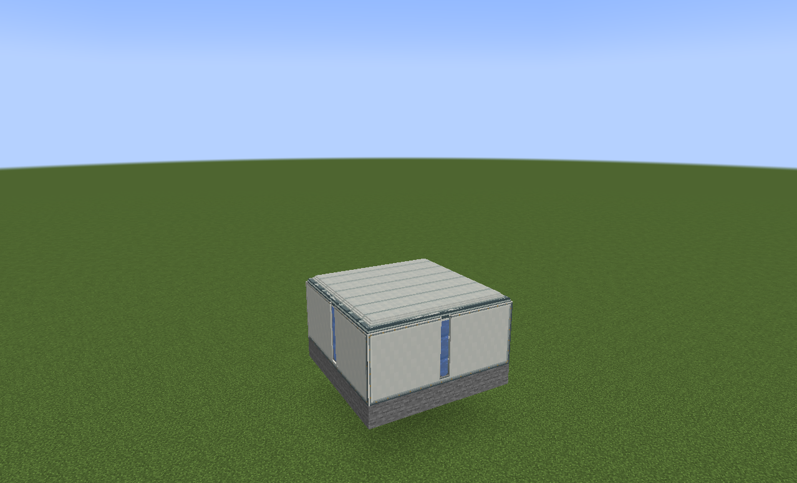

# 伸縮式ガスホルダー 幅4〜7対応レポート

作業日：2026-11-10。実装コミット：`76528ef1a8b4c3da5f4a4956ef185e8d6e2e5b92`。

## 変更内容

伸縮式ガスホルダーの対応幅を1×1〜3×3から**1×1〜7×7**へ拡張した。高さは従来の2〜8段。既存の白い外装、3段の伸縮、Create標準の配置・配管・連結テクスチャを利用し、別ブロックや装置を増やしていない。

- Createの構造探索に使われる `getMaxWidth()` と `getMaxLength()` を、共通の最大幅7へそろえた。
- 可動筒のNBT読込で幅3へ切り詰めていた処理も最大幅7へ更新。保存後も外槽・描画・当たり判定の幅を一致させる。
- Create標準の窓配置は幅3までなので、幅4以上では四側面の中央へ窓を配置。偶数幅は中央2列、奇数幅は中央1列とし、レンチの窓切替を維持する。1〜3幅では標準処理をそのまま使う。
- 必要個数を持って上面へ配置すると、同幅の1層を増設できる。日英中のPonder説明、生成元、設計文書を更新した。

容量は従来どおり `幅² × 外槽の高さ × Createの1部材容量設定`。既定値は8,000 mB。高さを増やさず横へ広げた場合、昇降距離と速度は変わらず容量が増える。

| 幅 | 1層の部材数 | 高さ3段での容量 | 3分の1ずつ搬入する試験の1回分 |
| --- | ---: | ---: | ---: |
| 4×4 | 16個 | 384,000 mB | 128,000 mB |
| 5×5 | 25個 | 600,000 mB | 200,000 mB |
| 6×6 | 36個 | 864,000 mB | 288,000 mB |
| 7×7 | 49個 | 1,176,000 mB | 392,000 mB |

最大7×7×8の容量は**3,136,000 mB**。各段ストロークは7.5 m、合計上昇量22.5 m。計算式・操作の正本は[ガスホルダー仕様](../gas-bell.md)。

## 主なファイル

| ファイル（Javaは `src/main/java/net/createplant/` から） | 役割 |
| --- | --- |
| `block/GasHolderGeometry.java` | 最大幅の共通定数 |
| `block/entity/GasHolderBlockEntity.java` | 構造探索上限と幅4以上の窓配置 |
| `contraptions/GasHolderSleeveContraption.java` | 保存した可動筒の幅・衝突形状の復元 |
| `gametest/GasBellGameTests.java` | 4〜7幅の実アイテム配置・伸縮・保存・境界試験 |
| `gametest/GasBellLoadGameTests.java` | 幅指定の16基負荷試験、各回の搬入・搬出量と全48体の生存を確認 |
| `client/GasBellClientCheck.java` | 任意の対応幅で実クライアントの同期と伸縮を確認 |
| `tools/generate_gas_bell_ponder.py`・日英中翻訳・`docs/gas-bell.md`・`DESIGN.md` | 対応寸法と層の増設方法 |

## 試験結果

Minecraft 1.21.1、NeoForge 21.1.219、Create 6.0.10、Java 21。依存するCreateの `ConnectivityHandler`、`FluidTankBlockEntity`、`FluidTankItem`、`FluidTankCTBehaviour` の解決済みソースを確認して実装した。

**関連GameTest 51/51件成功**（`GasBellGameTests,GasHolderGameTests,GasPipeGameTests,TransportQualityGameTests`）。新規6件を含み、既存1〜3幅の動作、汚染・危険混合・パージ・配管経由の物量保存も回帰確認した。別実行の16基負荷試験1/1件と最終 `build` も成功した。

| 確認 | 結果 |
| --- | --- |
| 幅4・5・6・7の構造形成 | 全サイズで2層から形成、すべての部材が同じ所有者・在庫へ接続 |
| 実際のタンクアイテムによる増設 | 生存モードで16/25/36/49個を消費し、同幅の高さ2→3段へ増設 |
| 窓の切替・配置 | 全部材を照合し、偶数幅・奇数幅それぞれの中央窓を確認 |
| 各幅の3段伸縮・排出 | 上昇量0→2.5→5→7.5→0 m。各幅の全容量を回収し、満杯時の追加搬入と二重回収を拒否 |
| 最大7×7×8の保存・復元 | ガス3,136,000 mB、幅7、高さ8、3体の元UUIDと幅7の衝突形状を復元。全量排出後に収納 |
| 幅8の境界 | 8×8が単一の過大な槽にならず、各所有者の幅が7以下に収まる |

### 実クライアント

`mc-debug glxinfo -B` でNVIDIA RTX 4060の直接描画を確認し、`mc-debug bash gradlew ... runClient` で7×7×3の実ワールドを起動した。ガス量0→392,000→784,000→1,176,000→0 mB、上昇量0→2.5→5→7.5→0 mを確認。全5状態で3体の可動エンティティの接続・生存・位置が同期した。窓、外槽の連結面、可動筒を画面で確認し、日本語Ponderの実行も成功した。

画像は今回の実クライアントのスクリーンショット。日英中のPonder文言検査と `git diff --check` も成功した。

### 幅7の16基負荷試験

7×7×2を16基、可動衝突体は48体。各基に392,000 mBずつ搬入・搬出し、毎回その全量が移動したことを確認した。200 tick準備後の静止400サンプル、動作800サンプルを記録。全可動体が生存・接続し、供給プール＋全槽の有限在庫は**6,272,000 mB**を保存した。

| 状態 | 平均ループ間隔 | p95 | 最大 |
| --- | ---: | ---: | ---: |
| 静止（400サンプル） | 0.662949 ms | 0.697127 ms | 48.532052 ms |
| 動作（800サンプル） | 0.500147 ms | 0.661239 ms | 14.667741 ms |

生データ：[telescopic-gas-holder-wide-load.json](telescopic-gas-holder-wide-load.json)。GameTestのtickコールバック間の実時間であり、通常サーバーのMSPT・TPSや装置単体CPU時間ではない。従来幅との性能向上比較はしていない。

初回は従来の32×32の試験領域に幅7の16基を配置し、領域外へはみ出した槽で `blocked` を記録して搬入量の検査が失敗した。配置全体が収まる既存の80×80テンプレートへ変更すると成功した。製品の障害物停止処理を緩めたり、搬入量の検査を省いたりしていない。

## 制約・未確認事項

- 対応断面は正方形1×1〜7×7。長方形や8×8の単一槽には対応しない。高さは2〜8段のまま。
- ブロックIDと保存形式を維持し、既存1〜3幅の処理を回帰確認した。隣接する同種ブロックは従来同様に自動結合の候補になり、新しい上限7が適用される。
- 今回の保存試験はBE＋実エンティティのNBT復元。ゲームプロセスを終了した既存ワールドの再起動、チャンク境界のアンロード、複数プレイヤーの再接続は未確認。
- 幅4・5・6と最大高さ8はGameTestで確認した。今回の実画面確認は幅7・高さ3で、日本語Ponderのみ。全GameTest・全サイズの実画面撮影は実施していない。
- 描画形状のキャッシュは最大7幅×7高さの49種類。動作中の障害物走査は最大7×7列・約32段に制限する。既存の8 tick同期抑制、クライアント補間を維持した。

再実行時はゲーム子JVMの `createplant.gameTestClasses` へ上記4クラスを指定する。負荷試験は `GasBellLoadGameTests`、`createplant.gasBellLoadWidth=7`、JSON出力先は `createplant.safetyLoadReport`。実クライアントは `createplant.gasBellClientCheck=true` と `createplant.gasBellClientWidth=7` を、既存のクライアント品質検査へ追加する。いずれも今回の実行ではGradleのinit scriptから各runの `systemProperty` に設定した。

成果物：`create-heavy-indusstry-0.1.0.jar`、6,008,245 byte。SHA-256：`6da9572813a73b9b02f17590368bf1443ed9a34147494edc565fdb41145fbbad`。
