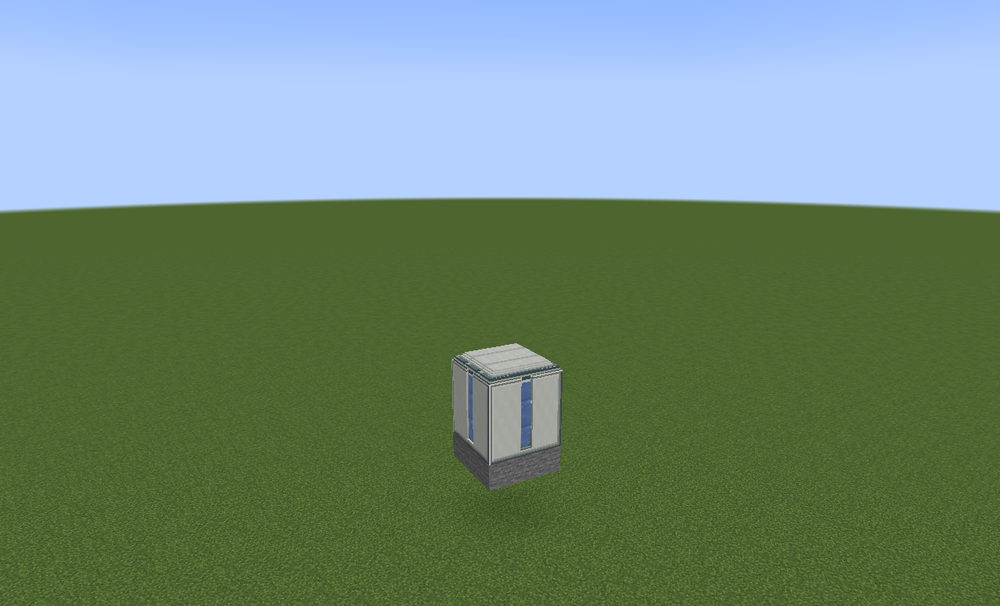
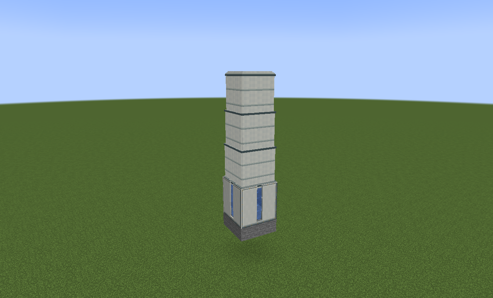

# 白いCreate型・3段伸縮ガスホルダー 完了レポート

作業日：2026-11-10。実装コミット：`3d49fb77c92a829deefd25c0a1d1fb17f61dccc9`。

後続作業で幅4×4〜7×7へ拡張した。現行の寸法と追加試験は[幅7対応レポート](telescopic-gas-holder-wide.md)を参照。本書の試験値は上記コミット時点の記録。

## 変更内容

添付された伸長時・収納時の水封式ガスホルダーの断面図を基に、白い金属の固定外槽へ3段の筒と屋根が収納される方式へ置き換えた。外槽はCreate標準タンクの形状・窓・連結テクスチャを再利用し、専用の亜鉛めっき風の白い板、灰色の縁、真鍮色の留め具を描いた。可動部にも板の継ぎ目と段の縁がある。ほかの設備の色は変更していない。

旧基点、ガイドレール、ローラー、接着屋根の組立処理と対応する登録・アイテム・レシピ・モデル・テクスチャ・翻訳を撤去した。球形ガスホルダーは別の現役設備なので維持した。

構造は幅1×1・2×2・3×3、固定外槽の高さ2〜8段。1段では運転しない。Create本体の `FluidTankBlock`、`FluidTankBlockEntity`、`ConnectivityHandler` とタンクアイテムの配置処理を利用する。新しいGUIや回転駆動はない。3×3の層の上に9個を持って配置すると、実際に次の3×3層を作れる。

### 動作と物量

- 容量はCreateの設定値×幅²×固定外槽の高さ。既定値は1部材8,000 mBで、ガスの256倍圧縮は適用しない。
- 高さH、各段ストロークS=H−0.5、合計移動量3S。ガス量/容量に比例して内筒→中段→外筒と順に伸長し、搬出時は逆順で縮む。上限速度は0.125 m/tick。最大伸長時も筒の重なりを0.5 m残す。
- ガス・材料の在庫は外槽のコントローラーだけが所有する。3枚の可動筒はCreate本体のコントラプションの衝突処理を持ち、屋根の上の実エンティティを持ち上げる。描画と衝突は同じ形状定義を使う。
- 側面と下面へ標準Create配管・ポンプと既存ガス管を接続できる。最上層の上面は接続不可。古い上向きハンドラーを保持していても、槽を縮小して最上層になった面から入出力できない。
- 障害物が筒・屋根へ接触すると移動と追加搬入を止め、搬出は許可する。障害物除去で復帰する。空にしてから障害物を除いた場合に停止が残る問題も修正した。
- 非互換ガスは全量を汚染混合ガスへ変える。量・質量・モル数・顕熱・危険性を引き継ぎ、可燃ガスと酸素・空気の実搬入では従来の爆発処理を行う。SIMULATEでは内容物や構造を変更しない。
- 通常レンチで窓を切替。ガスのある部材へShift＋レンチで共有在庫をパージ。完全排出後は別のガスを受け入れられる。ゴーグル4行と標準Display Linkを更新した。
- 水封は製作時に用意する構造材。水バケツを使うレシピで空バケツが返り、ポンプで取り出せる水を無から生成しない。

操作・レシピ・寸法の正本：[水封式の3段伸縮ガスホルダー](../gas-bell.md)。日英中の名称・状態文とPonderを更新した。

## 主な実装箇所

| ファイル | 役割 |
| --- | --- |
| `block/GasHolderBlock.java` | Createタンク部材、レンチ、撤去 |
| `block/entity/GasHolderBlockEntity.java` | 共有在庫、3段の位置、障害物、ガス反応、保存・同期 |
| `block/GasHolderGeometry.java` | 筒・屋根の共通寸法と衝突形状 |
| `contraptions/GasHolderSleeveContraption.java` | 可動筒のCreate衝突体と形状のNBT |
| `contraptions/GasHolderSleeveEntity.java` | Create制御エンティティとクライアント生成待機 |
| `client/GasHolderRenderer.java` / `client/PlantTankModels.java` | 可動部、水封、標準連結外槽 |
| `mixin/PlantTankItemMixin.java` | 既存タンク配置ラッパーで新しいBE型も認識 |
| `registry/CEGasBell.java` | 新外槽・可動筒・汚染ガスの登録、旧部材の撤去 |
| `transport/GasNetworks.java` / `thermal/PressureVesselBehaviour.java` / `compat/display/MachineReadings.java` | 既存配管、低圧モデル、共有在庫の読み出し |
| `ponder/GasBellPonderScenes.java` | 実装どおりの組立・搬入・伸縮・パージの説明 |
| `tools/generate_gas_bell_assets.py` / `tools/generate_gas_bell_ponder.py` | この設備だけの画像・モデル・Ponder生成元 |

Javaのパスは `src/main/java/net/createplant/` からの相対位置。

## 確認結果

Minecraft 1.21.1、NeoForge 21.1.219、Create 6.0.10、Java 21。実クライアントは `mc-debug` 経由、NVIDIA RTX 4060の直接描画を確認した。

### GameTestとビルド

**関連13クラスのGameTest 109/109件成功**。うち新方式の `GasBellGameTests` は18件。別実行の16基負荷試験1/1件も成功した。全GameTestを実行したという意味ではない。

| 確認項目 | 実測・結果 |
| --- | --- |
| 3×3×3の3段伸縮と全排出 | 0→72,000→144,000→216,000→0 mB、屋根上昇量0→2.5→5→7.5→0 m |
| 水素10,000＋窒素4,000 mBの混合 | 汚染ガス14,000 mB、質量誤差<10⁻¹² kg、顕熱誤差<10⁻⁷ J |
| Create標準機械式ポンプ経由の混合 | 供給元と外槽の合計26,000 mBを保存 |
| 非コントローラーへの受動ガス管搬入 | 供給元・管・外槽の合計50,000 mBを保存 |
| BEと3体の可動エンティティのNBT復元 | 元の3 UUIDへ再接続、108,000 mB・上昇量3.75 mを復元、追加複製なし |
| 1×1×2へ1層増設 | 容量16,000→24,000 mB、在庫8,000 mBを保持、可動部は3体 |
| 実エンティティの屋根衝突 | ブタをCreate本体の衝突処理で持ち上げた |
| 危険混合、残量1 mB、パージ、破損後の古い口 | 実処理とシミュレーションの区別、危険性の保存、切替・入出力制限が成功 |
| 生存モードのタンクアイテム配置 | 9個を消費し、3×3外槽の高さ2→3へ増設 |
| 空槽の障害物停止からの復帰 | 排出・障害物除去後に再搬入でき、停止が残らない |

同じ最終コードで `build` 成功。ビルドに含まれるFluidPhase 25チェック、HaberBoschProcess 1,019チェック、ReactorPhysics 1,670チェック、ReactorControlも成功した。

### 実クライアント

3×3×3の実ワールドで、空→内筒伸長→中段伸長→全伸長→全収納の5状態を確認。各状態でガス量と上昇量、**3体すべてのエンティティの接続・生存・位置**を照合して成功した。日本語Ponderも描画・撮影まで成功した。

初回のクライアント試験で、可動エンティティが外槽のブロックやCreateの追加生成データより先に届くと、Create標準tickがそれを削除する不具合を検出した。専用の継承エンティティで受信直後に最大100 tick待つ処理を加え、データとコントローラーがそろってから標準処理へ入るよう修正した。診断ログを通常経路から取り除いた最終実行でも、全3体の同期と全5状態が成功した。

収納時：



完全伸長時：



[内筒](images/telescopic-gas-holder/inner.png)・[中段](images/telescopic-gas-holder/middle.png)・[日本語Ponder](images/telescopic-gas-holder/ponder-ja.png)。画像は最終実クライアント実行のスクリーンショット。

### 16基の負荷・物量試験

3×3×2を16基、可動衝突体は合計48体。200 tickの準備後、静止400サンプル、動作800サンプルを記録した。動作区間では40 tickごとに各基へ72,000 mBを搬入・搬出。供給プール＋全外槽の有限在庫は、最後まで**1,152,000 mB**だった。すべての外槽が形成済みで可動部の接続も維持した。

| 状態 | サンプル数 | ループ間隔の平均 | p95 | 最大 |
| --- | ---: | ---: | ---: | ---: |
| 静止 | 400 | 0.406697 ms | 0.528641 ms | 2.697034 ms |
| 動作 | 800 | 0.361305 ms | 0.472455 ms | 45.536159 ms |

生データ：[telescopic-gas-holder-load.json](telescopic-gas-holder-load.json)。値はGameTestの各tickコールバック間の実時間で、装置単体のCPU時間・通常サーバーのMSPT・TPSではない。旧レール式と条件をそろえた比較を行っていないので、性能向上率は主張しない。寸法別形状・描画頂点をキャッシュし、静止時の位置更新、毎tickの形状再生成、毎フレームの頂点オブジェクト生成を避けている。

### アセット・文書

24個の外槽モデルのCreate親モデルと新テクスチャの参照先を確認。可動部の板・縁は16×16、各6色・5色。日英中の名称・状態文、11個のPonder説明と見出しを用意した。`tools/validate_ponder_language.py` と `git diff --check` が成功した。

## 制約・未確認事項・更新時の注意

- 旧基点・レールの登録は残していない。**旧設備を自動変換しないため、旧版でガスを搬出・接着屋根を解体し、新外槽で組み直す。** 過去のガイド式レポートは履歴として残し、冒頭に置換済みと明記した。
- 水封の水頭・蒸発補給・荷重・風・水質は計算しない。圧力は形成済みでガスがある場合1.02 bar、定格1.2 barの既存低圧貯蔵モデル。実機の容量や寸法を再現した校正ではない。
- 実施した保存試験はBE＋実エンティティのNBT復元。ゲームプロセスを終了したワールドの再起動、チャンク境界のアンロード、複数プレイヤーの再接続、全サイズの実画面撮影は未確認。
- 日英中の文字列は静的に検査したが、今回の実クライアントPonder撮影は日本語のみ。
- クライアント起動時に、対象外の `createdieselgenerators:andesite_girder_strut` の既存loot参照エラー、ナレーター読込失敗、Yggdrasil鍵取得失敗を観測した。今回の装置・Ponder試験は成功し、それらの外部機能は修正していない。

回帰試験のクラス選択値は次のとおり。

```text
GasBellGameTests,GasHolderGameTests,FlareGameTests,GasPipeGameTests,PressureGameTests,PressureStageTwoGameTests,PressureAndFreezingGameTests,ToxicGasGameTests,TransportQualityGameTests,GasCompressionGameTests,ThermalGameTests,ThermalStabilityGameTests,DisplayIntegrationGameTests
```

再実行時は通常の `runGameTestServer` の子JVMへ `createplant.gameTestClasses` としてこの値を渡す。負荷試験は `@ExplicitGameTest` の `GasBellLoadGameTests` を指定し、`createplant.safetyLoadReport` でJSON出力先を設定する。これらはGradle自身ではなく実行されるゲーム側のシステムプロパティで、今回もGradleのinit scriptからrunへ設定した。クライアントは既存の `createplant.clientQualityCheck=true`、`createplant.gasBellClientCheck=true`、ターゲット `gas_holder@gas_bell` を使う。

成果物JAR：`create-heavy-indusstry-0.1.0.jar`、6,003,438 byte。SHA-256：`5d6c77af9ed4fe6f34902527008d7a9c3fe9fd5ffb92dc27434a1bb9aefc4072`。
