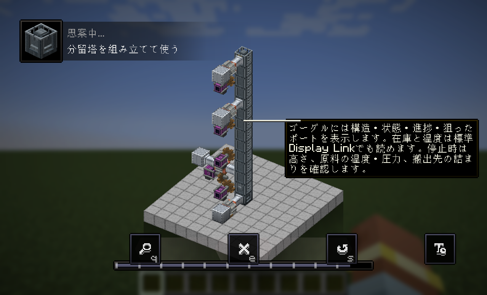

# 反応槽・分留塔の統合と沸騰・圧力修正

2026-11-10。実装コミット：`ed7a41e957cfa5579a6a803f8059ef04fedc291a`（統合本体：`4c406b77`、精製水統合：`13ffe878`）。
開始時の基点は`235246a6`。プッシュ前に追加された精製水・炭化木材の4コミット（`fa38ab0d`まで）を取り込み、他の変更を維持した。

## 変更結果

- 独立した`reaction_tower`を撤去し、3×3・高さ1～4段のふた付き槽＋触媒充填バスケットへ統合した。旧型の登録、レシピ、ガイド、モデル、テクスチャ、専用Mixin、旧Ponderを削除した。
- 鉄触媒では旧`HaberBoschBed`を再利用し、H₂/N₂/NH₃の有限モル数・分圧・平衡・反応速度・発熱・過熱損傷を保持する。固定量の合成ガスから固定量のアンモニアを作る旧バッチは廃止した。
- バスケット固定床の耐圧は300 bar。通常の触媒バッチは64 bar、通常・撹拌槽は16 bar。通常バッチの32 RPM・底面中央入力と既存レシピを維持し、鉄固定床は圧力供給で反応する。搬送ポンプは通常どおり駆動が必要。
- 鉄触媒の寿命は既存カートリッジで管理し、生成アンモニア400 mB相当を1バッチとして摩耗させる。再生レシピ、摩耗端数、床温度、損傷、モル数、層数を保存する。旧反応塔の使用済み触媒の山は撤去した。
- ふた付き槽用の分離棚段を撤去し、6種類の分離・蒸留を既存の`fractionating_column`へ統合した。表示名は日英中で「分留塔 / Fractionation Tower / 分馏塔」。高さ14段・幅1～3、断面積に比例する処理能力、空気分離の既存仕様を維持した。
- 化学分留は東面3段目から搬入し、北面14・10・7・4・1段目へ軽い留分から出す。原料・全生成物を抜き切るまで工程を変えない。各セルの在庫・工程IDを保存し、古いハンドラーを無効にする。
- 専用Ponderを`catalyst_basket`と`fractionating_column`として新設した。組立、実際のファンネル、駆動付きポンプ、材質に適合する配管、水ジャケット、製品搬出、安全弁、停止原因、ゴーグルとDisplay Linkを説明する。槽の圧力・冷却・清掃Ponderにも沸騰・安全弁・ハッチ減圧を追加した。
- JEIの設備リンク、数量、留分順、温度・駆動条件、日英中翻訳を更新した。分留塔に回転を要求する旧説明を残さない。

## 入出力

| 設備 | 入力 | 出力・観測 |
| --- | --- | --- |
| 鉄触媒バスケット | 北・東・西・下面の合成ガス、標準アイテム搬送の鉄触媒、底面下のバーナー | 上面の高温合成混合ガス。南面は有限水ジャケットの搬入出。床の温度・圧力・NH₃比率・寿命をゴーグルで表示 |
| その他の触媒バッチ | 従来の原料・触媒、底面中央32 RPM以上 | 従来の生成物と時間・数量。水素化脱硫30 bar、水素化分解50 barも維持 |
| 分留塔 | 東面3段目。原油は620 K以上、反応混合物は従来どおり冷却が必要 | 最大5種類の北面留分。空気モードでは酸素1段目・アルゴン10段目・窒素14段目の既存出口 |
| 安全弁 | 槽の側面へ直接取付。既存レンチ設定1～200 bar | 最大2 kg/s。実際の物理タンク・工程バッファ・触媒床から放出し、閉塞時には流れない |

Display Linkの測定番号は既存の順番を保持した。床の気体在庫・温度は流体9／温度9へ追加し、冷却出力・損傷は既存の測定を使う。専用GUIは追加していない。鉄触媒と通常のバッチ触媒を交換しても、接続済みの同じCreate配管を使い続けられることを試験した。

## 沸騰とハッチ・安全弁

通常水と、新たにmainへ追加された精製水の両方で、同じ水の飽和物性・内部エネルギーから温度・気液割合を求める。精製水は沸騰・ハッチ減圧後も残液の種類を保持する。開ハッチは大気圧境界、閉ハッチは体積と飽和曲線で平衡を解く。加熱は温度だけを直接増やさず、蒸発潜熱を支払う。高圧の水が100℃を超えること自体は許容する。

| 数値・確認 | 結果 |
| --- | --- |
| 水の比熱 | 4,180 J/(kg·K) |
| 蒸発潜熱 | 2,257,000 J/kg |
| 1 kgを1 K上げる熱に対する蒸発熱 | 約539.95倍 |
| 100℃・大気圧で0.5 kgを蒸発させる熱 | 1,128,500 J。沸騰中の温度を維持することを試験 |
| 15 barの飽和温度（既存曲線の近似値） | 約200.35℃ |
| 高圧ハッチ開放 | 実際の水蒸気量とその熱を放出し、残液を冷やして大気圧へ下がる。物理タンク・工程バッファの両方を試験 |
| 安全弁の減圧 | 小さな気相空間だけを放出する上限を廃し、放出中に水が追加で沸騰する分も計算。7,990/8,000 mBのほぼ満水でも減圧可能 |
| 安全弁なし／排気口閉塞 | 内蔵の自動停止・自動排気・復帰ラッチは使わず、持続過圧で槽が破裂することを試験 |

水の沸点が圧力で変わる点は[IAPWSの説明](https://www.iapws.org/faq1/boil.html)を確認した。本実装は既存の水・蒸気モデルに合わせた定比熱・一定潜熱・近似飽和曲線であり、[IAPWS-95](https://iapws.org/technical-guidance/release/IAPWS-95)の完全な状態方程式を実装したものではない。1 mB未満の蒸発に使った熱も内部エネルギーに保持する。定格出力など他設備の校正用定数は変更していない。

## 試験

| 実行 | 結果 |
| --- | --- |
| 統合前の関連回帰試験 | 144/144 合格 |
| 通常水の沸騰・触媒床・統合分留＋実ポンプ原油試験 | 20/20 合格 |
| 最新main取り込み後、精製水と新しい水質レシピを含む関連回帰試験 | **153/153 合格** |
| 精製水の同一物性登録・残液の種類を最終ソースで再確認 | 17/17 合格 |
| 触媒交換後の接続済み配管を含む最終の関連試験 | **76/76 合格** |
| Javaコンパイル・JAR作成 | 成功 |
| 全GameTestの無選別実行 | 今回は実施していない |

重複を除く関連試験は計154件。153件の広域試験後、精製水物性の最終確認17件と、触媒交換に関係する76件を再確認した。

合格した項目には、気化熱・密閉時の圧力上昇、ハッチ開放の質量・エネルギー保持、工程バッファの減圧、ほぼ満水での安全弁動作、安全弁なし／閉塞による破裂、鉄触媒平衡・発熱・摩耗・再生・保存、標準Createポンプ、6種類の分留、空気分離の幅1～3、在庫と進捗の再読込、構造破壊・再形成、硝酸プラント連結、製作とサバイバル到達経路を含む。

最初の広域試験で、旧固定量アンモニア合成を期待する試験と、廃止済みの側面入力を使う試験を発見した。汎用の回転・バッチ保存試験は重合反応へ移し、鉄触媒は新しい有限平衡反応の試験へ置き換えた。冷却・凝固試験の配線も現行の底面中央入力へ修正した。mainで精製水が追加されたため、硫酸製造の既存試験もその正しい原料へ更新した。試験の成功条件を単に緩めていない。

実クライアントはNVIDIA GeForce RTX 4060・ハードウェアOpenGLで実行。日本語の3シーン（触媒バスケット、分留塔、槽の圧力・冷却・清掃）の実行・翻訳・描画を確認した。分留塔の上端の見切れとPonderの窓再描画を修正し、14段全体が見える状態を再確認した。



再生成は`python3 tools/generate_vessel_consolidation_ponder.py`。静的検査`python3 tools/validate_plant_tutorials.py`は、カタログ89シーン・443対の字幕・143項目リンクと全出荷NBTの旧ID除去を確認した。機械の仕様は[反応プラント](../reaction-plant.md)と[分留塔](../distillation-plant.md)を更新した。

再実行（対象のクラスだけを起動する一時init script）：

```sh
cat > /tmp/vessel-column-tests.gradle <<'EOF'
allprojects {
    afterEvaluate {
        extensions.getByName('neoForge').runs.named('gameTestServer') {
            gameDirectory.set(new File(project.buildDir, 'vessel-column-tests'))
            systemProperty 'createplant.gameTestClasses', 'VesselBoilingGameTests,CatalystBasketGameTests,ColumnConsolidationGameTests,VesselClimateGameTests,ReactorGameTests,HaberBoschGameTests,NitricAcidGameTests,NitricPlantIntegrationGameTests,DistillationGameTests,LiddedVesselGameTests,DriveLessVesselGameTests,VesselBasinGameTests,StructureGuideGameTests,TankGameTests,PressureGameTests,ToxicGasGameTests,CraftingRecipeGameTests,SurvivalReachabilityGameTests,PurifiedWaterGameTests'
        }
    }
}
EOF
./gradlew --no-daemon -I /tmp/vessel-column-tests.gradle runGameTestServer
```

すべて通常のGameTestで、長時間のExplicitGameTestは追加していない。

## 更新時の影響と限界

- 旧反応塔・分離棚段・使用済み触媒の山の自動変換は行わない。更新前に旧設備の内容物を回収して組み直す。吸収塔・既存アンモニア分離器は維持する。
- 水の質量・熱と床の有限モル数を扱うが、化学分留の6レシピは既存の生成量・公称温度を保つ。水・蒸気は単成分のモデルで、独立バッファの気相を単一の共通空間へ結合する計算は行っていない。塔全体の多成分気液平衡、全熱収支、外部還流・リボイラーの新しい装置は今回追加していない。空気コールドボックスも既存のモデルを維持する。
- 破裂・爆発は既存のサーバー設定に従う。既定の有効設定で試験した。安全弁の能力が供給を上回る保証はなく、排気先と流入量も設計する必要がある。
- 全GameTestの無選別実行、長時間運転、専用サーバーと実クライアントをつないだ複数人試験、英語・中国語UIの実機表示は未確認。日英中の翻訳データは更新済み。
